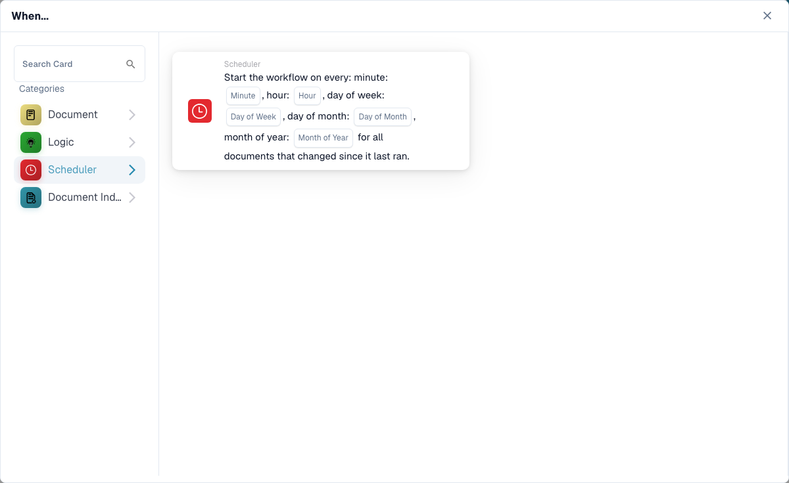

# 何时

此类别中的卡片显示在工作流生成器的 **添加卡片** 库中：

<figure><figcaption>
此类别中的卡片。
</figcaption></figure>

<figure><figcaption></figcaption></figure>

#### 了解工作流配置中的“何时”

**“何时”的用途**

* 工作流配置中的“何时”部分用于定义启动特定工作流操作的触发条件。这些条件基于文档属性或 ERP 系统中的用户活动等指定标准。

**工作原理**

* 在界面中，“何时”是用户选择不同触发卡片的起点。每张卡片都会指定相应条件，满足条件后才会执行“并且”部分中定义的后续操作。

**文档类型条件卡片**

* 截图中带有文档图标的卡片是“文档类型”条件的不同形式，可根据正在处理的文档类型触发工作流。以下是截图中各类条件卡片的说明：
  * **文档类型 (运算符) 属于 (类型)**：当文档类型与列表中指定的某个类型匹配时，此卡片会触发操作。运算符可能包含“是”或“不是”等选项，用于设置包含或排除条件。
  * **文档类型 (运算符) (类型)**：此简化版本根据单个文档类型条件触发。它通常会检查文档类型是否“是”或“不是”某个特定类型，不能从多个类型中进行选择。
  *

**Celery Beat**

* 截图中带有时钟图标的卡片是“Celery Beat”条件，可根据日期和时间触发工作流。

#### 设置“何时”触发卡片

1. **选择条件类型**：用户首先选择与要自动化的工作流相关的条件类型。在此处，重点是文档类型。
2. **定义运算符**：用户需要选择逻辑运算符，例如“是”或“不是”，以确定如何将实际文档类型与定义的条件进行比较。
3. **指定文档类型**：根据卡片类型，用户可以选择一种或多种文档类型。当处理这些类型的文档时，工作流就会触发。
4. **完成触发条件设置**：设置完成后，该条件将成为触发工作流中特定操作的依据。如果文档符合所设条件，定义的操作就会自动启动。

#### 实际应用

实际使用中，这些触发卡片对于自动执行审批、通知或其他依赖所处理文档类型的流程至关重要。例如，如果文档类型“是”“发票”，并且符合“何时”卡片中设置的条件，工作流可能会自动将文档转交给付款处理流程。

此设置可确保工作流不仅高效，还能满足组织的特定运营需求，减少人工监督并加快文档处理速度。

总之，工作流配置中的“何时”用于设定基于特定预定义条件启动自动操作的基础。它能让 ERP 系统根据业务需求动态响应，从而提升文档管理的效率和准确性。
