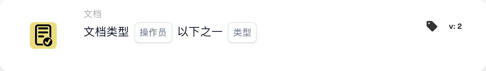

# 卡片描述

## **When 卡片：文档类型**

工作流可以通过这两张卡片启动。在这里，您可以选择工作流以哪种文档类型开始，或者选择不让工作流影响指定的文档类型。

\\

<figure><figcaption>
所示版本的卡片字段。占位字段尚未配置。 此版本界面的部分标签尚未翻译或翻译不准确。本页说明使用正确术语；图片保留了实际界面。
</figcaption></figure>

<figure><figcaption>
所示版本的卡片字段。占位字段尚未配置。 此版本界面的部分标签尚未翻译或翻译不准确。本页说明使用正确术语；图片保留了实际界面。
</figcaption></figure>

此卡片还可用于指定工作流应影响的多种文档类型。
