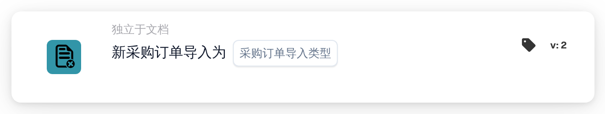

# 采购订单导入

<figure><figcaption>
版本 2
</figcaption></figure>

## 用途：

此工作流卡片会在采购订单导入 DocBits 时启动工作流（触发器）。它可以响应新创建的采购订单、现有采购订单的更新，或同时响应两者。该工作流在没有文档的情况下运行，因此每当采购订单数据到达时，都可以用它来通知相关人员或调用其他系统。

## 卡片组件：

1. **采购订单导入类型**
   * **描述：** 定义由哪种导入启动工作流。
   * **选项：**
     * **新的采购订单。** 该采购订单此前不存在，由导入创建。
     * **对现有采购订单的更新。** 现有采购订单被导入更新。

     两个选项可以同时选择。

## 功能：

* **工作流何时启动：** 当采购订单导入处理来自 ERP 系统的采购订单时，系统会记录该采购订单是新建的还是更新的。随后，系统启动该组织所有已启用的独立于文档的工作流（Webhook 工作流和定时工作流除外），并将此信息连同采购订单 ID 和采购订单号一起传递给这些工作流。只有当该组织已启用工作流模块且存在活动工作流时，才会如此。如果某个采购订单因传入版本并不比已存储的版本新而被跳过，则不会启动工作流。
* **条件评估：** 卡片检查传递给工作流的导入类型是否属于卡片上所选的类型之一。
* **执行操作：**
  * **条件为真：**\
    如果导入类型与所选选项一致，工作流继续执行后续卡片。
  * **条件为假：**\
    如果导入类型不一致，或工作流由其他独立于文档的事件（例如供应商状态更改）启动，卡片条件不满足，其后的步骤不会运行。
* **缺少数据：** 如果卡片上未选择任何导入类型，卡片不会评估条件。它会在工作流日志中报告缺少的输入（或错误），其后的步骤不会运行。

## 设置和配置：

* 可以从 **WHEN** 分组的 **独立于文档** 类别中添加此卡片，然后选择一种或两种导入类型，再添加其他条件和操作，最后保存并启用工作流。

## 结论：

“采购订单导入”卡片让工作流在采购订单数据创建或更新后立即作出响应，而无需等待文档。这样，后续流程就能与来自 ERP 系统的采购订单保持同步。
