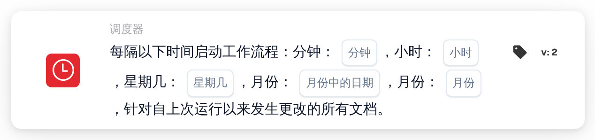

# 定时启动工作流

<figure><figcaption>
版本 2
</figcaption></figure>

## 用途：

此工作流卡片按照时间计划启动工作流（触发器），类似于 cron 作业。在每个计划时间，系统会针对自上次运行以来发生更改的所有文档运行工作流。这适用于定期处理，例如夜间检查、定期提醒或跟进，这类处理不应在每次文档更改时立即运行。

## 卡片组件：

1. **分钟**
   * **描述：** 工作流在每小时中的哪一（几）分钟启动。
   * **详细信息：** cron 格式的值，例如 `0`、`30`、`0,30` 或 `*/15`。留空表示每分钟（`*`）。
2. **小时**
   * **描述：** 工作流在一天中的哪一（几）个小时启动。
   * **详细信息：** cron 格式的值，例如 `6` 或 `8-18`。留空表示每小时（`*`）。
3. **星期几**
   * **描述：** 工作流在星期几启动。
   * **详细信息：** cron 格式的值，例如 `1-5`。留空表示每个工作日（`*`）。
4. **月份中的日期**
   * **描述：** 工作流在每月的哪一（几）天启动。
   * **详细信息：** cron 格式的值，例如 `1` 或 `1,15`。留空表示每天（`*`）。
5. **月份**
   * **描述：** 工作流在哪一（几）个月启动。
   * **详细信息：** cron 格式的值，例如 `1` 或 `1-6`。留空表示每个月（`*`）。

## 功能：

* **时区：** 所有时间均为 UTC，即 DocBits 服务器所用的时区。例如，6:00 UTC 相当于中欧夏令时 8:00。
* **工作流何时启动：** 保存并启用工作流时，系统会根据这五个字段创建一个计划条目。如果工作流被停用或删除，该计划条目也会被移除。在每个计划时间，系统会：
  * 查找该组织自工作流上次运行以来被修改、保存或状态发生变化的文档，
  * 在后台为其中每份文档分别启动工作流，并且
  * 记住本次运行的时间，作为下一次运行的起点。

  已达到工作流执行限制的文档会被跳过。如果在处理文档期间停用了工作流，其余文档将不再运行。
* **条件评估：** 卡片检查工作流是否由计划启动。
* **执行操作：**
  * **条件为真：**\
    当工作流由计划启动时，卡片条件满足，工作流继续执行后续卡片。
  * **条件为假：**\
    当工作流以其他任何方式启动时，例如由文档触发器、Webhook 或变量更改启动，卡片条件不满足，其后的步骤不会运行。
* **每个工作流只有一个计划：** 在 Advanced Workflow Builder 中，如果一个工作流包含多张计划卡片，则只有第一张用于计划。
* **保存：** 如果保存时无法更新计划条目，工作流仍会被保存，并显示一条警告。再次保存工作流会重新尝试更新。

## 设置和配置：

* 可以从 **WHEN** 分组的 **调度器** 类别中添加此卡片，然后填写时间字段；留空的字段表示“每”。例如，分钟为 `0`、小时为 `6`、星期几为 `1-5`、其他字段留空时，工作流会在工作日的 6:00 UTC 启动。之后再添加其他条件和操作，然后保存并启用工作流。

## 结论：

“定时启动工作流”卡片会在固定时间运行工作流，而不是在每次事件发生时运行。由于每次运行只处理自上次运行以来发生更改的文档，定期处理可以始终聚焦于新的工作。
