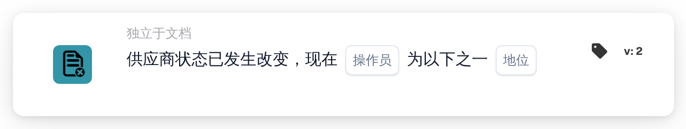

# 供应商状态已更改

<figure><figcaption>
版本 2
</figcaption></figure>

## 用途：

此工作流卡片会在供应商状态发生变化时启动工作流（触发器），例如供应商被批准或被拒绝时。该工作流在没有文档的情况下运行，因此可用于通知相关人员，或在供应商入驻过程中启动后续步骤。

## 卡片组件：

1. **操作员**
   * **描述：** 定义供应商的新状态应属于所选状态之一，还是不属于其中任何一个。
   * **选项：**
     * **是：** 如果新状态是所选状态之一，则条件为真。
     * **不是：** 如果工作流由供应商状态变更启动，且新状态不是所选状态之一，则条件为真。
2. **地位**
   * **描述：** 与新状态进行比较的供应商状态。
   * **选项：** 以下一项或多项：
     * **得到正式认可的**
     * **等待 AP 批准**
     * **待批准**
     * **等待注册**
     * **被拒绝**

## 功能：

* **工作流何时启动：** 供应商管理中的供应商状态变化会启动该组织所有已启用的独立于文档的工作流（Webhook 工作流和定时工作流除外），并将新状态传递给这些工作流。例如，在邀请新供应商（状态为等待注册）、提交供应商审批、批准或拒绝供应商，或者以不同状态保存供应商详细信息时，都会发生这种情况。该状态需要是为该组织配置的供应商状态之一，否则不会启动任何工作流。只有当该组织已启用工作流模块且存在活动工作流时，才会启动工作流。
* **条件评估：** 卡片将传递给工作流的状态与卡片上所选的状态进行比较。
* **执行操作：**
  * **条件为真：**\
    选择 **是** 时，新状态是所选状态之一；选择 **不是** 时，工作流由供应商状态变更启动，且新状态不是所选状态之一。工作流继续执行后续卡片。
  * **条件为假：**\
    如果条件不满足，则卡片不成立，其后的步骤不会运行。
* **其他独立于文档的事件：** 采购订单导入同样会启动所有独立于文档的工作流，包括含有此卡片的工作流。此类运行在任一运算符下都不满足此卡片，因此后续步骤仅在供应商状态变更时运行。
* **缺少数据：** 如果卡片上未选择任何状态，卡片不会评估条件。它会在工作流日志中报告缺少的输入（或错误），其后的步骤不会运行。
* **无效运算符：** 如果运算符既不是 **是** 也不是 **不是**，卡片会在工作流日志中报告卡片设置错误。

## 设置和配置：

* 可以从 **WHEN** 分组的 **独立于文档** 类别中添加此卡片，然后选择运算符和一个或多个状态，再添加其他条件和操作，最后保存并启用工作流。

## 结论：

“供应商状态已更改”卡片将供应商管理与工作流连接起来。批准、拒绝及其他状态变化可以直接触发通知和后续步骤，因此供应商入驻无需依赖人工检查。
