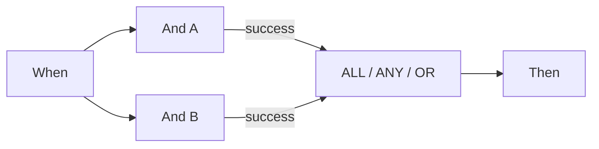

# P0：正确连接 Wait ALL、Wait ANY 和 OR

ALL 要求**每个不同源节点**都有一个匹配的已连接出口。ANY 和 OR 只要求至少一个源节点匹配。同一个源节点同时连接绿色和橙色出口，仍只计算一个源。OR 不会创建互斥分支，也不会取消其他操作。ANY 也不保证“最快的分支获胜”。

经检查的调度器会先等待所有输入前驱。如果未选择的分支导致某个前驱不可达，正常执行会跳过这个停滞的汇合节点。测试模式却可以使用已有结果继续求值。**因此，局部测试显示绿色，并不能证明实际文档运行会经过同一图继续执行。**

如果两项检查都必须满足，应实际执行两项检查，再将所需出口连接到 ALL。本版本中的替代路径可使用 v2 案例里的共同 Then 完成卡片，直接连接各路径终点。这适用于互斥路径，不能代替多个同时执行操作所需的等待屏障。

分别核对源节点、连接出口、实际选中出口和可达性。源节点出现 Error，即使 ANY/OR 随后成功，整体运行仍保留错误。经检查的代码还会为未满足的 ALL 设置错误详情，不能只凭橙色判断结果。

## 卡片与示例参数

这些值描述单张卡片的参数，不是可直接导入的完整工作流。YOUR_* 必须替换为自有测试选项；隐藏的调用方 ID 由设计器管理。目录依据：Dev、DocFlow 2.10.38、2026 年 10 月 21 日。请另外核对本组织可用版本与授权。

`node_type`: `all`, `any`, `or`

## 业务测试用例

| 用例 | 输入 / 配置 | 预期结果 |
| --- | --- | --- |
| MERGE-01 | A=success; B=success | ALL/ANY/OR: join=success |
| MERGE-02 | A=success; B=failed_condition; B→failed_condition: — | ALL: join=failed_condition, workflow=error; ANY/OR: join=success, workflow=failed_condition |
| MERGE-03 | A=success; B=error | ANY/OR: join=success; workflow=error |
| MERGE-04 | A=success; B=未到达 | 测试：求值；调度器：跳过 |
| MERGE-05 | A→success + A→failed_condition; B→success | sources=2 |

## 验证依据与限制

所选卡片及节点结果已使用合成数据在 Advanced Test 中验证，响应位于练习包。文档操作经过模拟，不能据此证明已持久保存的文档运行或外部送达。

[继续学习](../workflow-learning-path.md) · [练习包](../workflow-training-kit.md)
