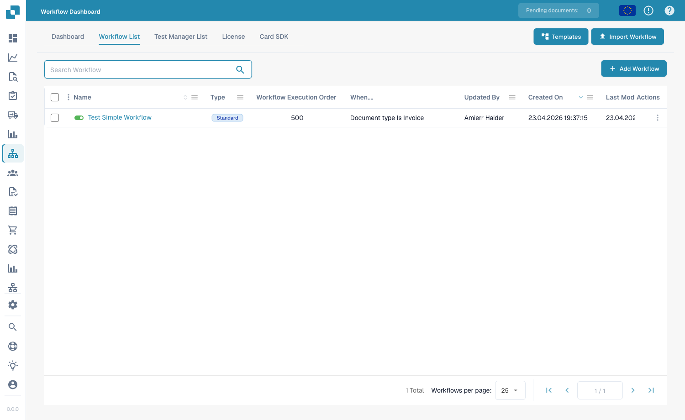
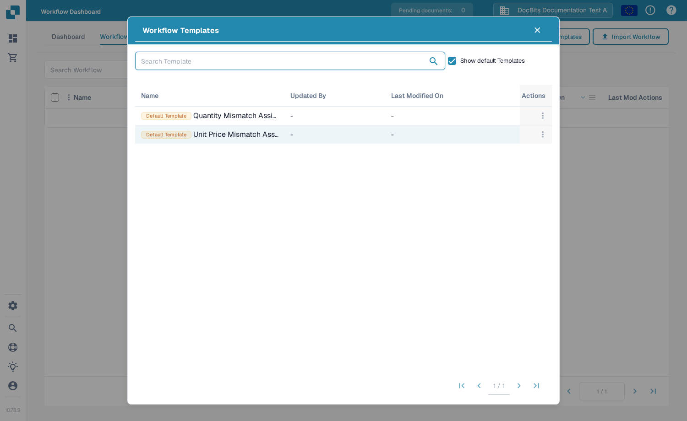

# 标准工作流

**标准工作流**构建器是一个基于卡片的线性编辑器，用于自动处理文档。一个工作流由三组卡片组成：**When**（触发条件）、**And**（附加条件）和 **Then**（要执行的操作）。当文档符合 When/And 条件时，Then 操作会自动运行。

## 创建并测试标准工作流 

在真实的 DocBits 界面中创建完整的标准工作流：选择发票，检查发票号码和金额是否超过 1000，分配审核人并更改状态。保存规则，运行三个测试场景，然后查看文档的实际结果。



[观看带字幕的视频](https://docbits-videos.fra1.cdn.digitaloceanspaces.com/settings-assistant/standard-workflow-admin/v2/zh.html) · [打开视频](https://docbits-videos.fra1.cdn.digitaloceanspaces.com/settings-assistant/standard-workflow-admin/v2/zh.mp4) · [字幕（WebVTT）](https://docbits-videos.fra1.cdn.digitaloceanspaces.com/settings-assistant/standard-workflow-admin/v2/zh.vtt) · [文字稿](https://docbits-videos.fra1.cdn.digitaloceanspaces.com/settings-assistant/standard-workflow-admin/v2/zh.txt) · 3:41

章节与文字稿

| 章节 | 开始时间 |
| --- | --- |
| 此工作流的作用 | [0:00](https://docbits-videos.fra1.cdn.digitaloceanspaces.com/settings-assistant/standard-workflow-admin/v2/zh.mp4#t=0.000) |
| 命名工作流 | [0:14](https://docbits-videos.fra1.cdn.digitaloceanspaces.com/settings-assistant/standard-workflow-admin/v2/zh.mp4#t=14.042) |
| When：文档类型 | [0:25](https://docbits-videos.fra1.cdn.digitaloceanspaces.com/settings-assistant/standard-workflow-admin/v2/zh.mp4#t=25.417) |
| And：发票号码 | [0:37](https://docbits-videos.fra1.cdn.digitaloceanspaces.com/settings-assistant/standard-workflow-admin/v2/zh.mp4#t=37.375) |
| And：金额超过 1000 | [0:51](https://docbits-videos.fra1.cdn.digitaloceanspaces.com/settings-assistant/standard-workflow-admin/v2/zh.mp4#t=51.667) |
| Then：分配审核人 | [1:04](https://docbits-videos.fra1.cdn.digitaloceanspaces.com/settings-assistant/standard-workflow-admin/v2/zh.mp4#t=64.667) |
| Then：更改状态 | [1:18](https://docbits-videos.fra1.cdn.digitaloceanspaces.com/settings-assistant/standard-workflow-admin/v2/zh.mp4#t=78.708) |
| 检查并保存 | [1:30](https://docbits-videos.fra1.cdn.digitaloceanspaces.com/settings-assistant/standard-workflow-admin/v2/zh.mp4#t=90.208) |
| 检查已保存的规则 | [1:46](https://docbits-videos.fra1.cdn.digitaloceanspaces.com/settings-assistant/standard-workflow-admin/v2/zh.mp4#t=106.500) |
| 准备测试场景 | [1:58](https://docbits-videos.fra1.cdn.digitaloceanspaces.com/settings-assistant/standard-workflow-admin/v2/zh.mp4#t=118.542) |
| 运行正向测试 | [2:18](https://docbits-videos.fra1.cdn.digitaloceanspaces.com/settings-assistant/standard-workflow-admin/v2/zh.mp4#t=138.833) |
| 测试边界值 | [2:36](https://docbits-videos.fra1.cdn.digitaloceanspaces.com/settings-assistant/standard-workflow-admin/v2/zh.mp4#t=156.542) |
| 测试其他发票号码 | [2:53](https://docbits-videos.fra1.cdn.digitaloceanspaces.com/settings-assistant/standard-workflow-admin/v2/zh.mp4#t=173.458) |
| 检查文档结果 | [3:10](https://docbits-videos.fra1.cdn.digitaloceanspaces.com/settings-assistant/standard-workflow-admin/v2/zh.mp4#t=190.333) |
| 启用已测试的规则 | [3:26](https://docbits-videos.fra1.cdn.digitaloceanspaces.com/settings-assistant/standard-workflow-admin/v2/zh.mp4#t=206.583) |

**此工作流的作用**

好，我来为培训发票创建一个完整的标准工作流。金额超过一千时，把文档分配给审核人，并等待审批。专用发票号码把这个示例限制在指定文档内。

**命名工作流**

在工作流列表中，我点击新建工作流。添加卡片前，先填写清楚的名称。这个组织会直接打开标准工作流设计器。

**When：文档类型**

在 When 中，我打开卡片库并选择文档类型卡片。运算符选择 Is，文档类型选择发票。这就确定了规则要检查的文档类型。

**And：发票号码**

在 And 中，我添加文档字段条件。字段选择 invoice_id，运算符选择等于，再输入培训发票号码。这个额外条件确保演示只处理指定发票。

**And：金额超过 1000**

另一个 And 条件检查 total_amount。我选择大于，再输入一千。金额恰好为一千时，不满足这个条件。比较的金额和币种必须与培训文档一致。

**Then：分配审核人**

在 Then 中，我选择把文档分配给用户的操作。审核人选择 Docs User A2，也就是文档演示的测试用户。这个操作只分配文档，不创建邮件通知。

**Then：更改状态**

第二个操作把状态改为等待审批。我把触发工作流设置为 false。这个示例不需要因为自身修改状态而再次触发工作流。

**检查并保存**

保存之前，我重新检查整条规则。文档必须是发票，号码必须完全匹配，金额必须超过一千。随后按界面显示的顺序执行两个操作。我保存工作流，并检查确认信息。

**检查已保存的规则**

回到列表，我确认工作流已经保存，并检查启用状态。保存时可能已经启用工作流。在准备测试期间，我先停用这条培训规则。

**准备测试场景**

在测试管理器中，我添加一个场景，选择已经保存的工作流。我填写清楚的场景名称，上传输入和预期结果的 JSON 文件。输入包含培训发票号码、金额一千七百八十五，以及待验证的初始状态。预期状态是等待审批。

**运行正向测试**

我提交场景，然后在菜单中选择运行测试。重新打开列表后，读取已经保存的结果。通过表示预期文档状态匹配。这个沙箱的卡片详情面板不能可靠显示每条消息，所以我还要核对实际文档。

**测试边界值**

接着测试金额恰好为一千。发票号码和文档类型仍然匹配，但大于条件应该为假。在这份测试输入中，预期状态保持待验证。我保存并运行这个独立场景，然后检查结果。

**测试其他发票号码**

另一个场景使用不同的发票号码，金额仍然超过一千。只有金额符合，不应该执行操作。我保存并运行这个场景，预期结果仍然是原来的状态。这些反例用来检查规则的适用边界。

**检查文档结果**

在文档仪表板中，我找到培训文档。实际状态已经是等待审批，接收人是 Docs User A2。这确认了两个操作的可见结果。这个变化来自手动测试，不能证明自动处理已经运行。

**启用已测试的规则**

回到工作流列表，我启用经过测试的规则，确认开关打开。正式启用前，要核对条件、接收人和测试结果。演示开关之后，我再次停用这条培训规则。

## 如何访问

打开 **Workflow Dashboard → Workflow List**，然后点击 **New Workflow** 创建新的标准工作流，或点击现有工作流进行编辑。

<figure><figcaption>
Workflow List — 每一行都是一个工作流，你可以打开、启用或停用，也可以进行编辑。
</figcaption></figure>

## When / And / Then 模型

<figure><figcaption>
标准工作流画布。此示例会在子组织中的发票触发，并将其分配给一位用户。
</figcaption></figure>

* **When** — 启动工作流的触发条件（例如，_Document type is Invoice_）。
* **And** — 还必须满足的其他条件（例如，_Document is part of sub-organization_）。留空时，只要符合 When 卡片的条件就会运行。
* **Then** — 要执行的操作（例如，将文档分配给用户、创建任务、调用 API 或发送电子邮件）。

## 添加卡片

在任意分组中点击 **Add Card**，打开卡片库。卡片按类别整理，方便你找到所需的构建模块：

<figure><figcaption>
<strong>Add Card</strong> 卡片库 — 按类别分组的条件卡片、比较卡片、操作卡片等。
</figcaption></figure>

点击 **Save Workflow** 保存，或点击 **Save Template** 将布局保存为可重复使用的模板。

## 工作流模板 

工作流工具栏中的 **Templates** 按钮会打开 **Workflow Templates** 库，你可以在其中管理组织中保存的模板：

<figure><figcaption>
<strong>Workflow Templates</strong> 对话框 — 显示已保存的模板；启用 <strong>Show default Templates</strong> 后，还会显示内置默认模板。
</figcaption></figure>

* 列表会显示每个模板的 **Name**、**Updated By** 和 **Last Modified On**。
* 启用 **Show default Templates**，即可在列表中显示内置默认模板。
* 使用所在行的 **Actions** 菜单 **Duplicate** 模板，或 **Delete** 已保存的模板 — 内置默认模板无法删除。
* 点击模板所在行，可在 **Template Designer** 中打开该模板。该设计器使用与标准工作流设计器相同的 When/And/Then 画布。点击 **Save Template** 保存更改。
* 要从模板新建工作流，请在设计器中打开模板，调整卡片，然后点击 **Save Workflow** 将其保存为工作流。

## 后续步骤

* 在 **Cards** 部分了解各卡片的功能。
* 通过 **Workflow Pattern Guides** 将卡片组合为经过验证的解决方案。
* 如需包含并行路径（Wait ALL / Wait ANY / OR）的分支流程，请使用 **Advanced Workflow** 构建器。
