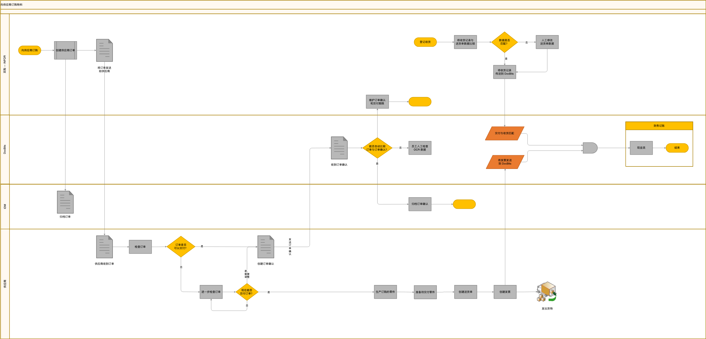

# 材料订购与处理工作流

本文档概述了供应商材料订购、货物接收和发票处理工作流，涵盖供应商、INFOR ERP 系统与 DocBits 文档管理之间的集成。

### 流程概述

1. **订购材料**
   * 向供应商发起订单。
   * 通过 INFOR 向供应商发送订单。
2. **接收订单确认**
   * 供应商确认收到订单。
   * 创建并发送订单确认。
3. **货物接收与检验**
   * 接收供应商交付的货物。
   * 在 INFOR 中登记货物接收，并与送货单核对。
4. **发票处理**
   * 接收发票并发送至 DocBits 进行处理。
   * 将发票详情与订单及货物接收信息进行核对和验证。
5. **最后步骤**
   * 在 DocBits 中归档订单及相关文档。
   * 在 INFOR 中更新交易详情，以供财务记账。

### 决策点与操作

* **收到的货物是否与订单相符？**
  * 是：继续处理发票。
  * 否：需要人工检查并更新。
* **发票是否与收到的货物和订单详情相符？**
  * 是：完成交易并更新财务记录。
  * 否：需要进一步检查并进行更正。

### 集成点

* **INFOR ERP**：用于订单处理、货物接收和财务记账的主系统。
* **DocBits**：用于处理和归档发票及订单确认的文档管理系统。

### 备注

* 请确保所有文档均经过验证并归档，以便留存记录。
* 必须及时解决订单或发票详情中的差异，以避免延误。

<figure><figcaption>
物料订购、订单确认、收货和发票处理的示例流程，涉及供应商、采购、IDM、DocBits 和财务记账。请按实际配置调整检查步骤与系统连接。
</figcaption></figure>
