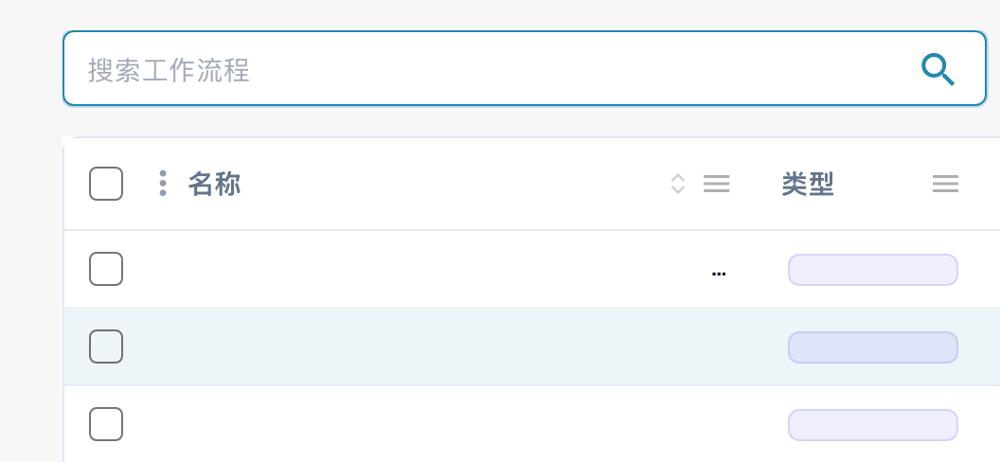
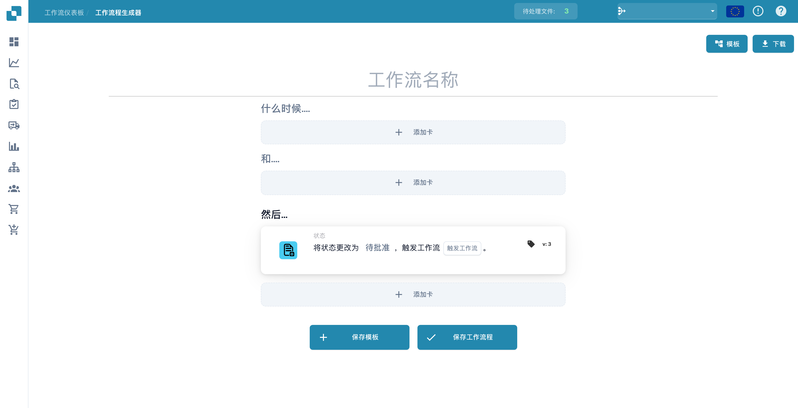
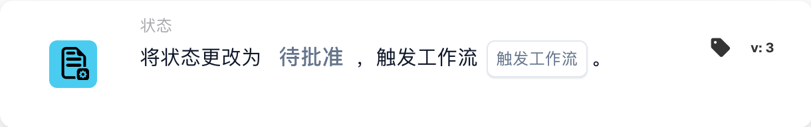
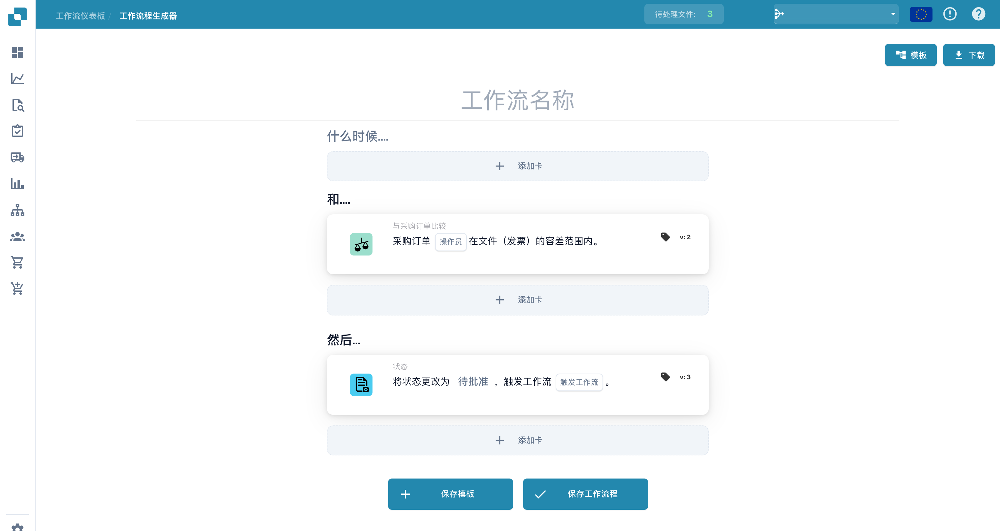
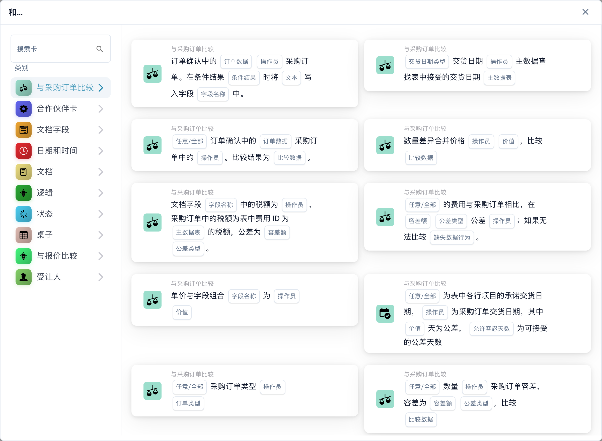

# 分配与状态 — 示例

为工作流设置清晰的名称，便于在列表中辨认其用途。打开工作流仪表板后，选择 **工作流列表**，使用 **搜索工作流程** 查找已有工作流。

<figure><figcaption>
工作流列表局部视图：搜索栏与部分列标题。工作流名称等私有值已隐藏。
</figcaption></figure>

创建新工作流时，点击 **新工作流程**。

<figure><figcaption>
工作流工具栏：新工作流程、模板和导入工作流程。
</figcaption></figure>

你可以使用这些工作流（Test 1、2、3），自动将不同的文档分配给公司中合适的员工。

.png>)

如果发票或其他文档的总金额超过了需要事先审核和审批的限额，就可以立即将这些文档分配给相应的人员。

<figure><figcaption></figcaption></figure>

**Test 1：逻辑卡片**

When：**Assignee is:** 收件负责人

And：**Document type is:** Invoice

Then：**Assign document to:** 发票审核人

.png>)

**Test 2：逻辑卡片**

When：**Assignee is:** 收件负责人

And：**Document type is:** Delivery Note

Then：**Assign document to:** 交付审核人

.png>)

**Test 3：逻辑卡片**

**When：****Assignee is:** 收件负责人

**And：****Document type is:** Order Confirmation

**Then：****Assign document to:** 订单审核人

.png>)

如果文档不只分配给某一个人，也可以从一开始就将其分配给指定员工。

<figure><figcaption></figcaption></figure>

为了更清楚地了解文档接下来应如何处理，你可以在此工作流中设置传入文档的状态。这样就能立即看出文档是否处于待审批状态等情况。

**Test 4：逻辑卡片**

**When：****Document type is:** Delivery Note

**And：****Assignee is:** 收件负责人

**Then：****Change Status to:** Pending Approval

<figure><figcaption>
更改状态的工作流草稿，尚未保存。
</figcaption></figure>

.png>)

**Test 5：逻辑卡片**

When：**Document type is:** Invoice

And：**Assignee is:** 发票审核人

Then：**Change Status to:** Pending Second Approval

<figure><figcaption></figcaption></figure>

.png>)

如果发票或其他文档的总金额超过了需要事先审核和审批的限额，就可以立即将这些文档分配给合适的人员。

.png>)

**Test 6：逻辑卡片**

When：**Assignee is:** 收件负责人

And：Docfield **total\_amount** is **Greater than 500**

Then：**Assign document to:** 审批负责人

<figure><figcaption></figcaption></figure>

.png>)

也可以在工作流中设置状态，让被分配的人员立即了解文档当前的状态以及接下来应如何处理。

**Test 7：逻辑卡片**

**When：****Assignee is:** 收件负责人

**And：**Docfield **total\_amount** is **Greater then 500**

**Then：****Assign document to:** 审批负责人

**Change Status to:** Pending Approval

<figure><figcaption>
工作流草稿中的状态更改操作。
</figcaption></figure>

<figure><figcaption></figcaption></figure>

例如，如果文档缺少某些信息或重要信息，而这些信息对后续处理至关重要，你可以设置工作流，让这些文档立即转发给采购员及其替代人员。

<figure><figcaption></figcaption></figure>

**Test 9：**

包含这些逻辑卡片的工作流旨在自动验证订单确认中的数量、单价或折扣是否与采购订单中的相应数据一致。通过验证，可以确保订购内容与供应商确认交付的内容保持一致且准确。

你可以为这些文档设置特定状态，或将其分配给指定员工。

<figure><figcaption>
含采购订单比较条件的工作流草稿。 卡片中的“操作员”实际表示比较运算符；该示例未保存工作流。
</figcaption></figure>

<figure><figcaption>
选择与采购订单进行比较的条件。 界面中的“操作员”实际表示比较运算符，“价值”表示字段值，“桌子”表示数据表格。
</figcaption></figure>

**逻辑卡片：数量、单价或折扣匹配**

此逻辑卡片旨在自动验证订单确认中的数量、单价或折扣是否与采购订单中的相应数据一致。通过验证，可以确保订购内容与供应商确认交付的内容保持一致且准确。

**触发条件**

当订单确认中的以下任一数据与原始采购订单中的相应数据满足条件时，将激活此逻辑：

* **数量**：订购数量与供应商确认的数量一致。
* **单价**：约定的商品单价与供应商确认的单价一致。
* **折扣**：采购订单与订单确认中的折扣一致。
* **定义比较参数**：设置逻辑卡片用于检查匹配情况的具体字段（数量、单价、折扣）。
* **自动执行验证**：配置系统，使其在收到订单确认后自动比较这些详细信息。
* **自定义提醒**：确定如何通过工作流处理差异，包括自定义提醒以便进行人工审核。

此逻辑卡片对于确保订单确认中的详细信息与原始采购订单一致至关重要，有助于维护采购流程的完整性。

**Test 10：**

如果附加费用采用不同的计算方式，或者仅适用于某些行项目，可以使用通用表格计算卡片；其中一些卡片还支持按正则表达式筛选。

<figure><figcaption></figcaption></figure>

上方是 MTZ 的计算示例，筛选条件为行项目编号以 01、06、9、001 或 000 开头。

对于手动设置，建议将依赖新增列的计算拆分到单独的工作流中。要继续执行计算，可以使用 Run Workflow 卡片。

**运行工作流**

<figure><figcaption></figcaption></figure>

使用此卡片，你可以指定一个工作流的名称：当其条件满足且当前工作流中之前的 Then 卡片执行完毕后，该工作流将接着运行。系统会优先运行可运行的活动工作流，但如果文档满足已停用工作流的条件，也允许运行该工作流。

### **将计算出的附加费用添加到现有列中** 

如果你想将所有附加费用作为负折扣添加到折扣列中，可以使用计算卡片。该列中可能已有值；你可以将该列设为卡片中的一个变量，从中减去 MTZ，然后将计算结果写回该列。如果字段为空（附加费用仅适用于部分行项目），系统会在计算时将其视为 0。

**通知用户在 DocBits 中授权订单确认**

计算附加费用后，你可能需要通知指定用户授权订单确认。为此，你可以使用通知卡片。

<figure><figcaption></figcaption></figure>

根据设置，用户会在 DocBits 中收到一项新任务，也可以选择通过电子邮件通知用户有新任务。

更新后的图片展示未保存的条件和操作草稿。请根据自己的组织调整角色和条件。
