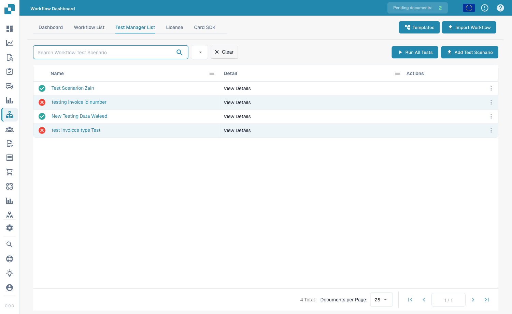
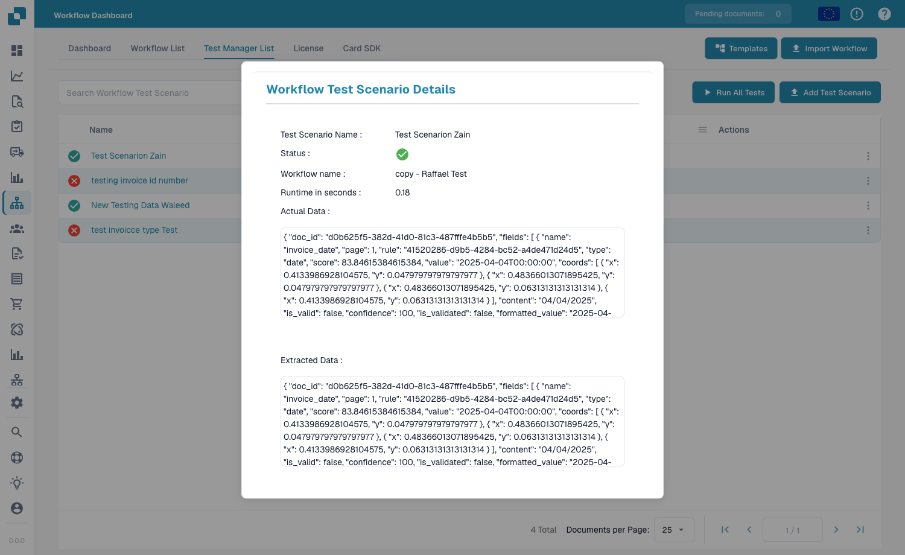

# 测试管理器

**测试管理器**允许您为工作流保存可重复使用的**测试场景**并批量运行，以便在更改工作流后确认其行为仍然正确。它适用于标准工作流和高级工作流。

从 **Workflow Dashboard → Test Manager List** 打开。

<figure><figcaption>
测试管理器列表 — 每个已保存的场景都会显示通过或失败结果。
</figcaption></figure>

## 什么是测试场景

测试场景包含一个工作流、一个示例输入和**预期结果**。运行场景时，测试管理器会使用该输入重新执行工作流，并将结果与预期结果进行比较 — 通过时将该行标为**绿色**，失败时标为**红色**。

## 使用测试场景

* **Add Test Scenario** — 根据工作流和示例文档创建新的场景。
* **Run All Tests** — 一次运行所有场景，一目了然地查看哪些工作流仍能通过测试。
* **View Details** — 打开场景并检查其结果。

<figure><figcaption>
场景详情 — 名称、状态、运行时间，以及本次运行生成的实际数据与提取数据。
</figcaption></figure>

详情视图会显示场景名称和**状态**、**工作流名称**、**运行时间**，以及本次运行生成的**实际数据**和**提取数据** — 让您准确了解场景通过或失败的原因。

## 测试管理器与构建器中的测试

这是两种不同的功能：

* **Test Manager**（本页）— 使用**Run All Tests**批量运行具有预期结果的_已保存、可重复执行_场景。用于更改后的回归测试。
* **构建器中的测试** — Advanced Workflow 构建器中的内联 **Validate** 和 **Test** 控件，供您在构建时快速检查。请参阅[验证与测试](advanced-workflow-builder/validation-and-testing.md)。
