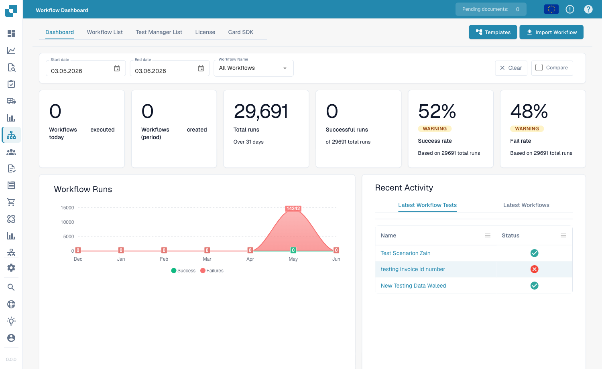
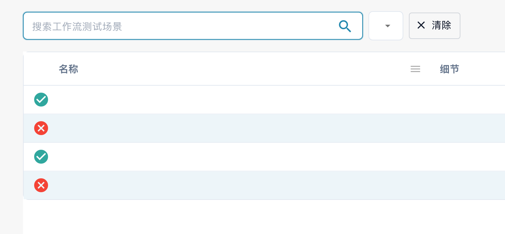

# 仪表板

**工作流仪表板**是工作流区域的主页。它展示工作流的运行情况，包括运行总数、成功率和失败率、随时间变化的运行次数图表以及近期活动，并提供访问工作流列表、测试管理器和 Card SDK 的入口。

<figure><figcaption>
工作流仪表板 — 每个工作流的运行总数、成功率和失败率以及近期活动。
</figcaption></figure>

## 选项卡

* **仪表板** — 运行指标和近期活动（如上所示）。
* **工作流列表** — 列出每个工作流及其类型、执行顺序和触发器。使用 **新工作流程** 创建新工作流。
* **测试管理器列表** — 用于验证工作流的测试场景；使用 **运行所有测试** 运行这些场景。
* **执照** — 工作流许可信息。
* **Card SDK** — 构建并上传自定义工作流卡片（参见 [Card SDK](card-sdk.md)）。

工具栏还提供 **模板**，用于打开 [Workflow Templates](standard-workflow-builder/#workflow-templates) 库；以及 **导入工作流程**，用于从 JSON 文件导入工作流。

**测试管理器** 允许你为每个工作流保存测试场景并批量运行，从而确认更改后工作流仍能正常运行：

<figure><figcaption>
测试管理器列表局部视图：搜索栏、名称与细节列。场景名称等私有值已隐藏；状态图标来自已有记录。
</figcaption></figure>

<figure><figcaption>
测试管理器操作：运行所有测试与添加测试场景。
</figcaption></figure>

## 后续步骤

* 使用 **标准工作流** 构建器构建线性自动化流程。
* 使用 **高级工作流程** 构建器构建分支流程。
