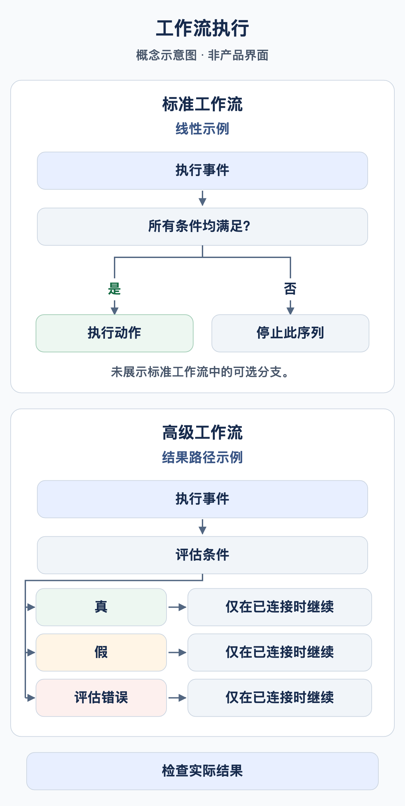

# 我的工作流何时运行？

工作流需要执行契机和匹配的条件。**文档类型为发票**用于筛选文档，并不意味着对发票进行任何修改都会自动启动新一次执行。

<figure><figcaption>概念示例：线性的标准工作流序列仅在条件均满足时执行动作，否则该序列停止。高级工作流中的条件节点可使用分别配置的结果路径。只有已连接的路径才会继续。图中省略了标准工作流的可选分支；这不是 DocBits 产品界面的截图。</figcaption></figure>

## 从事件到操作

1. 检查组织、权限和 Workflow 模块；使用高级工作流时，还需检查 Advanced 授权。
2. 明确执行契机：文档处理、显式手动调用，或受支持的事件触发器。仅使用当前版本卡片目录中实际提供的触发器。
3. Standard Workflow 要求 When 和所有 And 条件均匹配。条件为假会停止当前线性卡片序列。
4. Advanced Workflow 由入口和已连接的结果出口决定路径。And 条件为假时可以沿橙色出口继续；红色出口处理求值错误。
5. 在正确的位置核实结果：测试响应、持久化的执行记录、文档或连接的接收系统。

**Start** 是手动入口。练习包使用发票 When 入口和精确的培训发票编号，以满足当前界面的要求。请在停用状态下导入并手动测试。手动测试成功并不能证明文档事件会自动触发工作流。

## 保存、测试与启用

| 状态 | 含义 |
| --- | --- |
| 本地草稿 | 浏览器副本不能代替服务器上的保存。 |
| 已保存 | 配置已存在。请单独检查启用状态；保存新规则可能同时将其启用。 |
| Advanced 测试 | 评估当前图，包括未保存的更改。测试模式会模拟文档操作。 |
| 已启用 | 发生匹配事件时，系统可以考虑执行该规则。必须另行测试该事件。 |

Test Manager 与 Advanced 测试对话框是不同的执行入口。仅比较状态无法证明已完成分配、通知或导出交付。在真实文档上测试前，应确认所选测试入口可能产生的影响。

## 多个工作流与重复执行

**执行顺序**数值越小，越先运行。例如，工作流 100 准备字段，工作流 200 检查该字段。使用不同数值，并在新一次执行中核实实际读取的数据。Advanced 卡片在画布上的位置不决定执行顺序。

**Change Status to → Trigger Workflows** 可以启动后续执行；**Run Workflow** 调用选定的工作流。两者都需要明确设置条件，均不保证仅执行一次。通过业务处理状态限制任务和导出，并明确测试第二次运行。仅设置完成标记，并不能普遍防止并发重复处理。

接下来阅读[高级案例](advanced-workflow-case-study.md)、[练习包](workflow-training-kit.md)和[诊断指南](workflow-troubleshooting.md)。

## WF-01: 练习与验收

记录事件、过滤条件、启用状态和卡片版本。检查连续两次运行，并通过实际读取的后续字段验证 100/200 顺序。区分预期的后续请求与已经观察到的运行。

[学习路径](workflow-learning-path.md)
