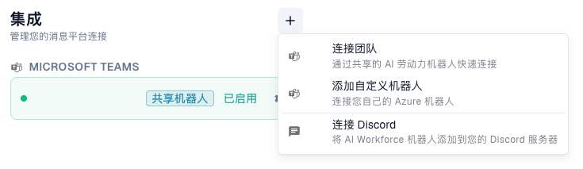
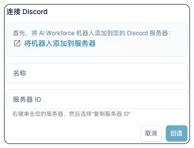

# 将 AI Workforce 连接到 Teams 和 Discord

需要有效的 AI Workforce 订阅、连接管理权限，以及目标 Teams 租户或 Discord 服务器的访问权限。如界面提示订阅要求，先与管理员处理。

<figure><figcaption>
在集成区域点击 +，可选择连接 Teams、添加自定义机器人或连接 Discord。现有连接的名称已隐藏。 当前界面把 Microsoft Teams 选项误译为“连接团队”。
</figcaption></figure>

## Microsoft Teams

1. 打开 **AI Workforce → 设置 → 集成**。
2. 选择 **+ → 连接 Teams**。DocBits 生成连接码并显示剩余有效时间。
3. 在目标 Teams 环境中按照该连接码旁显示的说明操作。妥善保密，并在过期前完成关联。
4. 等待连接确认，在列表中检查新连接名称，以及共享或自定义机器人模式。
5. 如果连接未激活且应接收工作，执行激活。已保存与已激活是不同状态。
6. 从正确 Teams 上下文发送无害测试请求，在 DocBits 确认对应任务、来源和组织，并在收件箱完成必要的人工批准。

使用企业自己的机器人时，选择自定义机器人选项，填写连接名称、租户 ID、应用 ID 和应用密钥。密钥只填写在凭据表单中，不放入提示词或截图。

## Discord

<figure><figcaption>
提交前的 Discord 连接表单。服务器 ID 指 Discord 服务器的标识（Guild ID）；尚未创建任何连接。
</figcaption></figure>

1. 在“集成 → +”中选择连接 Discord。
2. 如果提供添加机器人选项，由有权限的服务器管理员将其加入正确服务器。
3. 填写易识别的名称及正确的 **Guild ID**。这是服务器标识，不是频道标识。
4. 创建并检查连接，必要时将其激活。
5. 发送无害测试，核对产生的任务、来源和组织。

## 故障排查

Teams 连接码过期后，生成新码并按照新说明操作。收不到工作时，检查激活状态、租户/服务器标识、机器人权限与错误信息。显示已连接并不代表智能体已完成任务。

有关任务、智能体权限和批准，参见 [AI Workforce](ai_workforce.md)。聊天连接与邮件导入、Microsoft 登录配置是不同功能。
