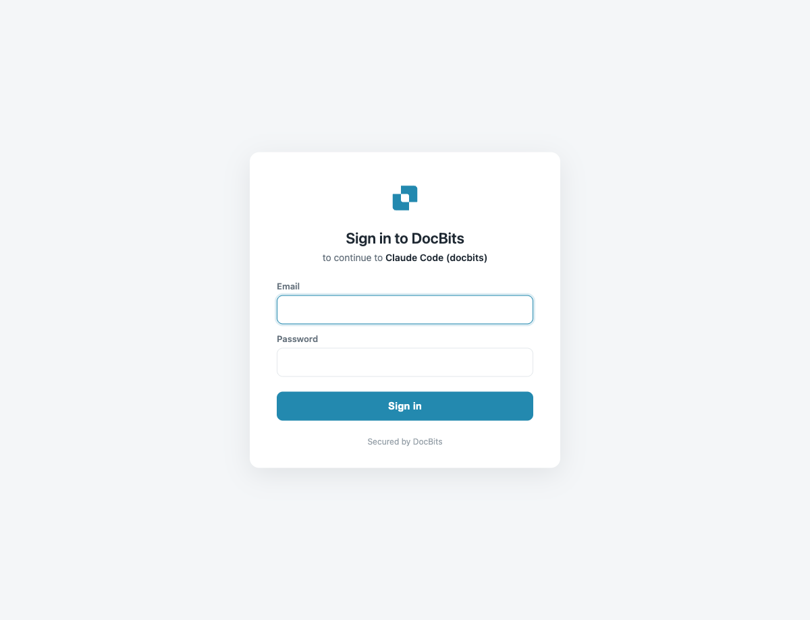

# 设置与配置

将 AI 助手连接到 DocBits MCP 只需运行一条命令，然后完成一次性登录。推荐使用 **OAuth** 登录——在浏览器中使用你已有的 DocBits 登录信息。对于自动化场景，也可以改用 API 密钥连接。

## 1. 选择端点

MCP 服务器位于 DocBits API 主机上。请使用**你所在区域（EU 或 US）**对应的主机：

| 环境 | EU 端点 | US 端点 |
|-------------|-------------|-------------|
| 生产环境 | `https://eu.api.docbits.com/v3/mcp` | `https://us.api.docbits.com/v3/mcp` |
| 沙盒 | `https://eu.sandbox.api.docbits.com/v3/mcp` | `https://us.sandbox.api.docbits.com/v3/mcp` |


`api.docbits.com` 是客户使用的统一端点。请始终选择**你的组织所在区域**（EU 或 US）——MCP 会自动将登录指向相应的身份验证服务器，无需单独配置。以下示例使用 EU 生产环境主机；请替换为你自己的主机。


## 2. 使用 OAuth 登录（推荐）

OAuth 是最简单的方式——无需复制任何密钥。添加服务器后，**首次连接时会在浏览器中打开 DocBits 登录页面**；你批准授权界面后，客户端便会连接。

**所有客户端都会显示以下流程：**

1. 客户端会在浏览器中打开 DocBits 登录页面。
2. 使用你的 DocBits 账户登录（如果你已登录 DocBits Web 应用，会复用当前会话，无需重新登录）。
3. 批准授权界面（“Authorize access”）。
4. 浏览器会将令牌交给客户端，连接随即建立。

OAuth 会签发一个短期有效的访问令牌（8 h）和一个刷新令牌（30 天），因此客户端会自动刷新并保持连接——**你只需登录一次。**


**你必须登录 DocBits——系统会复用你现有的会话。** 如果浏览器中已有 DocBits 会话，MCP 登录不会要求你再次登录。如果你已登录 DocBits Web 应用，**会直接进入授权界面**。如果尚未登录，系统会先显示 DocBits 登录页面；登录一次后，会话便会自动沿用到 MCP。


<figure><figcaption><p>尚未登录 — 品牌化的 DocBits 登录页面（仅当浏览器中没有 DocBits 会话时才会显示）</p></figcaption></figure>

<figure><figcaption><p>已登录 — 系统会复用现有会话并直接进入授权界面。批准后即可连接；界面会显示客户端请求的内容（scope 和 redirect）。</p></figcaption></figure>



```bash
# 1) add the server
claude mcp add --transport http docbits https://eu.api.docbits.com/v3/mcp

# 2) sign in (opens browser → DocBits login + consent → connected)
claude mcp login docbits
```

`claude mcp login docbits` 是 OAuth 登录步骤。成功后，可以询问 Claude：*“check the DocBits API health”* 以确认连接。



```bash
gemini mcp add --transport http docbits https://eu.api.docbits.com/v3/mcp
```

Gemini CLI 会自动发现 OAuth 服务器。**首次**使用该服务器时，它会在浏览器中打开 DocBits 登录页面（动态客户端注册和令牌管理均由系统自动处理）。批准授权后即可连接。如有需要，可以在 Gemini 的 `/mcp` 菜单中重新触发登录。



```bash
codex mcp add docbits \
  --url https://eu.api.docbits.com/v3/mcp \
  --oauth-resource https://eu.api.docbits.com/v3/mcp
```

`--oauth-resource` 标志会指示 Codex 为此服务器执行 OAuth 登录。首次使用时，Codex 会在浏览器中打开 DocBits 登录页面；批准授权后即可连接。



## 3. 使用 API 密钥连接（自动化）

对于无头代理、CI 或任何无法使用浏览器的环境，请跳过 OAuth，并将组织 API 密钥作为 `X-API-KEY` 标头传递。



```bash
claude mcp add --transport http docbits https://eu.api.docbits.com/v3/mcp \
  --header "X-API-KEY: <your-api-key>"
```



添加到 `~/.gemini/settings.json`：

```json
{
  "mcpServers": {
    "docbits": {
      "httpUrl": "https://eu.api.docbits.com/v3/mcp",
      "headers": { "X-API-KEY": "<your-api-key>" }
    }
  }
}
```



添加到 `~/.codex/config.toml`：

```toml
[mcp_servers.docbits]
url = "https://eu.api.docbits.com/v3/mcp"
http_headers = { "X-API-KEY" = "<your-api-key>" }
```

或者，将密钥保存在文件之外，并从环境中读取：

```toml
[mcp_servers.docbits]
url = "https://eu.api.docbits.com/v3/mcp"
env_http_headers = { "X-API-KEY" = "DOCBITS_API_KEY" }
```



## OAuth 登录的工作原理（底层机制）

DocBits 实现了标准的 **MCP OAuth 2.1** 流程，因此任何兼容的客户端都可以无需手动配置即可连接：

1. 客户端调用 MCP 端点，并收到带有 `WWW-Authenticate` 标头的 `401` 响应，该标头指向受保护资源元数据。
2. 客户端读取 `/.well-known/oauth-protected-resource`，其中列出了 DocBits 身份验证服务器。
3. 客户端读取身份验证服务器的元数据，并**动态注册自身**（RFC 7591）——无需客户端密钥。
4. 浏览器会打开 DocBits 登录和授权页面。如果你已登录 Web 应用，系统会复用当前会话。
5. 客户端通过 PKCE 将授权码交换为访问令牌和刷新令牌，然后调用 MCP。


退出 DocBits **Web 应用不会断开 MCP 连接**——MCP 使用自己的令牌，并会持续运行，直到刷新令牌过期（30 天）或你从客户端移除服务器。


## 故障排查

| 症状 | 原因 / 解决方法 |
|---------|-------------|
| 登录页面始终未打开 | 确认端点主机/区域正确且可访问；某些无头环境无法打开浏览器，请改用 API 密钥。 |
| 连接后出现 `401` | 令牌已过期且没有刷新令牌（API 密钥模式不会刷新令牌）——请重新连接 / 登录。 |
| 缺少工具 | 你的用户账户/API 密钥可能没有使用这些功能的权限；请检查你的 DocBits 角色。 |
| 数据或区域错误 | 确认使用的是**你所在区域**对应的端点（EU 或 US）。 |
