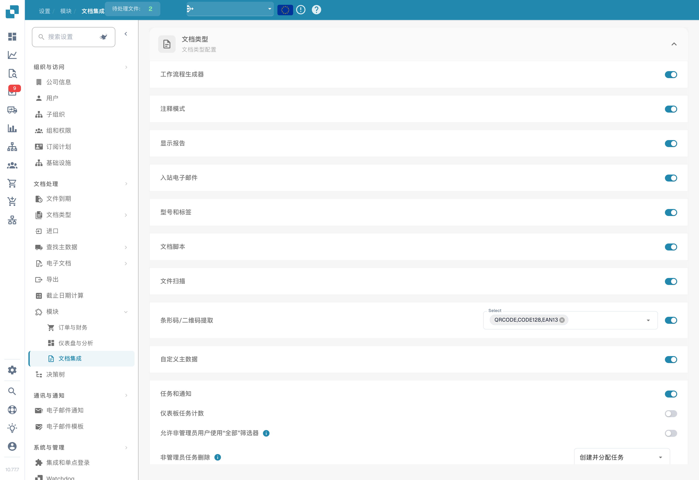
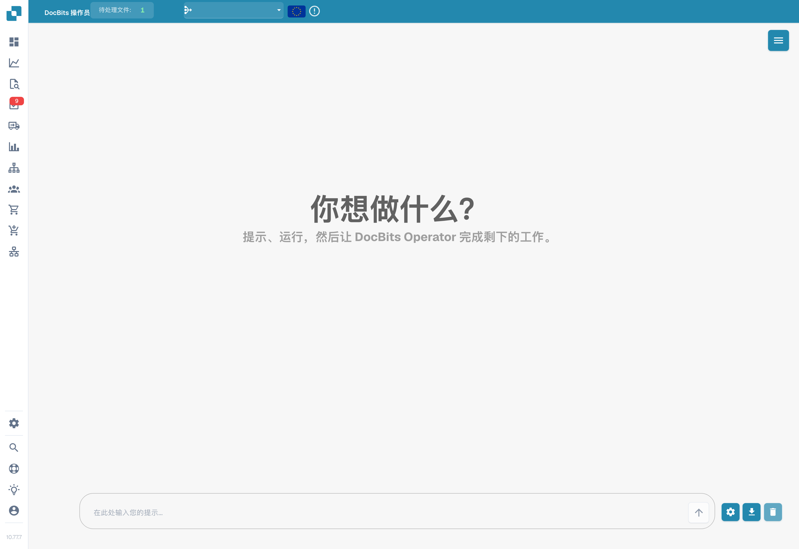
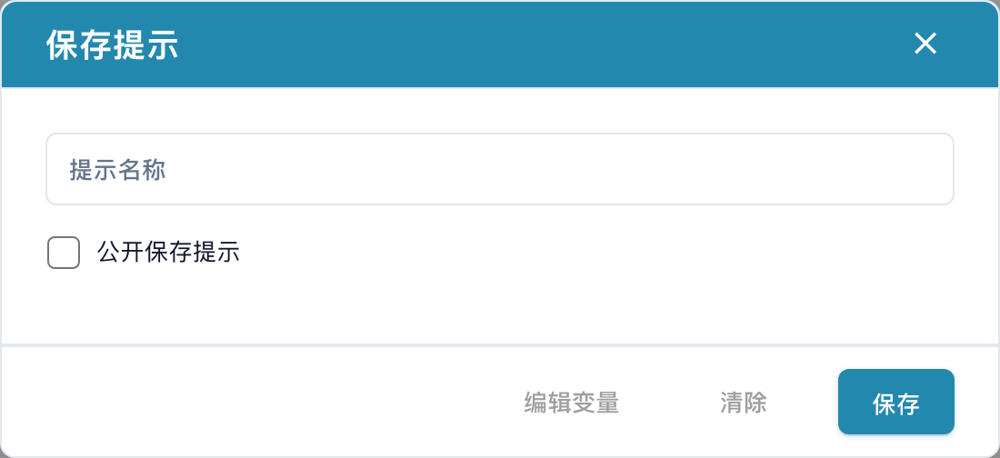

# DocBits Operator

DocBits Operator 根据用户指令执行任务。指令描述操作步骤，变量则提供本次执行所需的数据。

## 启用与访问

1. 打开**设置 → 模块 → 文档集成**。
2. 向下滚动至 **DocBits Operator**，在具备相应权限时启用该功能。
3. 从应用的主导航打开 **DocBits Operator**。

<figure><figcaption>
中文文档集成模块：脚本、扫描、条码及自定义主数据等选项；Select 仍为英文。未改动任何开关。
</figcaption></figure>

## 输入指令

在屏幕底部的输入框中描述预期结果和操作步骤。变量使用花括号，例如 `{invoice_number}` 或 `{url}`。齿轮按钮打开变量窗口，用于设置变量名称和值。

<figure><figcaption>
DocBits Operator 中文界面，指令输入框为空，未启动任何任务。
</figcaption></figure>

箭头按钮开始执行指令。下载图标打开保存指令的窗口，垃圾桶图标用于清除对话。仅打开保存窗口不会保存模板。

更多示例请参阅[指令编写指南](prompt-writing-guide.md)。

## 保存指令

在保存窗口中输入**指令名称**。公开共享选项用于设置模板的共享方式。准备共享模板时，请在指令文本中使用变量名称，并在具体执行前填写所需的变量值。

<figure><figcaption>
中文指令保存窗口；未输入任何值，也未点击最终保存按钮。
</figcaption></figure>

变量编辑按钮打开变量定义；保存按钮保存模板。要关闭窗口而不保存，请使用右上角的关闭图标。

在所示版本中，“清除”按钮实际关闭该窗口，其标签未准确描述此操作。

## 已保存的指令列表

右上角菜单打开已保存指令的侧边栏。列表分别显示组织指令和公开指令，并支持按名称搜索。

组织指令旁提供运行、编辑和删除图标。公开指令区域的箭头用于运行所选模板。运行前请填写变量值。

## 控制执行

执行期间可以暂停、继续、取消或接管控制。暂停会中止后续步骤，以便检查当前状态；继续会恢复执行，取消会结束本次运行。接管控制后，可以手动操作浏览器视图。

<figure><figcaption>
继续与停止执行图标示例。
</figcaption></figure>

## 详细视图

展开按钮打开执行的详细视图。在此可查看各项操作、当前步骤和 Operator 消息，并使用执行控制功能。

<figure><figcaption>
展开详细视图的图标。
</figcaption></figure>
