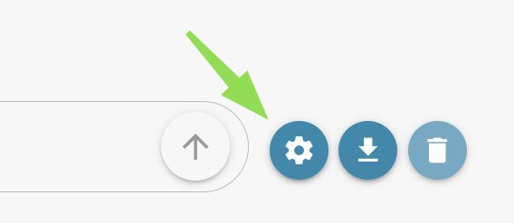

# 提示编写指南

本指南介绍如何为 DocBits Operator 编写有效的提示。提示是分步说明，用于指导 Operator 执行特定任务，例如浏览网页、与界面元素交互以及输入数据。

### 什么是提示？

提示是一系列以文本编写的说明，用于引导 Operator 执行工作流。提示可以包含点击按钮、填写表单、等待页面或元素加载等命令。

### 提示语法与结构

* 每条说明都应以编号步骤的形式编写。
* 使用清晰简洁的语言描述每项操作。
* 通过名称、标签或索引号指定界面元素，以确保精确定位。
* 使用一致的格式提高可读性。

### 在提示中使用变量

变量允许你在运行时插入不同的值，使提示具有动态性。不要将日期或文档编号等值写死在提示中，而应使用花括号中的占位符，例如：`{invoice_number}`、`{url}` 或 `{purchase_order}`。

这样一来，提示便可在不同的工作流或数据集中重复使用并灵活适配。

#### 如何使用变量

* 在提示文本中使用花括号括起变量：
  * 输入发票编号：{invoice\_number}，填入“Invoice number HP”字段。
* 每个变量都必须使用唯一名称（例如 `invoice_number`、`url`、`document_type`）。
* 变量名称不能包含空格或特殊字符（下划线除外）。
* 对于工作流，变量名称必须与文档的字段 ID 完全一致，才能启用自动数据映射。

### 提示变量弹出窗口 

要打开提示变量弹出窗口，请点击提示输入字段旁边的**齿轮图标**。

<figure><figcaption></figcaption></figure>

### 弹出窗口布局与控件

<figure><figcaption></figcaption></figure>

* **Key Input Field（键输入字段）：** 在此输入变量名称（不带花括号）。
* **Value Input Field（值输入字段）：** 输入提示运行时要用于此变量的值。
* **Save as Sensitive（保存为敏感信息，复选框）：** 勾选后，会将变量值标记为敏感信息。敏感值会经过加密，并在工作流中隐藏，以防止未授权用户查看机密信息。
* **Add Button (+)（添加按钮）：** 点击可再添加一行键值对输入项。
* **Delete Icon (Trashcan)（删除图标，垃圾桶）：** 存在多组键值对时，除第一组外，其余每组都会显示一个小垃圾桶图标，点击可删除相应的一组。
* **Clear Button（清除按钮）：** 清空所有键值对和已输入的值，以重置弹出窗口。
* **Save Button（保存按钮）：** 保存当前提示中定义的所有变量及其值。
