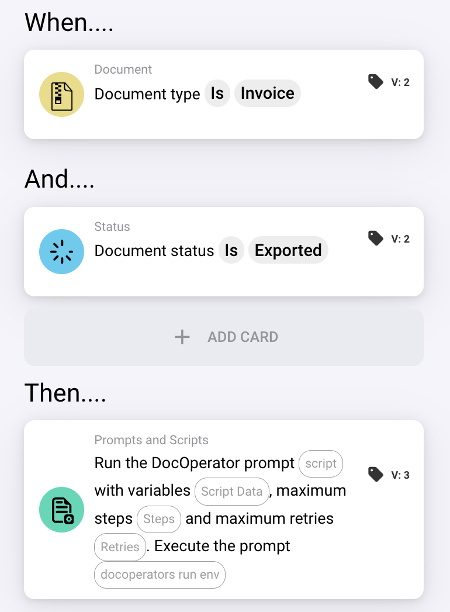
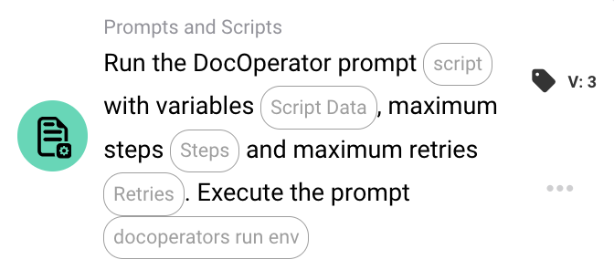

# 使用工作流触发提示

本指南介绍如何配置 DocBits 工作流，以自动触发已保存的提示。这样，您无需手动输入，即可将 Operator 提示集成到文档处理流程中。

### 步骤 1：创建提示

将提示关联到工作流之前：

* 确保已创建提示
* 在提示正文中包含所有必需的**变量**。

如需了解如何编写或保存提示，请参阅[提示编写指南](../prompt-writing-guide.md)和[Operator 界面概览](../)。

### 步骤 2：设置工作流

配置 Operator Prompt 卡片之前，请确保已正确创建工作流。

1. 在 DocBits 界面中进入**工作流构建器**（Workflow Builder）。
2. 创建新工作流，或打开现有工作流。
3. 定义**触发条件**——这些条件决定工作流何时启动（例如，文档类型、状态、字段是否存在等）。
4. 根据需要向工作流添加必要的**操作步骤**。

<figure><figcaption></figcaption></figure>

### 步骤 3：在工作流中配置 Operator Prompt 卡片

在工作流构建器中，使用**Operator Prompt 卡片**配置提示。满足工作流条件时，该提示将执行。

<figure><figcaption></figcaption></figure>

#### 主要配置选项

* **Script：**
  选择要执行的已保存**组织提示**（Organization Prompt）。
* **Script Data（变量）：**
  如果所选提示包含变量，请在此处使用键值对定义变量的值。
  * 如果此处的变量值留空，系统将尝试**从文档中**自动填充。
  * 要实现此功能，提示中的变量名称必须与文档属性的**字段 ID 完全一致**。
* **Max Steps：**
  定义允许 Operator 在执行此提示期间执行的最大步骤数。
* **Max Retries：**
  设置提示失败时系统应重试的次数。
* **Execution Mode：**
  选择提示的运行位置：
  * **In the Cloud（云端）**
  * **On-Premises（本地部署）**（如果 ERP 或目标系统托管在本地，则必须选择此项）
