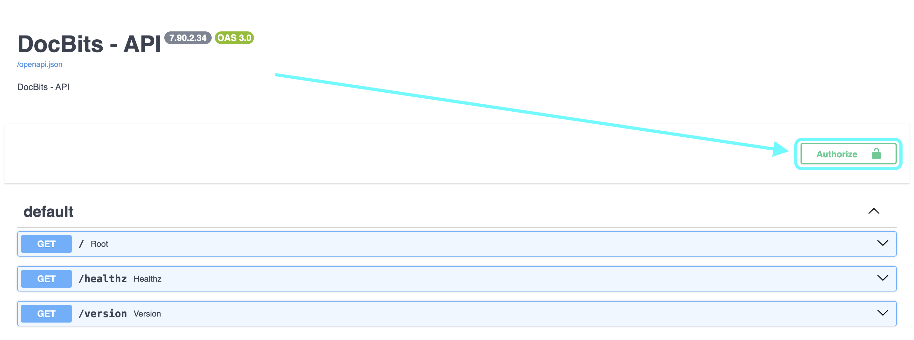
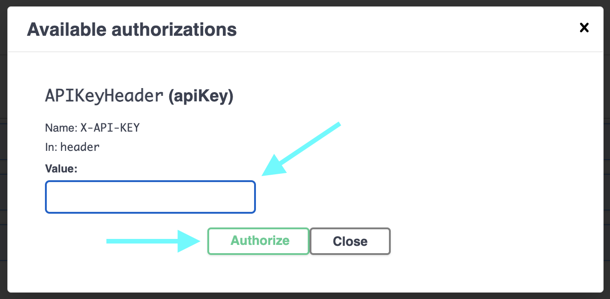
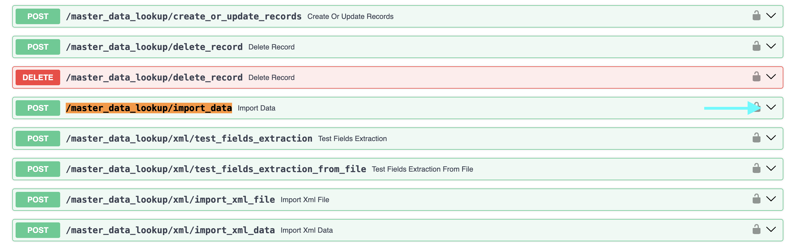
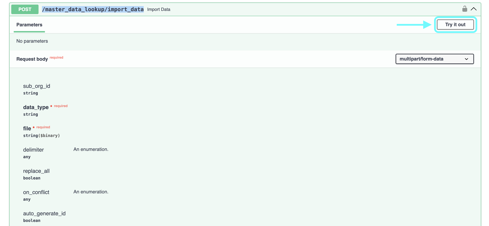
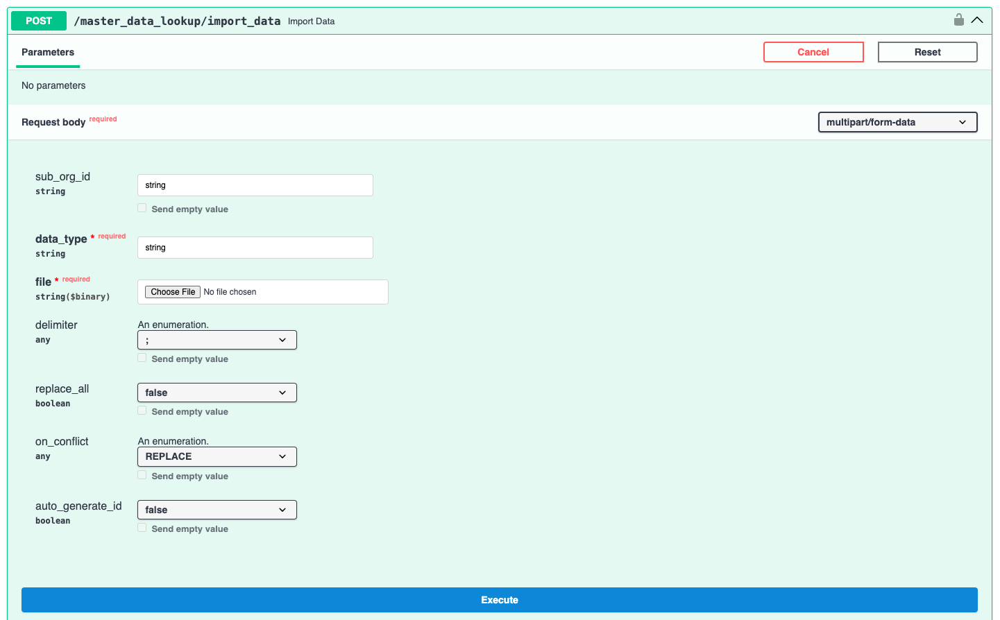
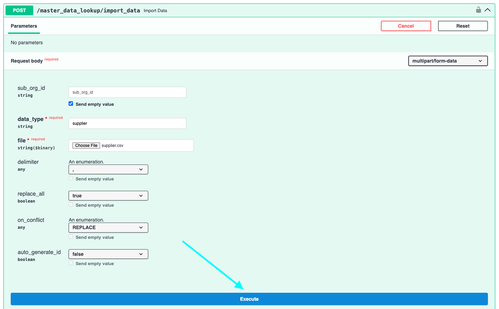

# 将供应商和采购订单数据从 CSV 文件导入 DocBits

## 概述

本页介绍如何使用逗号分隔值（.csv）文件将供应商和采购订单数据导入 DocBits。

**重要提示：** 导入任何数据之前，务必**彻底检查 .csv 文件**，以确保数据准确且配置正确。导入错误数据可能导致数据不一致。有关必填字段和可选字段的详细信息，请参阅[**采购订单的 CSV 规范**](importing-supplier-and-purchase-order-data-into-docbits-from-csv-files.md#csv-specifications-for-purchase-order)或[**供应商的 CSV 规范**](importing-supplier-and-purchase-order-data-into-docbits-from-csv-files.md#csv-specifications-for-supplier)部分。如果缺少必填字段，导入过程将失败。

**验证：** 尝试导入之前，请务必根据相应的规范部分检查 .csv 文件是否包含所有必需的列。

## 一般要求：

**日期格式：**

.csv 表格中的所有日期**必须**遵循以下格式：

YYYY-MM-DD HH:MM:SS

**必填字段：**

对于供应商和采购订单导入，相应规范中标记为“必填”的所有列**都必须存在于 .csv 文件中，并且每一行都必须包含相应的值**。如果某一行缺少必填字段或字段值为空，导入过程将失败。

### 采购订单的 CSV 规范 

**必填字段** -（列名必须存在且必须包含数据）

* `purchase_order_number`

**可包含的字段**

* `warehouse_id`
* `location_id`
* `supplier_id`
* `supplier_name`
* `order_date`
* `requested_shipment_date`
* `promised_delivery_date`
* `payment_terms_code`
* `total_amount`
* `buyer_contact_id`
* `buyer_contact_name`
* `order_last_modified_by`
* `order_last_modified_on`
* `ship_to_party_id`
* `ship_to_party_name`
* `ship_to_address_id`
* `disponent_id`
* `disponent_name`
* `extended_amount`
* `extended_base_amount`
* `extended_report_amount`
* `canceled_amount`
* `canceled_base_amount`
* `canceled_reporting_amount`
* `geo_code`
* `preview_path`
* `type_code`
* `type_description`
* `custom_field_1`
* `custom_field_2`
* `custom_field_3`
* `custom_field_4`
* `custom_field_5`
* `status`
* `line_number`
* `sub_line_number`
* `item_id`
* `supplier_item_id`
* `description`
* `note`
* `quantity`
* `open_quantity`
* `confirmed_quantity`
* `received_quantity`
* `received_base_mou_quantity`
* `promised_delivery_date`
* `requested_ship_date`
* `unit_code`
* `unit_code_price`
* `unit_price`
* `unit_price_per`
* `extended_amount`
* `total_amount`
* `currency`
* `status`
* `buyer_id`
* `buyer_name`
* `geo_code`
* `delivery_method`

### 供应商的 CSV 规范 

**必填字段** -（列名必须存在且必须包含数据）

* `customer_number`
* `supplier_number`
* `supplier_name`
* `country_code`

**可包含的字段**

* `address_1`
* `address_2`
* `address_3`
* `address_4`
* `town_city`
* `zip_code`
* `supplier_phone`
* `supplier_vat`
* `payment_term_id`
* `payment_method_code`
* `buyer_person_reference_id`
* `buyer_person_reference`
* `supplier_category`
* `supplier_group`
* `discount_term`
* `discount_term_description`
* `bank_id`
* `custom_field_1`
* `custom_field_2`
* `custom_field_3`
* `custom_field_4`
* `custom_field_5`
* `custom_field_6`
* `custom_field_7`
* `custom_field_8`
* `custom_field_9`
* `custom_field_10`
* `status`
* `account_number`
* `financial_partner_id`
* `financial_partner_name`
* `iban`
* `currency`

## 访问端点

要导入数据，请按以下步骤操作：

1. 访问：[https://api.docbits.com/](https://api.docbits.com/)
2. 点击 **“Authorize”** 按钮。

    <figure><figcaption>
英文 Swagger/OpenAPI 技术界面的历史示例，箭头指向 Authorize（授权）。它不是中文 DocBits 设置页；实际 API 地址和版本以目标环境为准。
</figcaption></figure>
3. 输入 API-Key，然后点击 **“Authorize”**

    * 在 DocBits **设置 → 全局设置 → 集成**中管理 API 密钥。完整密钥仅在创建时显示一次；使用已安全保存的完整值，列表前缀或遮蔽值不能用于认证。
    * **注意：** 请求中提供的 API key 决定目标组织，以及导入数据时使用的用户上下文。

    <figure><figcaption>
当前中文 API 密钥管理入口；密钥、前缀及账户数据已隐藏。完整密钥仅在创建时显示一次，应使用安全保存的完整密钥；列表中被遮蔽的值或前缀不是可用凭据。本次未创建或复制密钥。
</figcaption></figure>

    <figure><figcaption>
英文 OpenAPI 授权框示例，X-API-KEY 的 Value 为空，不含密钥。应输入安全保存的完整密钥；不要使用列表前缀或遮蔽值。
</figcaption></figure>

1. 按 **CTRL + F**（Mac 上按 **CMD + F**）打开搜索功能，然后搜索 `/master_data_lookup/import_data`。
2. 点击该请求以查看详细信息，然后点击 **“Try it out”** 继续。

    <figure><figcaption>
英文 OpenAPI 端点列表示例，目标为 POST /master_data_lookup/import_data。技术路径保持原文；不要选择相邻的删除操作。
</figcaption></figure>

    <figure><figcaption>
英文 OpenAPI 参数说明及 Try it out 入口的历史示例，只说明如何展开请求表单，不代表已执行 CSV 导入。
</figcaption></figure>
3. 现在可以在 Request Body 中输入所需参数。\

    **请求参数：**

    发起导入请求时，需要指定以下参数：

    * **sub\_org\_id：** 明确目标子组织；只有确认使用组织级范围时才留空。不要为照搬示例而清空此值。尤其在 `replace_all=true` 时，空值可能使删除范围覆盖该组织下此数据类型的全部现有记录，而非仅根组织记录。
    * **data\_type：** 此参数指定要导入的数据类型。根据 .csv 文件的内容，可以是 `supplier` 或 `purchase_order`。
    * **replace\_all：** 默认 `false`，用于插入或更新数据。`true` 会先删除所选数据范围内的现有记录，再导入 CSV：供应商还涉及地址和账户，采购订单还涉及订单行。仅在明确需要完整替换、已核对范围和完整数据集时使用 `true`；末图中的 `true` 是历史示例，不是增量导入的推荐设置。
    *   **delimiter：** 此参数指定用于分隔数据文件每一行中各个值的字符。**必须确认文件实际使用的分隔符。**常见分隔符包括逗号（`,`）和分号（`;`）。

        **如何检查分隔符：**

        1. 使用纯文本编辑器（例如 Windows 上的 Notepad、Mac 上的 TextEdit 或类似工具）打开数据文件（例如 `.csv` 文件）。
        2. 检查前几行数据。找到每一行中各项信息之间反复出现的字符。该字符就是分隔符。
        3. 在导入请求中，将 `delimiter` 参数设为识别出的字符（`,` 或 `;`）。使用错误的分隔符会导致数据无法正确解析，导入也会失败。
    * **on\_conflict & auto\_generate\_id：** 目前尚未为这些数据类型实现冲突处理功能（`on_conflict`）和自动生成 ID 功能（`auto_generate_id`）。

    <figure><figcaption>
英文 OpenAPI 空白导入表单示例，replace_all 为 false。string 等为占位文字，不是有效组织或数据类型；执行前核对全部实际参数。
</figcaption></figure>
4. 核对环境、组织／子组织、完整密钥、数据类型、分隔符及替换范围后，点击 **“Execute”** 才会实际写入。检查响应中的成功状态、插入／更新数量，并在主数据列表核对代表性记录；本次文档检查未执行导入。

    <figure><figcaption>
历史英文 OpenAPI 表单中 replace_all=true 且 sub_org_id 为空，这是完整替换示例，可能删除组织范围内该类型的现有数据，切勿直接照搬。增量导入通常保持 false；本次未执行请求。
</figcaption></figure>
