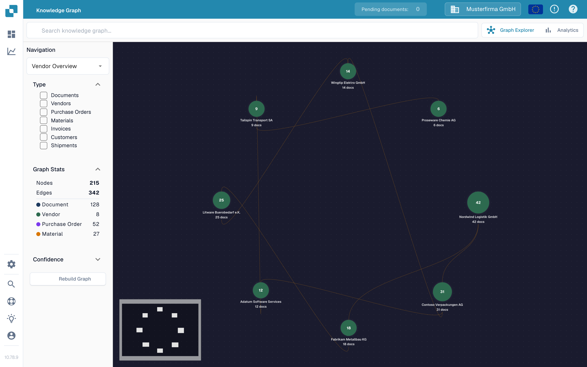

# 知识图谱探索器

知识图谱探索器可帮助你查看供应商、文档、采购订单及其他记录之间的关联。想要追踪某种关系或查看有多少关联项时，可以使用它。以下示例展示了英文沙盒测试组织中的空图谱。

<figure><figcaption>
空图谱的节点数和边数均为零。搜索项目或重建图谱即可开始使用。
</figcaption></figure>

## 开始使用

1. 在 DocBits 中打开 **Knowledge Graph Explorer**。确认页面顶部显示的组织是你要检查的组织。
2. 如果中心区域显示 **Search for a node or compute the graph to get started**，请选择 **Rebuild Graph**，并等待进度消息结束。这会准备图谱数据，可能需要一些时间。如果组织中尚无匹配的关系，**Nodes** 和 **Edges** 可能仍为零。
3. 在 **Search knowledge graph** 中输入名称或其他搜索词，然后按 Enter 或选择搜索图标。如果出现多个结果，请选择所需结果。只有一个结果时，会直接打开其图谱。
4. 选择一个节点以查看其详细信息。想要返回图谱时，使用 **X** 关闭详情面板。

## 选择要查看的内容

| 控件 | 功能 |
| ------------------------------ | -------------------------------------------------------------------------------------------------------------------------------------------------------------------------------------------------------------- |
| **Navigation** | 在 **Vendor Overview**（关联的供应商）、**Vendor Intelligence**（供应商表格）、**Document Journey**（文档处理中的步骤和变体）和 **Anomalies**（异常关系）之间切换。 |
| **Type** | 选择要关注的项目类型，例如 Documents、Vendors、Purchase Orders 或 Invoices。所选类型也会限制搜索结果。 |
| **Graph Stats** | 显示当前可用的节点（项目）数和边（关联）数。可按需展开或折叠此区域。 |
| **Confidence** | 打开此区域，以设置展开节点时所需的最低关系置信度。置信度越高，显示的关联越少。 |
| **Rebuild Graph** | 开始重新计算图谱。请等待计算进度结束后再搜索。 |
| **Graph Explorer / Analytics** | 在交互式图谱和汇总图表之间切换。存在图谱数据时，Analytics 会显示计数和图表；图谱为空时，Analytics 也不会显示内容。 |

如果需要处理发票与其订单之间的差异，请继续查看[采购订单匹配页面](../end-user-and-partner-section/end-user-section/purchase-order-matching/)。如需查看图谱以外的更广泛指标，请参阅[分析仪表板](../administration-and-setup/analytics-dashboard/)。
