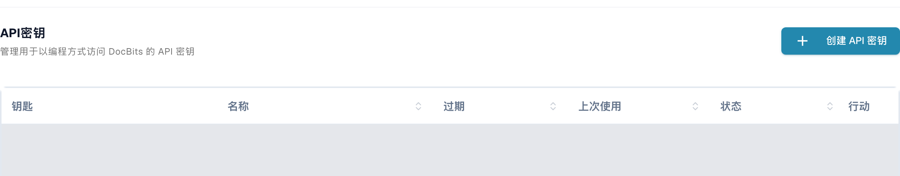
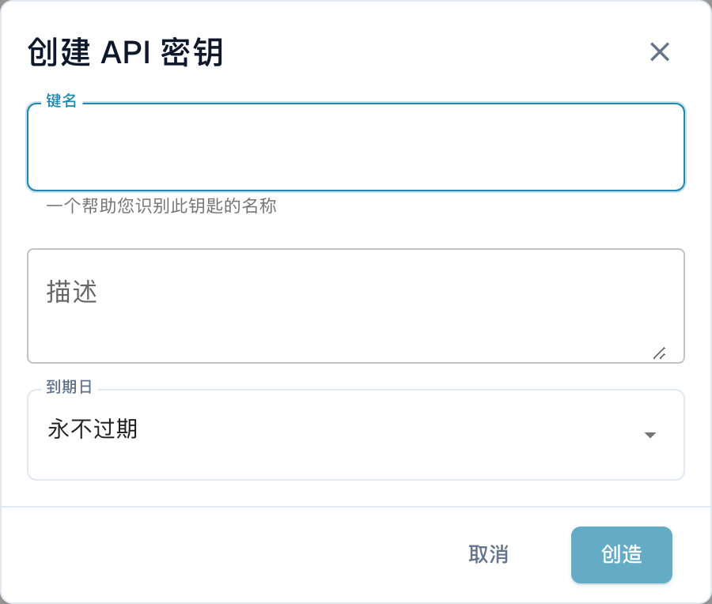

# DocBits 的 Postman 使用指南

您可以使用 Postman 向 DocBits API 发送 HTTP 请求。请先在您获准使用的环境中执行只读请求。为测试环境和生产环境分别配置 Postman 环境，并将凭据保存在私有变量或密钥库中。

## 设置

### DocBits API

打开相应环境的 API 文档，例如 [Sandbox API 文档](https://sandbox.api.docbits.com/docs)或[生产环境 API 文档](https://api.docbits.com/docs)。使用当前操作的路径以及文档中显示的 **Servers** 值。如果服务器路径是相对路径，应将其添加在 API 源地址之后。

在[本文核查的 Dev API 文档](https://eu.dev.api.docbits.com/docs)中，该路径为 `/dev-api`，因此完整的基础 URL 为 `https://eu.dev.api.docbits.com/dev-api`。其他环境的服务器路径可能不同。

API 规范列出了不同的请求头方案：

| 请求头 | 用途 |
| --- | --- |
| `X-ORG-ID` | 在操作要求时标识目标组织。 |
| `Authorization` | 提供相应身份验证机制所要求的授权值。 |
| `X-API-KEY` | 为采用此方案的操作提供 API 密钥。 |

这些请求头不能相互替代。全局 **Authorize** 对话框列出可用的方案，但并不表示每个操作都需要全部请求头。请查看具体操作的参数和授权说明。

请向管理员获取适当的凭据。有权限的用户可在 DocBits 设置的 **集成和单点登录 → API密钥** 中找到密钥管理。列表显示密钥前缀、名称、到期时间、上次使用时间和状态。截图中的现有数据行已遮盖。

<figure><figcaption><p>真实的中文 Dev 界面：API密钥、创建 API 密钥按钮，以及钥匙、名称、过期、上次使用、状态和行动列；现有数据行已遮盖。</p></figcaption></figure>

列表上方的 **创建 API 密钥** 按钮首先打开一个空白表单，包含 **键名**、**描述** 和 **到期日**。只有提交表单才会创建密钥。图中的表单使用 **取消** 关闭，未提交。未创建、显示、复制或撤销任何密钥。仅在权限允许并符合组织规定时创建密钥。

<figure><figcaption><p>中文创建 API 密钥空白表单，包含键名、描述、到期日、取消和创造；键名为空时，实际显示为创造的提交按钮处于禁用状态。</p></figcaption></figure>

### 在 Postman 中创建新工作区

打开 Postman，使用可见性设置符合组织要求的工作区。创建一个环境并添加变量 `base_url`，将其值设为完整的基础 URL，包括服务器路径。发送请求前先选择此环境。[Postman 环境指南](https://learning.postman.com/docs/use/send-requests/variables/managing-environments/)介绍了如何选择和使用变量。

创建请求，或将请求添加到集合中。下文保留 Postman 应用中控件的技术标签；上方图片展示的是中文 DocBits 密钥管理界面。

## “GET” 方法示例

选择 **GET**，URL 填写 `{{base_url}}/version`。在 **Authorization** 中选择 **No Auth**，然后选择 **Send**。已核查的 Dev 只读请求为：

```http
GET https://eu.dev.api.docbits.com/dev-api/version
```

此端点在未提供 API 密钥的情况下返回 HTTP 200。它检查 API 是否可访问并返回版本信息，但不能证明您有权访问某个组织的文档或用户。检查响应状态和内容；如果失败，请先核对所选环境、API 源地址和服务器路径。

对于使用 API 密钥的操作，在 Postman 中选择 **Authorization → API Key**。将 **Key** 设为 `X-API-KEY`，在 **Value** 中使用私有密钥，并在 **Add to** 中选择 **Header**。如果操作要求 `X-ORG-ID`，请在 **Headers** 中添加该请求头。请参阅官方的 [API 密钥授权说明](https://learning.postman.com/docs/use/send-requests/authorization/authorization-types/#api-key)和 [Vault 密钥指南](https://learning.postman.com/docs/use/postman-vault/use-vault-secrets/)。

## “POST” 方法示例

**POST** 可以创建数据或启动处理流程。请从当前 API 规范中获取操作的 HTTP 方法、路径、必填参数和请求体结构。仅为具体且已获授权的任务执行此类请求。版本查询成功不代表写入请求一定会成功。

### 上传文档

上传之前，请查看当前文档中的对应操作。如果该操作要求 multipart 表单数据，请选择相应的请求体类型，并使用规范规定的字段名和文件类型。不要根据旧版 API 的截图推断这些内容。本文的核查没有上传任何文档。

## “DELETE” 方法示例

**DELETE** 可能永久删除数据。请核对具体操作、目标 ID 和所需权限。本文没有执行删除操作，也没有将其描述为已经测试成功。

## “PUT” 方法示例

**PUT** 可以修改现有数据。仅使用当前操作规定的参数和请求体结构，并确认所要求的修改范围。本文没有执行任何修改。

## 更改用户的电子邮件地址

请从当前 API 规范中获取路径和必填字段，并在执行前对用户修改进行业务审核。本文不展示真实用户或组织数据，也不能证明电子邮件地址修改已成功。

已核查当前 Dev API 规范、无需身份验证的版本查询，以及中文 DocBits 密钥管理和空白表单的真实界面。界面核查使用了获准的测试账户和只读界面元数据查询。未创建密钥、上传文档、创建用户、修改或删除数据。未测试针对文档或用户记录的业务 API 操作，也没有在 Postman 应用中测试请求。
