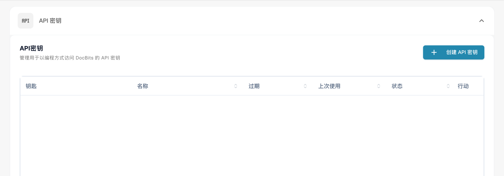

# 使用 Postman 测试 BOD 连接

## 概述

本页介绍如何使用 Postman 验证 BOD（业务对象文档）是否已成功处理。您将通过发送包含 BOD 映射文件的请求来测试相关 API 端点。请按照以下步骤完成操作。

## 获取 API 密钥和 BOD 映射文件

### 获取 API 密钥

1.  前往 **设置 → 全局设置 → 集成与单点登录**。

    <figure><figcaption><p>当前中文 API 密钥管理入口；密钥、前缀及账户数据已隐藏。完整密钥仅在创建时显示一次，应使用安全保存的完整密钥；列表中被遮蔽的值或前缀不是可用凭据。本次未创建或复制密钥。</p></figcaption></figure>
2.  使用创建时安全保存的完整 **API 密钥**。完整值仅在创建时显示一次；列表中的前缀或遮蔽值不是有效凭据，复制按钮不保证能重新获得完整旧密钥。


### **下载 BOD 映射文件**

1.  前往 **设置 → 文档处理 → 导出**。

    <figure><figcaption><p>中文导出配置列表，用于定位已有导出配置；记录值已隐藏，部分操作标签仍为英文。本图没有打开行菜单或下载映射，映射必须从实际已保存的目标配置获取。</p></figcaption></figure>
2.  在相关导出条目的 **操作** 列中，点击三点菜单并选择 **编辑**。


3.  从实际已保存且与目标数据类型匹配的配置中下载 **BOD 映射文件**。下图仅显示空白配置表单，未下载映射；如果没有现成映射，应先由集成管理员确认接收契约，不能上传空白或其他类型的文件。

    <figure><figcaption><p>中文界面的空白 Infor ION/BOD 导出配置表单，仅说明配置类型和字段位置。部分产品标签翻译不完整；本图未保存配置、未下载映射，也没有连接 ION 或执行 BOD 传输。</p></figcaption></figure>

## 在 Postman 中测试端点

1.  **在 Postman 中粘贴 cURL 命令**

    打开 Postman，将以下 cURL 模板粘贴到 **Import（导入）**区域。代码保留旧生产地址示例；执行前必须替换为已批准环境的当前 API 地址，并按该环境 OpenAPI 核对路径。填写实际目标组织／子组织及映射，不要直接发送占位值。

    ```bash
    curl -X 'POST' \
      'https://api.docbits.com/prod-api/import/purchase_order_bod' \
      -H 'accept: application/json' \
      -H 'X-API-KEY:' \
      -H 'Content-Type: multipart/form-data' \
      -F 'org_id=' \
      -F 'sub_org_id=' \
      -F 'file=@file.xml;type=text/xml' \
      -F 'custom_fields_mapping='
    ```

    <figure><figcaption><p>外部 Postman 英文客户端的 Import（导入）入口示例；此操作导入请求定义，不会自行发送 BOD。</p></figcaption></figure>

    <figure><figcaption><p>外部 Postman 英文导入窗口，Paste cURL to import 用于粘贴请求模板。实际按钮和账户要求可能随客户端版本变化。</p></figcaption></figure>
2.  **设置 API 密钥**\
    转到 **Headers** 选项卡，找到 `X-API-KEY` 标头，然后在 **Value** 列中粘贴 API 密钥。

    <figure><figcaption><p>外部 Postman Headers 示例，X-API-KEY 值为空，不含凭据。英文技术标头保持原样；目标环境地址和完整密钥需另行确认。</p></figcaption></figure>
3.  **上传 BOD 文件**\
    转到 **Body** 选项卡，找到 `file` 键，然后点击 **Value** 列中的 **Select Files**，并上传 BOD XML 文件。

    <figure><figcaption><p>外部 Postman Body/form-data 示例，org_id、sub_org_id 和 custom_fields_mapping 均为空，file 尚未选择。此图不能作为可直接发送的完整请求。</p></figcaption></figure>
4.  **发送请求**\
    点击 **Send** 发起 API 调用。

    <figure><figcaption><p>外部 Postman Send 按钮示例。No Auth 表示未使用 Postman 内置授权方式，不能省略端点要求的 X-API-KEY；点击 Send 会实际写入目标环境。</p></figcaption></figure>
5.  **验证响应**\
    检查 HTTP 状态和响应正文，再到目标组织的相应主数据列表中核对唯一测试标识及关键字段。`success: true` 只说明该 API 请求的处理结果，不能单独证明整个 ION 路由、全部数据或后续导出成功。下图是历史响应示例，本次检查未发送 BOD。

    <figure><figcaption><p>历史英文 Postman 响应示例：HTTP 200、success=true、BOD processed successfully。它不是本次测试结果，也不能单独证明整条 ION 集成或下游业务成功。</p></figcaption></figure>
