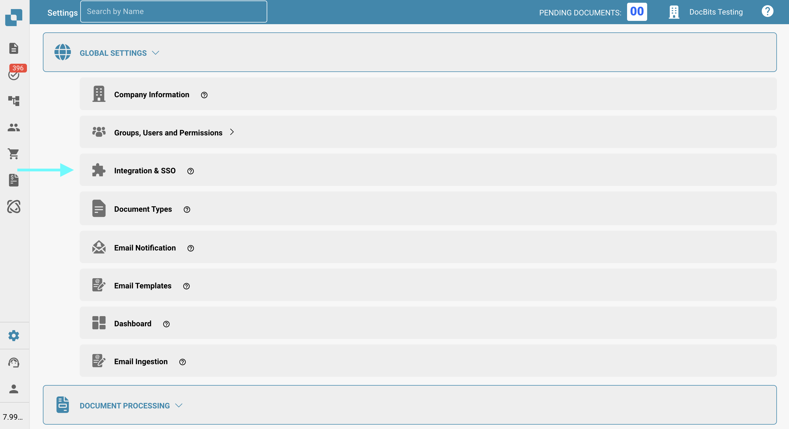
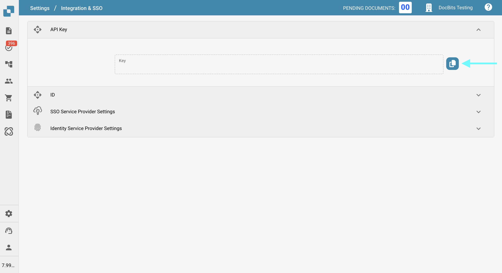
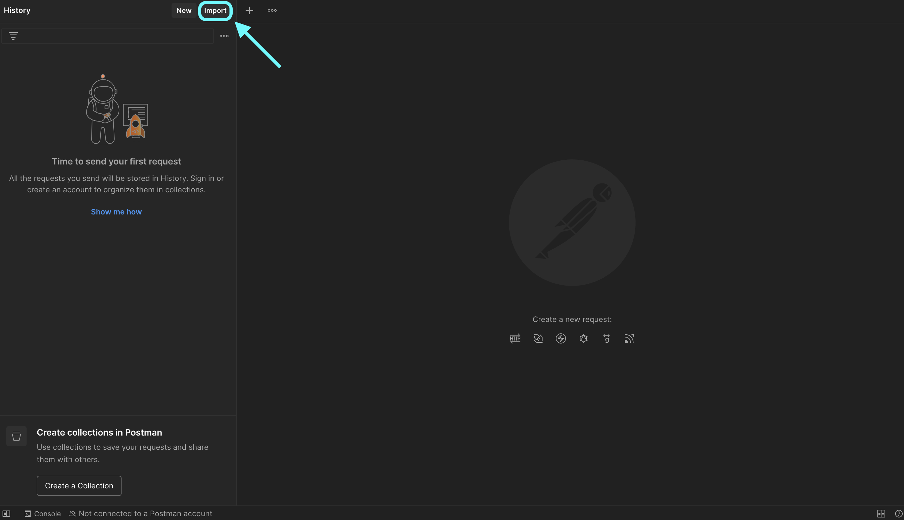
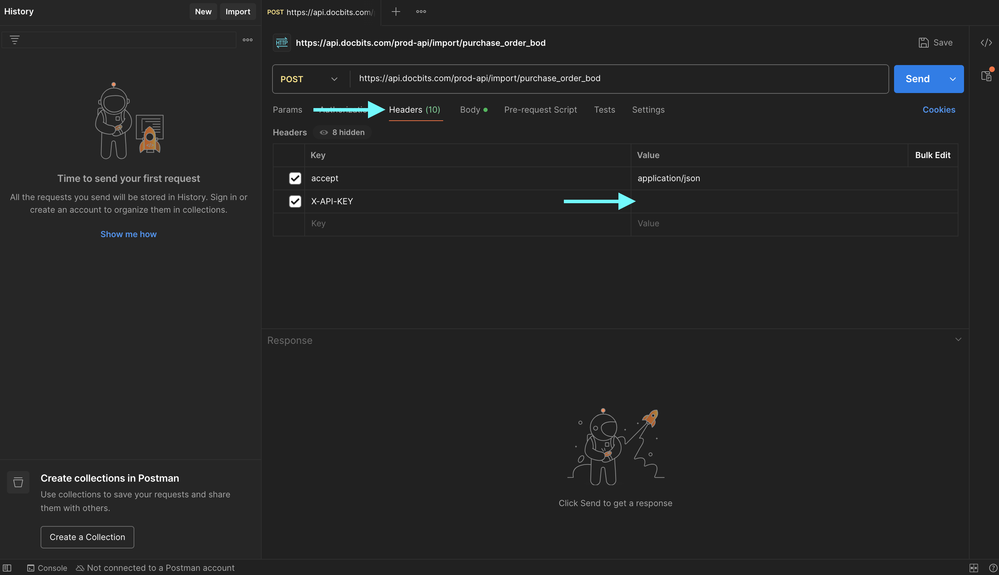
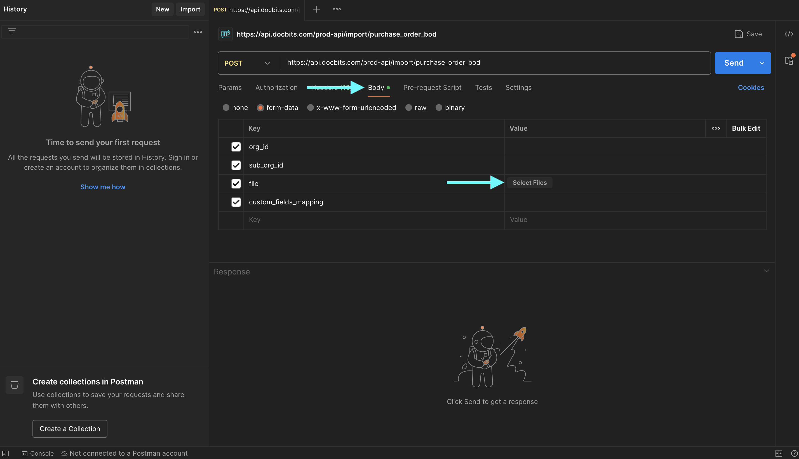
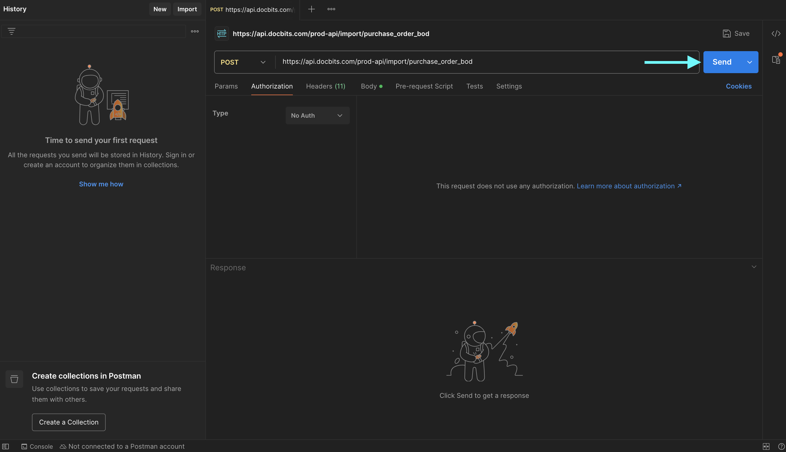

# 使用 Postman 测试 BOD 连接

## 概述

本页介绍如何使用 Postman 验证 BOD（业务对象文档）是否已成功处理。您将通过发送包含 BOD 映射文件的请求来测试相关 API 端点。请按照以下步骤完成操作。

## 获取 API 密钥和 BOD 映射文件

### 获取 API 密钥

1.  前往 **设置 → 全局设置 → 集成与单点登录**。

    <figure><figcaption></figcaption></figure>
2.  您可以手动复制 **API 密钥**，也可以点击复制按钮将其复制到剪贴板。

    <figure><figcaption></figcaption></figure>

### **下载 BOD 映射文件**

1.  前往 **设置 → 文档处理 → 导出**。

    <figure><figcaption></figcaption></figure>
2.  在相关导出条目的 **操作** 列中，点击三点菜单并选择 **编辑**。

    <figure><figcaption></figcaption></figure>
3.  找到 **BOD 映射文件**，然后点击 **下载** 按钮将其保存。

    <figure><figcaption></figcaption></figure>

## 在 Postman 中测试端点

1.  **在 Postman 中粘贴 cURL 命令**

    打开 Postman，并将以下 cURL 命令粘贴到 **导入** 区域。Postman 会自动配置请求。

    ```bash
    curl -X 'POST' \
      'https://api.docbits.com/prod-api/import/purchase_order_bod' \
      -H 'accept: application/json' \
      -H 'X-API-KEY:' \
      -H 'Content-Type: multipart/form-data' \
      -F 'org_id=' \
      -F 'sub_org_id=' \
      -F 'file=@file.xml;type=text/xml' \
      -F 'custom_fields_mapping='
    ```

    <figure><figcaption></figcaption></figure>

    <figure><figcaption></figcaption></figure>
2.  **设置 API 密钥**\
    转到 **Headers** 选项卡，找到 `X-API-KEY` 标头，然后在 **Value** 列中粘贴 API 密钥。

    <figure><figcaption></figcaption></figure>
3.  **上传 BOD 文件**\
    转到 **Body** 选项卡，找到 `file` 键，然后点击 **Value** 列中的 **Select Files**，并上传 BOD XML 文件。

    <figure><figcaption></figcaption></figure>
4.  **发送请求**\
    点击 **Send** 发起 API 调用。

    <figure><figcaption></figcaption></figure>
5.  **验证响应**\
    检查响应，确认 BOD 已成功处理。

    <figure><figcaption></figcaption></figure>
