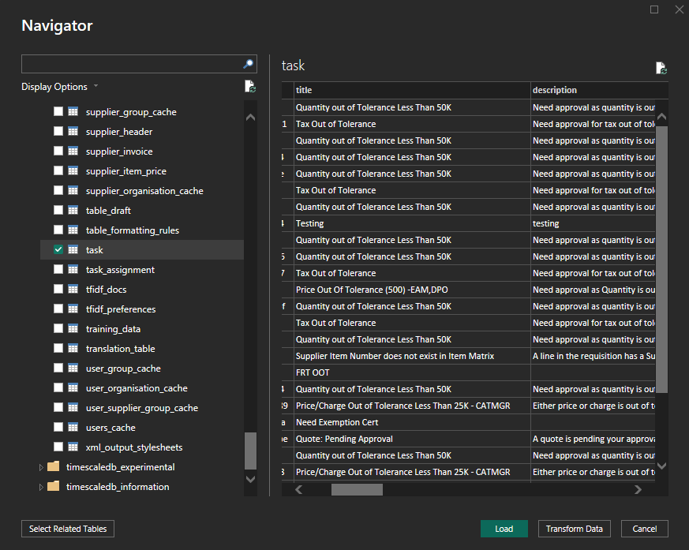

# 通过只读数据库连接

本指南将介绍如何使用 **PostgreSQL ODBC 驱动程序**将 **DocBits 只读数据库连接到 Power BI Desktop**。内容涵盖驱动程序安装、ODBC 配置、Power BI 集成和计划刷新。




#### 1. 安装 PostgreSQL ODBC 驱动程序

* 从官方网站下载最新的 PostgreSQL ODBC 驱动程序（**psqlODBC**）：
  * [https://www.postgresql.org/ftp/odbc/releases/](https://www.postgresql.org/ftp/odbc/releases/)
* 运行安装程序并按照安装向导操作。

#### 2. 配置 ODBC 数据源

* 通过控制面板或 Windows 搜索打开 **ODBC 数据源管理器（64 位）**。
* 转到 **系统 DSN** 选项卡，然后点击 **添加**。
* 从列表中选择 **PostgreSQL Unicode(x64)** 驱动程序，然后点击 **完成**。
* 使用以下位置提供的凭据填写必填字段：\n  **DocBits → 设置 → 文档处理 → 模块 → AI 仪表板 → 只读数据库访问**

<figure><figcaption></figcaption></figure>

**必填字段：**

* **名称：** 连接名称（例如，`Sandbox-Read_Only`）
* **服务器：** 从 DocBits 复制主机值
* **端口：** 从 DocBits 复制端口值
* **数据库：** 从 DocBits 复制数据库名称
* **用户名：** 从 DocBits 复制用户名
* **密码：** 从 DocBits 复制密码
* **SSL 模式：** 设置为 **Require**（确保通信加密）

#### 3. 将只读数据库连接到 Power BI

* 打开 **Power BI Desktop**。
*   选择 **获取数据** → **ODBC** → **连接**。

    <figure><figcaption></figcaption></figure>
* 在 DSN 列表中，选择已配置的数据源（例如，`Sandbox-Read_Only`）。

<figure><figcaption></figcaption></figure>

* 点击 **确定**。如果系统提示，请再次输入凭据。
  * 出现 `password authentication failed for user` 时，请检查主机、数据库、用户名和密码。在凭据对话框中输入实际密码。ODBC 连接字符串中使用花括号转义属于驱动程序语法，并不是修复身份验证失败的通用方法。

#### 4. 加载和转换数据

* 在 **导航器**窗格中展开架构列表。
* 打开 **`public`** 架构。
* 选择要导入的表。

* 选择：
  * **加载** → 直接导入 Power BI
  * **转换数据** → 打开 Power Query，在加载前整理和筛选数据

#### 5. 可视化数据

* 使用 Power BI 报表画布构建仪表板。
* 拖动字段、添加切片器、选择图表类型并应用 DAX 计算。
* 创建可视化内容前，使用 **Power Query 编辑器**清理或联接数据。
* 参考：[Power BI 文档](https://learn.microsoft.com/en-us/power-bi/)

#### 6. 启用计划刷新（可选）

计划刷新取决于工作区的许可证或容量、连接器及连接模式。对于此 ODBC 连接，请配置可访问的网关，并安装匹配的驱动程序、配置 DSN 和凭据。请在官方文档中确认当前要求。

* 若要使报表与 PostgreSQL 保持同步：
* 将 `.pbix` 文件发布到 **Power BI Service**。
* 在可访问 PostgreSQL 网络的计算机上以标准模式安装 **Power BI Gateway**。
* 在 Power BI Service 中：
  * 转到数据集 → **设置** → **计划刷新**
  * 映射 DSN 并提供凭据
* 更多信息请参阅[此处](https://learn.microsoft.com/en-us/power-bi/connect-data/service-gateway-deployment-guidance)。&#x20;

#### 7. 仪表板和数据视图示例&#x20;

<figure><figcaption></figcaption></figure> <figure><figcaption></figcaption></figure> <figure><figcaption></figcaption></figure> <figure><figcaption></figcaption></figure>

[官方文档 — ODBC](https://learn.microsoft.com/en-us/power-query/connectors/odbc)

[官方文档 — psqlODBC](https://odbc.postgresql.org/docs/config-opt.html)

[官方文档 — Power BI](https://learn.microsoft.com/en-us/power-bi/connect-data/refresh-scheduled-refresh)
