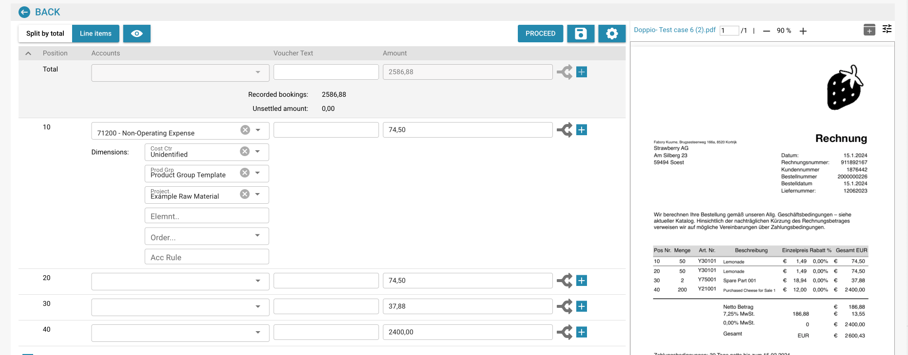

# 成本发票和间接销售会计

## 简介

欢迎使用“成本发票和间接销售会计”模块！此模块旨在帮助您在 ERP 系统中高效管理和对账财务交易。借助自动数据提取、文档匹配和详细跟踪等功能，您可以确保财务记录准确且保持最新。

<figure><figcaption></figcaption></figure>

## 开始使用

要开始使用会计模块，请确保系统管理员已为您设置必要的权限。您需要在 ERP 系统中同时访问成本会计和销售会计模块。

## 系统要求

* 可访问 ERP 系统中的成本会计和销售会计模块。
* 具备查看和处理财务文档所需的用户权限。

## 主要功能

1. **自动数据提取**：自动提取并解读数字发票和其他文档中的数据。
2. **数据比较**：将提取的发票数据与现有采购订单数据进行比较。
3. **匹配验证**：依据预定义规则和容差验证匹配结果。
4. **差异报告**：识别并报告发票与采购订单之间的任何差异。
5. **审计跟踪**：记录所有操作，以便合规检查和审核。
6. **文档训练**：只需很少的工作即可训练系统识别新文档，通常只需训练一次。
7. **金额拆分**：按部门拆分金额，以便详细跟踪财务数据。
8. **总账科目定义**：数据提取完成后，APS（会计与采购系统）团队可以定义总账科目。

## 用户界面

会计模块界面通常包含以下组件：

* **仪表板**：概览发票和销售状态，以及近期活动。
* **搜索和筛选工具**：用于搜索和筛选发票和销售记录。
* **已匹配记录**：显示成功匹配记录的区域。
* **差异**：显示存在差异、需要审核或处理的记录的区域。
* **报告**：访问详细报告和导出选项。

## 会计模块分步指南

### 1. 访问会计模块

从 ERP 系统的主菜单进入会计模块。

### 2. 导入或访问发票

* **自动导入**：如果系统已设置自动数据采集，发票将自动导入系统。
* **手动上传**：如有需要，可使用提供的界面手动将发票文件上传到系统。

### 3. 审核自动匹配的发票

* 审核已自动与采购订单匹配的发票。
* 核对匹配详情，包括项目编号、数量和价格。

### 4. 处理差异

* 进入“差异”区域，审核无法自动匹配的发票。
* 根据需要手动调整数量或价格，或将发票标记为需要进一步审核。

### 5. 手动匹配

对于未能自动匹配的发票：

* 使用搜索和筛选工具查找相应的采购订单。
* 手动核验发票，并将其与采购订单匹配。

### 6. 训练系统

* 对于新文档类型，提供样本以训练系统识别此类文档。
* 通常只需训练一次，系统之后便能准确识别类似文档。

### 7. 记录记账信息

* 前往“行项目”选项卡，查看并记录每张发票的记账信息。
* 将金额分配到适当的科目、成本中心和 Infor LN/M3 专用维度。

#### **示例：成本发票记账**

1. **选择行项目**：选择成本发票的行项目。
2. **分配科目**：分配适当的科目，例如“71200 - 营业外费用”。
3. **设置维度**：设置其他维度，例如成本中心、产品组和项目。
4. **拆分金额**：如有需要，按部门拆分金额，以便进行更详细的跟踪。
5. **输入金额**：输入该行项目的金额。

### 8. 定义总账科目

* 数据提取完成后，APS 团队可以定义总账科目。
* 这样可以确保每笔交易都记入正确科目，从而准确生成财务报告。

### 9. 生成报告

* 进入“报告”区域，生成财务交易详细报告。
* 使用导出选项保存报告，以便进一步分析或留存记录。

### 使用示例

1. **上传文档**：用户可以将各种文档（发票、送货单等）上传到系统。
2. **自动匹配**：系统会自动将上传的文档与现有采购订单匹配。
3. **审核匹配结果**：用户可以审核匹配结果、核对详情并查看状态指示。
4. **解决差异**：系统会突出显示任何不匹配或差异，供用户手动审核和更正。
5. **导出数据**：可以导出已匹配的数据，以便进一步处理或留存记录。
