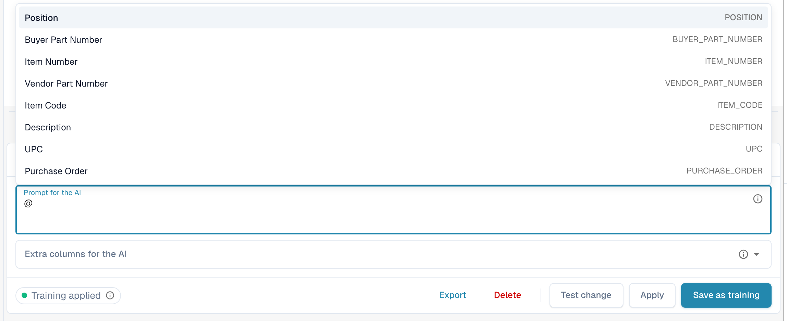
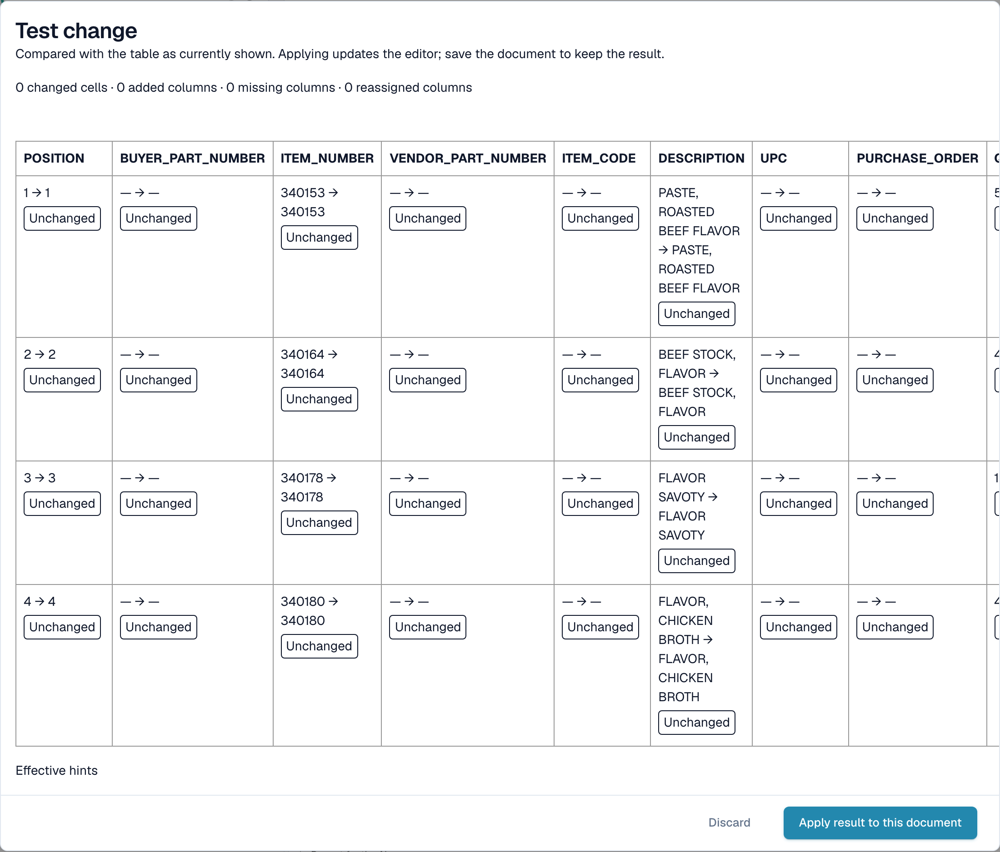
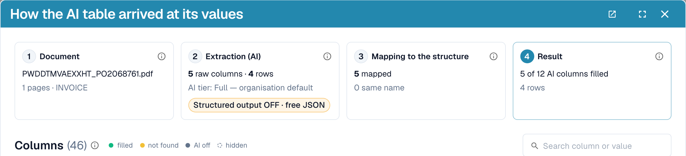
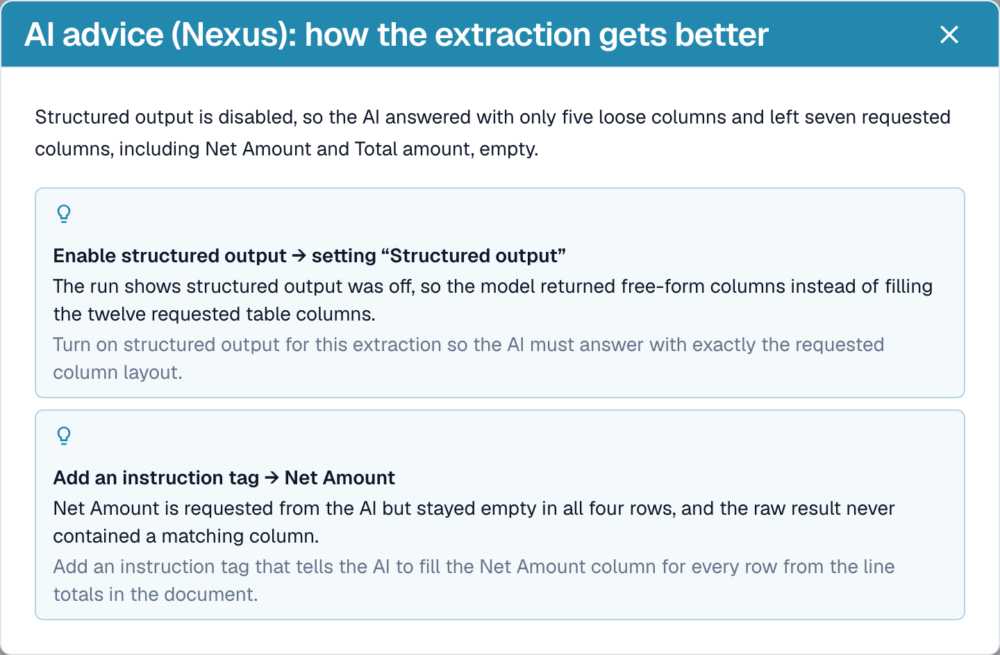
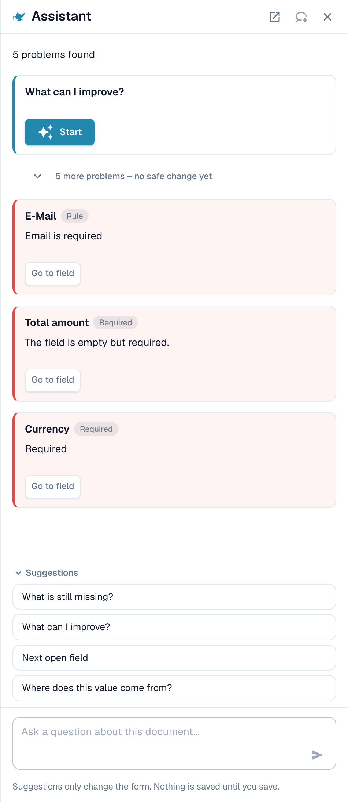
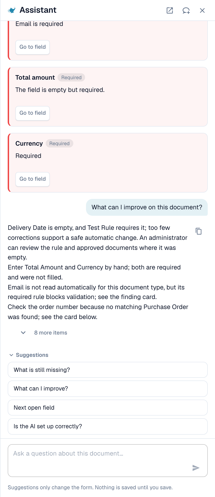

# AI 表格

**AI 提取表格**是 DocBits 在供应商没有经过训练的表格规则时使用 AI 读取的行项目表。它显示在验证界面中，位于抬头字段下方。本页介绍表格周围的各项控件：如何修正错误列、如何向 AI 提供指令、如何在保留更改前进行测试、如何查看 AI 的处理结果、Assistant 能为你做什么和不能做什么，以及谁有权保存哪些内容。

## 视频系列

面向日常用户的短视频。按顺序观看，也可以直接跳到需要的内容。

### 1. 阅读 AI 表格



了解验证界面中的内容，以及各个图标、列和按钮的用途。时长约 1.5 分钟。

### 2. 修正列并教会 DocBits



了解如何选择正确的列、向 AI 提供指令、测试更改，并将其保留以用于后续发票。时长约 1.7 分钟。

### 3. 三种常见问题



一个列填入了三个字段、单价错误，以及运费和附加费出现了额外行。了解会看到什么、该写什么以及如何检查。时长约 1.7 分钟。

### 4. 折扣、税费和数量为零的行



了解加拿大和英国发票中缺失的折扣和税费，以及未发货的行。时长约 1.4 分钟。

### 5. AI 已能正确读取的内容



了解 DocBits 无需帮助即可正确读取的五种特殊发票版式，以及首先该做什么。

### 6. Assistant 以及谁可以更改什么



了解 Assistant 如何帮助处理 AI 表格、如何提出改进建议，以及哪些内容只能由管理员更改。

## 何时会显示 AI 表格

* 管理员已启用 **AI Table extraction**（设置 → 文档处理 → 分类和提取，参见[管理员设置](./#settings-for-admins)）。如果未启用，表格区域会显示 _AI Table will display here. Enable in …_。
* 供应商**没有已保存的规则**。一旦有人训练了该供应商的表格并保存规则，已保存的规则就会替代该供应商的 AI 表格。此后，行会显示在 **Extracted table** 选项卡中，而 **AI Extracted table** 选项卡会变灰，并显示工具提示 _Table AI Deactivated: A custom-trained table is in use._。
* 例外：在表格列设置中标记为 **Use AI** 的列，即使供应商已有已保存的规则，也会由 AI 填充，参见[按列使用 AI](./#use-ai-per-column)。

读取表格的 AI 层级（Fast、Full、Nexus）按组织设置，也可以按供应商覆盖，参见[供应商专属 AI 模型](../validation-screen/supplier-specific-ai-model-for-field-and-table-extraction.md)。

## AI 表格概览

<figure><figcaption>
两个选项卡、AI Extracted table 及其列标题。
</figcaption></figure>

* **选项卡。** _AI Extracted table_ 显示 AI 读取的内容。_Extracted table_ 是根据已训练规则生成的传统表格。文档包含 AI 表格时，默认打开 AI 选项卡。
* **列标题。** 每列都显示名称、一个小型**来源**符号（将鼠标悬停在其上，可查看 _AI · mapping_、_AI · synonym_ 等信息，了解 AI 如何匹配该列）、一个**三点**菜单，以及映射列对应的**名称按钮**，点击后可以更改列的对应关系。
* **行按钮。** 行首的 **x** 可以删除该行。右键单击某行，可选择 _Select as additional cost_ / _Remove as additional cost_。
* **页脚工具栏。** 屏幕底部的图标可以添加或隐藏列和行，参见[页脚工具栏](./#footer-toolbar)。
* 表格下方的 **AI instructions** 卡片：提示、额外列、**Test change**、**Apply**、**Save as training**、**Delete**、**Export**，参见[向 AI 提供指令](./#give-the-ai-instructions)。


只有在你可以编辑文档时，列控件才可用。如果这些控件显示为灰色，说明文档为只读状态，或已在其他会话中锁定。如果红色横幅显示文档已由你自己的用户在其他会话中锁定，**Unlock** 会接管该锁定。


## 更改列

### 选择正确的列（重新映射）

如果某个值位于错误的列中，可以使用此功能。例如，净额出现在 _Total amount_ 中，或者发票中有数量，但 _Quantity_ 为空。

1. 点击标题中的**列名称**。
2. 选择值实际所属的已配置表格列。

<figure><figcaption>
点击列名称，然后选择它应该对应的列。列表会显示所有已配置的表格列。
</figcaption></figure>

DocBits 会立即重新排列表格，此更改仅适用于当前文档。如果所选列已被另一列使用，对话框 _Remap "…"?_ 会警告另一列将变为未映射状态。确认后即可继续；另一列随后会显示错误图标 _Select a column to map from dropdown_，你可以为其选择对应的列。

### 三点菜单

<figure><figcaption>
列的三点菜单。
</figcaption></figure>

| 条目 | 功能 |
| --------------------- | ------------------------------------------------------------------------------------------------------------------------------------------------------------------------------------------------------------------- |
| **Delete column**     | 隐藏该列。确认提示会显示 _Modifications will be discarded_；选择 **Done**。系统会在删除该列后重新生成表格。使用页脚工具栏中的 **Restore Table Column** 可恢复隐藏的列。 |
| **Disable column**    | 对于你自行添加的列：隐藏该列，但不重新运行 AI。 |
| **Amount Formatting** | 仅适用于金额列。选择数字的读取方式（小数分隔符和千位分隔符）。**Auto** 由 DocBits 自动判断。 |
| **Extract From**      | 指示 AI 从列标签的**上方**或**下方**一行提取值。如果值位于通常的位置，请留空。 |

### 页脚工具栏 

<figure><figcaption>
验证界面页脚中的表格图标，从左到右排列。
</figcaption></figure>

| 图标（工具提示） | 功能 |
| --------------------------------------------------------- | ------------------------------------------------------------------------------------------------------------------------------------------------------------------------------------------------------------- |
| **Go to table extraction view**                           | 打开传统表格训练。如果文档包含 AI 表格，DocBits 会发出警告：_Table is already extracted by AI. Do you want to train manually? In future AI table will not extracted for this supplier_。 |
| **Add empty mapped columns**                              | 打开 **Columns settings**，以添加 AI 未填充的已配置列，方便你手动输入值。 |
| **Show non mapped columns**（显示未映射列）/ **Hide non mapped columns**（隐藏未映射列） | 显示或隐藏 AI 返回但未映射到已配置列的列。默认情况下，这些列处于隐藏状态。此操作只会更改当前文档的视图。 |
| **Block table extraction for this supplier**（禁止对此供应商执行表格提取）              | 关闭该供应商的表格提取。 |
| **Delete table**                                          | 清空编辑器中的表格。 |
| **Add new table column**（添加新的表格列）                                  | 添加自定义列。仅限管理员使用。 |
| **Add new table row**                                     | 添加空行。 |
| **Ignore table validation**                               | 忽略当前文档的表格验证。 |
| **Restore Table Column**                                  | 恢复所有已删除的列。 |

<figure><figcaption>
Columns settings：使用箭头按钮将列从 <em>Available columns</em> 移至 <em>Columns in table</em>，然后选择 <strong>Done</strong>。
</figcaption></figure>

## 向 AI 提供指令 

表格下方的 **AI instructions** 卡片用于告诉 AI 应如何调整处理方式。卡片包含两个输入框和四个常用按钮。

<figure><figcaption>
AI instructions 卡片。
</figcaption></figure>

* **Prompt for the AI.** 用通俗语言逐行写入指令。输入 **@** 可插入列名称，让 AI 明确你指的是哪一列。
* **Extra columns for the AI.** 选择 AI 除常规列外还必须返回的列。
* **训练状态。** 如果最近一次运行使用了已保存的训练，状态标签会显示 **Training applied**；否则显示 **No training applied**。

<figure><figcaption>
在提示中输入 <strong>@</strong> 可选择列。只要内容发生更改，<strong>Test change</strong> 就会显示在 <strong>Apply</strong> 旁边。
</figcaption></figure>


更改提示会让 AI 重新读取表格，并且可能影响所有列，而不只是你想修改的那一列。之后请检查整个表格。


### 使用 Nexus 提供建议

不确定该写什么？点击 **Suggest with Nexus**。DocBits 会分析当前文档的提取结果，并提出指令或额外列建议。只有点击 **Insert**（将内容添加到提示中）或 **Add column** 后，更改才会应用。

<figure><figcaption>
Nexus 提供的建议。<strong>Insert</strong> 会将建议复制到提示中。
</figcaption></figure>

如果你的组织已关闭 AI 顾问功能，DocBits 会告知你，而不是提供建议。

### 测试、应用和保存：各按钮的功能

| 按钮 | 会发生什么 | 是否保存供后续文档使用？ |
| ------------------------------------------- | ------------------------------------------------------------------------------------------------------------------------------------------------------------------------------------------------- | ------------------------------ |
| **Test change**                             | 运行你的更改并显示对比结果。**不会写入任何内容**，既不会写入文档，也不会保存为规则。 | 否 |
| **Apply**                                   | 根据你的更改重新读取表格，并将结果放入编辑器中的当前文档。只有保存文档后，更改才会生效。 | 否 |
| **Save as training**（保存为训练样本；工具提示 _Save Rules_） | 保存当前供应商版式的提示、额外列、列映射、隐藏列、金额格式和 **Extract From** 设置。之后，该版式的新文档会采用相同方式读取。 | 是 |
| **Delete**（工具提示 _Delete Rules_）         | 删除当前供应商版式已保存的表格规则，无需额外确认，然后在不使用这些规则的情况下重新运行 AI。它也会删除为同一版式保存的传统表格训练。 | 删除这些规则 |
| **Export**                                  | 将表格下载为 CSV 文件。 | 否 |


标题重新映射、**Delete column**、**Amount Formatting**、**Extract From** 和 **Restore Table Column** 的行为与 **Apply** 相同：它们会立即为当前文档重新生成表格，并随文档一起保存，而不会保存为规则。只有 **Save as training** 才会训练 DocBits 以处理后续文档。


如果文档中的行已与采购订单匹配，点击 Apply 和 Save 时会收到警告：**你可能会丢失 PO 关联**。选择 **Done** 继续，然后重新进行匹配。

<figure><figcaption>
<strong>Test change</strong> 对话框会将新结果与当前显示的表格进行对比。
</figcaption></figure>

**Test change** 对话框会统计可能发生的更改：已更改单元格、新增列、缺失列和重新分配的列。每个单元格都会标记为 **Added**、**Changed**、**Missing**、**Reassigned** 或 **Unchanged**。对话框底部会列出此次运行的依据：_Effective hints_、_Selected training_、_Column policy_ 和 _Request overrides used_。选择 **Apply result to this document** 以应用结果（然后保存文档），或选择 **Discard** 放弃结果。如果测试后更改了提示，测试结果会标记为过期，你必须重新测试。

点击 **Save as training** 后，DocBits 会告知你该训练将在下次重新处理时使用；当前这次运行尚未使用该训练。请在该供应商的下一个文档中检查状态标签是否显示 **Training applied**。

## 查看 AI 的处理结果

表格下方的四个按钮用于说明提取结果。

<figure><figcaption>
说明按钮。
</figcaption></figure>

* **Explain extraction** 会打开 _How the AI table arrived at its values_，其中包含文档、AI 提取信息（层级、原始列数和行数）、与当前结构的映射，以及各列的结果和来源。
* **Open as page** 会在单独的窗口中显示相同的说明。
* **Processing pipeline** 会列出文档的处理步骤，以及处理在哪一步停止。
* **AI advice** 会询问 Nexus 如何改进提取结果，并列出具体建议，例如 _Enable structured output_ 或 _Add an instruction tag for Net Amount_。这些只是建议，由你决定是否采纳。

<figure><figcaption>
Explain extraction：从文档到结果的四个步骤。
</figcaption></figure>

<figure><figcaption>
AI advice 会提出后续步骤建议。
</figcaption></figure>

<figure><figcaption>
Processing pipeline 会显示文档在哪一步停止；此处显示文档停在字段验证阶段。
</figcaption></figure>

这些说明属于 **Analytics Dashboard** 模块。如果没有该模块的许可证，或者你的角色无权访问 Analytics 选项卡，DocBits 会告知你需要向管理员提出什么请求（在设置 → 模块中启用该模块，或在设置 → 角色中为你的角色授予该选项卡的访问权限）。

## 实际示例

| 情况 | 处理方法 |
| ----------------------------------------------------------------------------- | ----------------------------------------------------------------------------------------------------------------------------------------------------------------------------------- |
| 值位于错误的列中，例如 _Unit price_ 出现在 _Net amount_ 中 | 点击列名称并将其映射到正确的列。如果该供应商的发票总是采用这种格式，请点击 **Save as training**。 |
| 每一行的某列都为空，例如 _Discount_ | 在 **Extra columns for the AI** 中添加该列，或者根据发票上的用词编写指令，例如 _Fill the Discount Amount column from the column called "Rabatt" on the invoice._ 使用 **Test change** 检查，然后点击 **Apply**。 |
| AI 不知道该怎么做（提示中没有任何内容） | 点击 **Suggest with Nexus**，然后插入合适的建议。 |
| 价格需要进行除法计算或舍入 | 在提示中写入规则，例如 _The unit price is the net amount divided by the quantity_。 |
| 金额使用了错误的分隔符（1.234,50 与 1,234.50） | 打开该列的三点菜单，选择 **Amount Formatting**，然后选择正确的格式。 |
| 标签位于值的下方 | 三点菜单 → **Extract From** → **Below**。 |
| 该供应商不需要某列 | 三点菜单 → **Delete column**。点击 **Save as training** 可将该列保持隐藏状态，供该供应商后续使用。 |
| 某一行错误或缺失 | 使用 **x** 删除该行，或使用 **Add new table row** 添加一行并输入值。 |
| 需要反复进行相同的修正 | 使用 **Save as training**，让该供应商的后续文档正确读取。对于复杂版式，请改为[训练表格](../../../administration-and-setup/setup/document-training/training-line-fields-table-training/)。 |


并非每种换行的描述都能通过指令修复。如果同一项目的多行内容被拆分到多个行中，请编辑这些行，或使用传统表格训练。


## Assistant 与 AI 表格

在验证界面中，点击 **Assistant**（Save 旁边的灯泡图标），即可询问有关文档的问题。

<figure><figcaption>
Assistant 会列出尚未解决的问题，并提供可询问的问题。
</figcaption></figure>

**Assistant 可以为表格执行的操作。** 它可以带你定位到某个表格单元格；如果你有权编辑文档，还可以设置单元格的值或添加表格行。这些操作适用于 AI Extracted table 和 Extracted table。你还可以询问 _What is still missing?_ 和 _What can I improve?_ 等问题。

<figure><figcaption>
询问 <em>What can I improve?</em>，即可获取简短的待修正事项列表。
</figcaption></figure>

**Assistant 不能执行的操作。** Assistant **不会**更改 AI 指令、额外列、列映射或训练。如需执行这些操作，请使用 **AI instructions** 卡片（**Suggest with Nexus**、**Test change**、**Apply**、**Save as training**）。管理员可以询问 _Is the AI set up correctly?_，以查看设置建议，例如如何将 AI 表格读取与已保存的表格规则结合使用。

### 向管理员提出规则建议

许多问题来自**字段**而非表格：始终必填但为空的电子邮件、格式错误的日期，或需要查找的供应商 ID。对于这些问题，任何可以打开文档的人都可以通过 Assistant 发送建议：

1. 询问 _What can I improve?_，或在 Assistant 中打开一张发现卡片。
2. 如果你是管理员，卡片会显示 **Apply**。如果你不是管理员，卡片会显示 _An administrator can review this proposal._，并提供 **Suggest improvement**。点击该按钮。
3. DocBits 会显示 _Your suggestion was sent to the administrators._。如果之前已有人发送相同建议，你的请求会计入该建议，而不会创建重复建议。
4. 随后，卡片会显示 **Requested**，之后状态会变为 **Implemented** 或 **Declined**（如果管理员填写了原因，也会显示原因）。

建议可以是**转换规则**、**验证规则**或**查找规则**。你可以从文档中发送建议；服务器会根据发现的问题自行生成规则草稿，因此你无需编写任何内容。每位用户每小时最多可发送 20 条建议。


你不能通过此方式建议**AI 表格指令、列映射或训练**。如果表格需要修正，请在文档中进行修改并告知管理员，或请管理员在该供应商的某份文档上点击 **Save as training**。管理员可以保存规则；参见[谁可以执行哪些操作](./#who-can-do-what)。


**管理员看到的内容。** 管理员会收到任务和电子邮件通知。他们可以打开 **Touchless Intelligence**，在 **Open improvements** 下找到建议（_Open_ 选项卡显示待处理建议，_History_ 选项卡显示历史记录）。点击建议后，会打开 _Improvement suggestion_ 侧边栏，其中包含示例文档和预览。管理员可以选择 **Approve** 或 **Reject**。批准时，**Switch on right away** 用于决定是否立即启用新规则；如果未启用该选项，规则会以未启用状态创建，管理员需要在规则列表中将其启用。拒绝时，管理员必须填写原因，也可以附上给请求者的备注。参见 [Touchless Intelligence](../../../administration-and-setup/analytics-dashboard/touchless-intelligence/)。

<figure><figcaption>
管理员可以在 **Open improvements** 下找到建议。
</figcaption></figure>

## 谁可以执行哪些操作 

| 操作 | 权限 |
| ----------------------------------------------------------------------------------------------------------------- | ------------------------------------------------------------------------------------------------------------------------------------------------------------------------------- |
| 重新映射列、**Delete column**、**Amount Formatting**、**Extract From**、**Test change**、**Apply**、编辑行 | 所有可以编辑文档的用户 |
| **Save as training** | 所有可以编辑文档的用户均可使用，但组织设置 **Save extraction rules (Admin only)** 开启时除外。开启后，只有组织管理员可以保存规则；其他用户会收到错误消息。 |
| **Add new table column**（添加新的表格列） | 管理员 |
| 通过 Assistant 提出规则建议 | 所有可以打开文档的用户 |
| 批准或拒绝建议 | 管理员 |
| **Explain extraction**、**AI advice** | 其角色有权访问 Analytics Dashboard 模块的用户 |

## 管理员设置 

打开 **设置 → 文档处理 → 文档类型 → 分类和提取**，选择 **General** 选项卡中的 **Extraction** 部分。

<figure><figcaption>
用于决定是否启用 AI 表格的开关。
</figcaption></figure>

* **Table Extraction** 用于启用传统表格。
* **AI Table extraction** 用于为组织启用或关闭 AI 表格。
* **Use Structured Extraction (AI)**：AI 会按照固定结构返回表格，直接映射到已配置的列，而不是复制供应商的标题。列名称会始终与配置一致；供应商打印的列如果尚未配置，则不会提取。
* **Save extraction rules (Admin only)**：开启后，只有组织管理员可以保存和导出提取规则。

<figure><figcaption>
<strong>Save extraction rules (Admin only)</strong> 用于控制谁可以使用 <strong>Save as training</strong>。
</figcaption></figure>

### 按列使用 AI 

每个表格列都有一个 **Use AI** 标志（设置 → 全局设置 → 文档类型 → [表格列](../../../administration-and-setup/settings/global-settings/document-types/table-columns/)）。启用该标志后，即使供应商已有已保存的规则，AI 也会填充该列；其余列仍使用规则中的结果。典型用例：使用经过训练的规则仍难以正确提取的自由文本描述列。

随后，AI 会根据整行内容推测该列的值。如果该列持续出现错误值，例如行总额被填入 _Charges_，请关闭该列的 **Use AI**，或添加指令，告诉 AI 该列代表什么内容。

## 相关页面

* [AI 表格标签和指令](ai-table-tags.md)
* [训练行字段 / 表格训练](../../../administration-and-setup/setup/document-training/training-line-fields-table-training/)
* [供应商专属 AI 模型](../validation-screen/supplier-specific-ai-model-for-field-and-table-extraction.md)
* [使用了哪种提取路径？](../../../overview-and-basics/faq/document-processing/which-extraction-path-was-used.md)
* [Touchless Intelligence](../../../administration-and-setup/analytics-dashboard/touchless-intelligence/)
