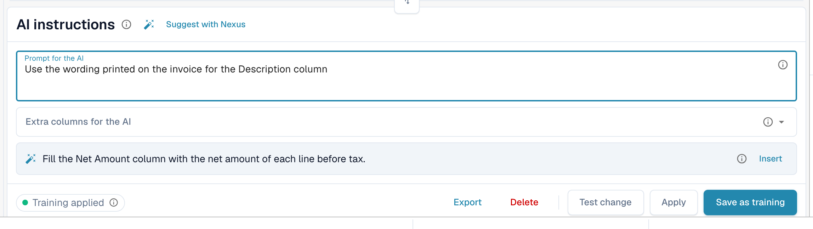

# AI 表格标签和指令

标签用于告诉 AI 如何处理表格。在 AI 表格下方的 **AI instructions** 卡片中（参见 [AI 表格](README.md)），可以使用两种标签：

| 类型 | 输入位置 | AI 会执行的操作 |
| --- | --- | --- |
| **指令** | **Prompt for the AI**，每行一条指令 | 阅读表格时遵循指令，例如说明如何计算或使用哪种措辞。 |
| **列** | **Extra columns for the AI** | 除通常返回的列外，还必须返回该列，即使文档中没有清楚地标出该列。 |

点击 **Save as training** 后，这两种标签会一并保存为该供应商的 AI 标签。

<figure><figcaption>
在 <strong>Prompt for the AI</strong> 中每行输入一条指令。
</figcaption></figure>

## 逐步添加标签

1. 在验证界面打开文档，并停留在 **AI Extracted table** 标签页。
2. 在 **Prompt for the AI** 中填写 AI 应执行的操作，每行一条指令。输入 **@** 可插入配置中的列。
3. 或打开 **Extra columns for the AI**，选择 AI 必须返回的列。
4. 不确定该写什么？点击 **Suggest with Nexus**，然后对建议使用 **Insert** 或 **Add column**。
5. 点击 **Test change**，将结果与当前表格进行比较。此时不会写入任何内容。
6. 满意后，点击 **Apply**（或在测试对话框中点击 **Apply result to this document**），将结果应用到此文档。
7. 如果该供应商的每份文档都需要这些标签，请点击 **Save as training**。**Delete** 会删除该供应商布局中已保存的标签和规则。


**Prompt for the AI** 中的每一行都是一条指令，即使只有一个词也一样（DocBits 会添加句号，避免 AI 将其误认为列名）。列应添加到 **Extra columns for the AI** 中。


## 编写有效指令

* **指出列名和文档中的措辞。** *从名为“Rabatt”的列中填入 Discount Amount 列。* 比 *查找折扣* 更有效。
* **每行只写一件事。** 短句更容易测试和删除。
* **清楚描述计算方式。** *单价等于净额除以数量。*
* **说明哪些内容应保持不变。** *忽略表格底部的运费行。*
* **检查整个表格。** 修改提示会让 AI 重新运行，并可能更改所有列。
* **不要重复已有信息。** 与其他标签重复的列标签，或与表头字段相同的列标签，会被忽略。

## 示例

| 问题 | 标签 |
| --- | --- |
| 折扣列为空 | 添加列 **Discount Amount**，并使用指令 *从名为“Rabatt”的列中填入 Discount Amount 列。* |
| 数量和单位在同一个单元格中 | *将数字填入 Quantity，将计量单位填入 Unit。* |
| 未打印单价 | *单价等于净额除以数量。* |
| 日期必须采用 ISO 格式 | *将所有日期写为 YYYY-MM-DD。* |
| 金额使用外币 | *将所有金额四舍五入到两位小数。* |

可供选择的列是为该文档类型配置的表格列，详见 [表格列](../../../administration-and-setup/settings/global-settings/document-types/table-columns/README.md)。

## 保存前

* 请先点击 **Test change**。该操作不会写入任何内容。
* **Save as training** 会应用于该供应商的布局，因此后续文档将使用这些标签进行读取。请在下一份文档中确认标记显示 **Training applied**。
* 如果启用了 **Save extraction rules (Admin only)**，请让组织管理员保存。
* 标签会改变 AI 读取表格的方式。若要让重复布局的列位置保持稳定，请改为[训练表格](../../../administration-and-setup/setup/document-training/training-line-fields-table-training/README.md)。
