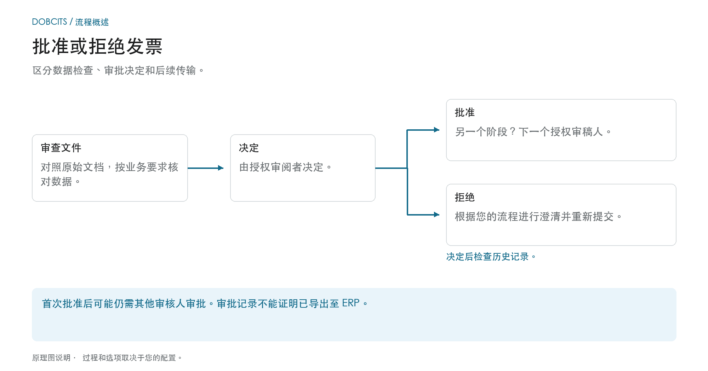
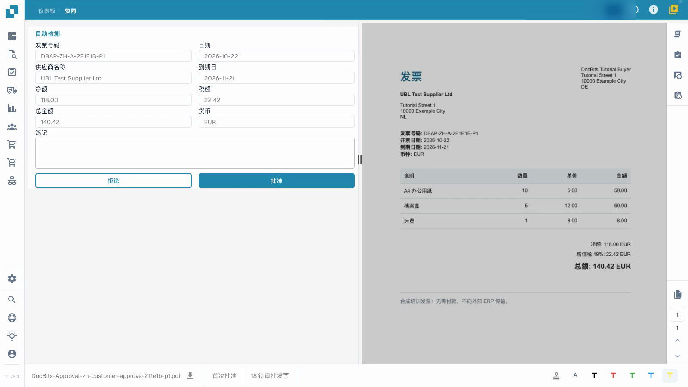
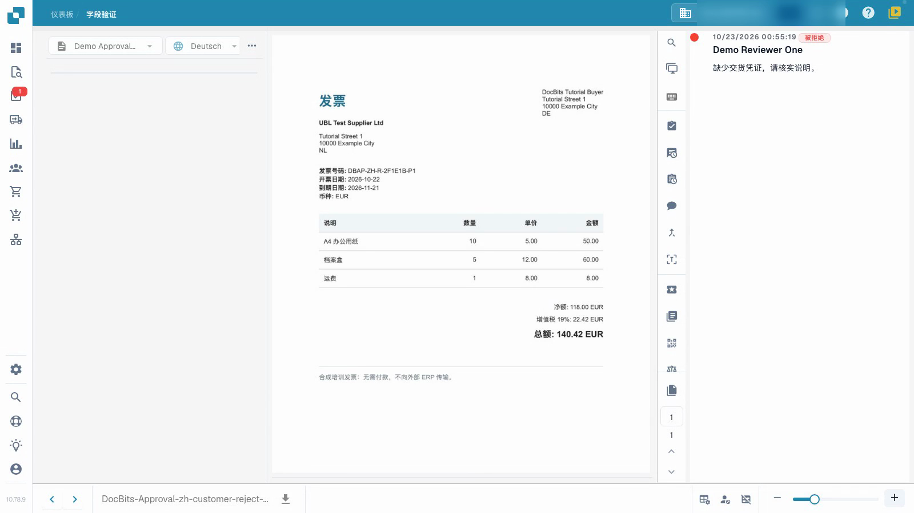

# 批准或拒绝发票

## 业务批准决定之后会发生什么

<figure><figcaption>
区分数据检查、审批决定和后续传输。 该图是示意性的；您组织的活动设置决定了实际行为。
</figcaption></figure>

技术验证检查文件数据；批准记录了授权审核者的业务决策。即使一张技术上有效的发票可能仍需要一个或多个批准。

1. **检查责任：** 打开分配的发票并检查您可以决定哪个审批级别。
2. **查看发票：** 将标题值、行项目和税费与原始单据和您公司的要求进行比较。
3. **文件决定：** 批准正确的发票或以特定原因拒绝它。等待回复，然后查看批准历史记录。
4. **确定下一步：** 如果配置了其他审批阶段，发票将等待他们的决定。拒绝后，请按照您配置的流程进行澄清、更正和重新提交。单独的导出过程确定数据是否已到达目标系统。

### 三种说法并不代表同一件事

| 声明 | 它不会自动证明什么 |
| --- | --- |
| **数据已验证。** | 授权的业务审查员已批准它。 |
| **审稿人批准了。** | 所有必需的批准阶段均已完成。 |
| **审批已完成。** | 发票已导出或过帐到 ERP。 |

使用 [记录任务](tasks.md) 处理分配的工作，使用 [文件状态](dashboard/document-status.md) 对当前状态进行分类。

此视频从审核员的角度展示了审批流程。


批准或拒绝发票


[观看带字幕的视频](https://docbits-videos.fra1.cdn.digitaloceanspaces.com/settings-assistant/invoice-approval-customer/v1/zh.html)

显示的是实际应用程序；选项的措辞可能取决于部署的版本。

使用审批功能记录您对已验证发票的业务决定。您需要访问该文档并拥有其当前审批阶段的权限。视频使用普通审核账号。

## 审核并决定

1. 打开分配给您的发票并检查当前的审批阶段。
2. 将发票号码、供应商、日期和总额与原件进行比较。同时检查明细行和税额。技术验证不能取代您的业务审核。
3. 填写清晰的审核备注。批准正确的发票，或在需要澄清时填写具体原因后拒绝发票。等待操作完成。
4. 重新打开文档并检查其审批历史记录。确认审核人员、操作时间、决定和完整备注均已正确保存。

<figure><figcaption>
填写的发票表单与原件的比较。
</figcaption></figure>

<figure><figcaption>
已保存的拒绝结果及其原因。
</figcaption></figure>

## 检查下一阶段

当配置了二次审批时，您的首次审批会使发票等待另一位授权审核员。它尚未完全获得批准。被拒绝的发票需要进行业务核实；更正和重新提交遵循您配置的流程。

审批历史记录条目并不能证明数据已到达ERP系统。在这个独立的测试示例中，数据读取通道没有外部ERP目标。当显示技术状态 `pending_data_fetch` 时，表示文档正在等待数据读取。

## 相关页面

- [验证屏幕](validation-screen/README.md)
- [文档任务](tasks.md)
