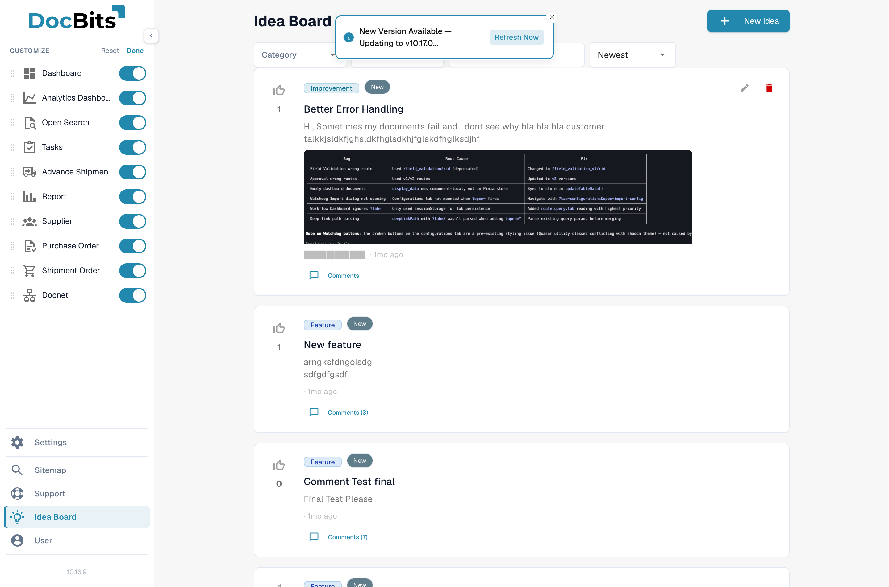

# 可自定义侧边栏

你可以重新排列侧边栏，让它符合自己的工作习惯。将项目拖到所需位置，隐藏不常用的条目，并将最常打开的条目固定在顶部。下次登录时，系统会保留你的布局。

## 如何访问

展开侧边栏（如果处于迷你模式，请点击顶部的切换按钮），滚动到底部，然后点击 **Customize**。侧边栏将进入编辑模式。

<figure><figcaption>
在编辑模式下，每个项目都会显示一个拖动手柄和一个可见性开关。
</figcaption></figure>

## 重新排列项目

在编辑模式下，每个条目都会显示一个拖动手柄（左侧的六点图标）。点击并拖动项目，将它移到新位置。其他项目会滑动以腾出空间。松开鼠标即可放置。

项目顺序仅对当前用户生效。组织中的其他人会看到各自的排序。

## 隐藏项目

每个条目右侧都有一个可见性开关。关闭开关即可将该条目从侧边栏中隐藏。隐藏的条目在编辑模式下会显示为灰暗状态，方便你查看并在之后重新启用。

隐藏条目会将其从侧边栏中移除，但仍可通过[全局快速搜索](global-quick-search.md)、[站点地图](sitemap.md)或直接 URL 访问对应页面。

## 固定到顶部

部分条目可以固定。无论拖放排序中的位置如何，已固定的项目始终显示在侧边栏顶部。你可以将每天多次使用的一两个界面固定在这里。

## 保存和重置

* **Done** — 退出编辑模式，并应用新的排序、可见性设置和固定项目。
* **Reset** — 清除所有自定义设置，并恢复默认侧边栏。

按下 **Done** 后，系统会自动保存你的偏好设置。这些设置会在不同会话间保留。

## 新功能

在未来版本中，DocBits 添加新功能时，该功能会以默认可见状态出现在侧边栏末尾。你可以在编辑模式下重新排列或隐藏它，让侧边栏符合你的日常工作习惯。

<mark>你无权使用的功能不会显示在自定义列表中，因此无法意外取消隐藏角色权限不允许你打开的内容。</mark>
