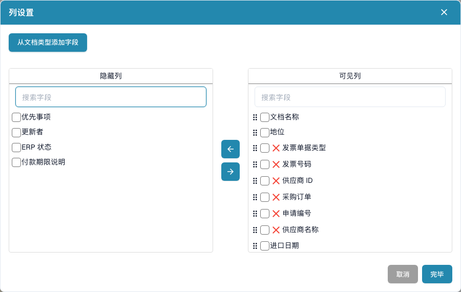

# 更改文档列

1. 打开搜索框旁的齿轮菜单。
2. 打开列设置。
3. 在隐藏列或可见列列表中搜索。选择列后，用箭头在两个列表之间移动。
4. 拖动可见列的手柄调整顺序。
5. 如需添加文档类型字段，请选择文档类型及所需字段。
6. 选择**完毕**应用配置。

如果正在使用自己保存的仪表板，请在请求表格导出前保存视图更改。导出的列来自已保存视图。关闭或取消对话框可放弃更改。可用列取决于文档类型和组织配置。

<figure><figcaption>
在列设置中选择并排列文档表格显示的信息。
</figcaption></figure>
