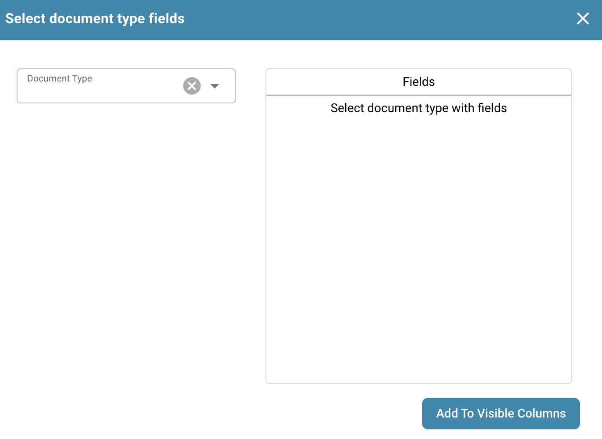
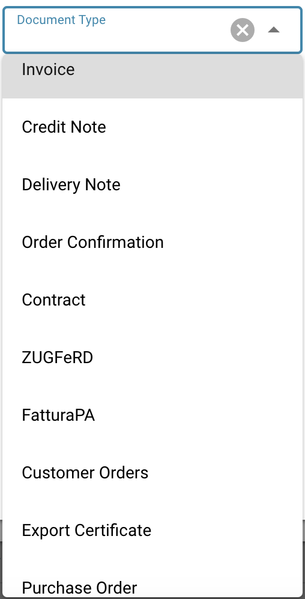

# 更改文档列

**在仪表板中，点击下方所示的高级设置图标：**

<figure><figcaption></figcaption></figure>

随后将显示以下菜单：

选择标有“Set dashboard columns for organization”（为组织设置仪表板列）的按钮，即可显示所有列名。

在此菜单中，你可以选择列名，并使用箭头添加或移除所需的列。

<figure><figcaption></figcaption></figure>

点击列名旁边的圆点并将其拖动到适当位置，即可设置列的顺序。

你还可以添加文档类型的字段：

<figure><figcaption></figcaption></figure>

<figure><figcaption>
选择文档类型字段窗口
</figcaption></figure>

在这里，你可以从不同的文档类型中进行选择：

<figure><figcaption></figcaption></figure>

每种文档类型都包含可供添加的不同字段：

<figure><figcaption>
选择文档类型字段窗口
</figcaption></figure>

选择所需字段并点击“Add to visible Columns”（添加到可见列），这些字段随后会显示在列设置中。

<figure><figcaption></figcaption></figure>
