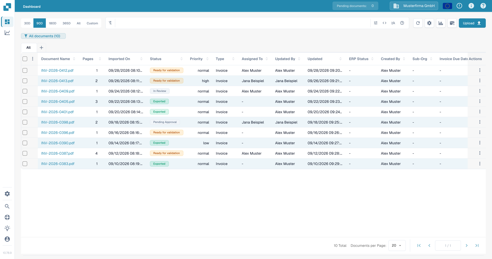
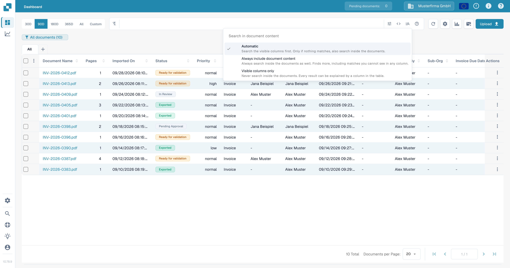
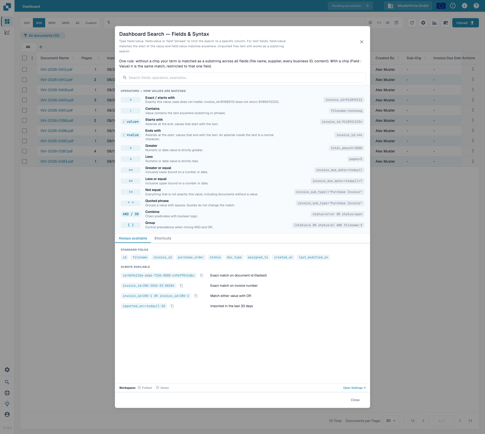
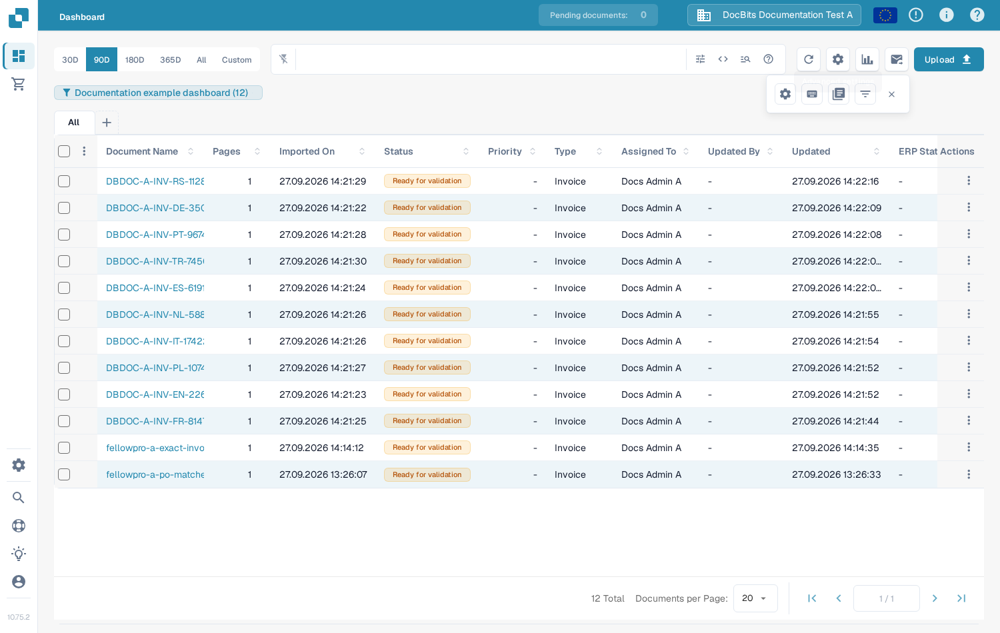
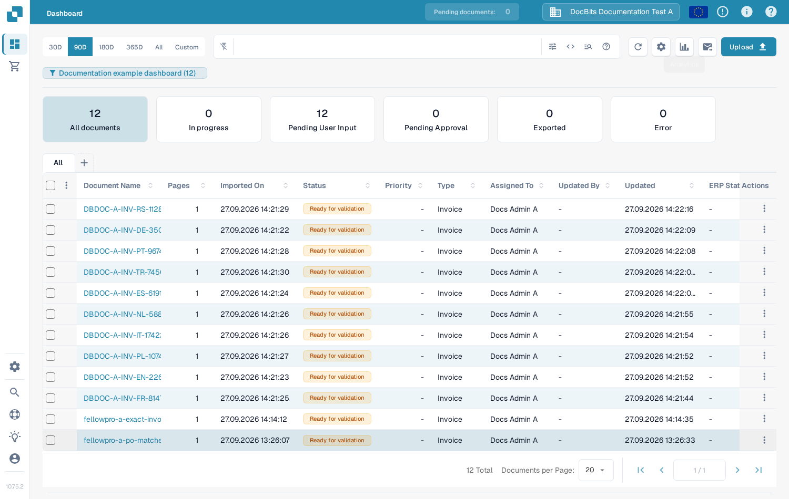
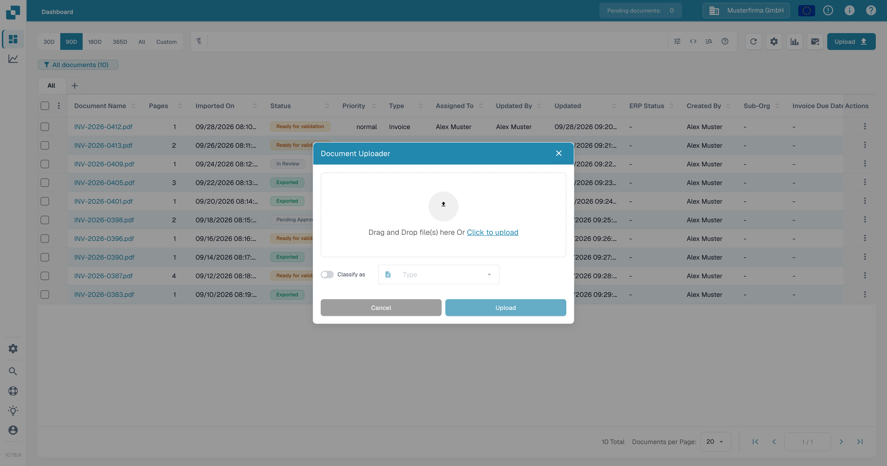
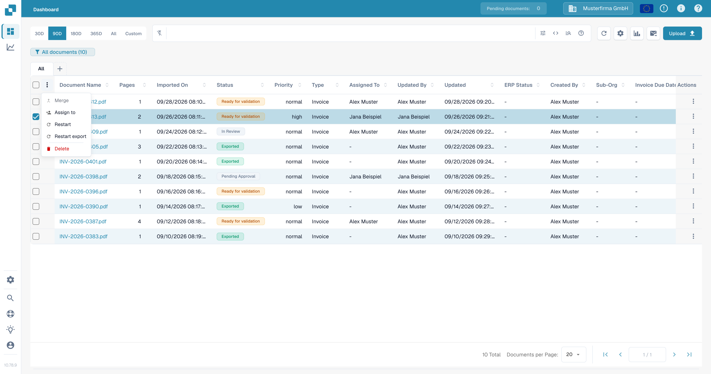
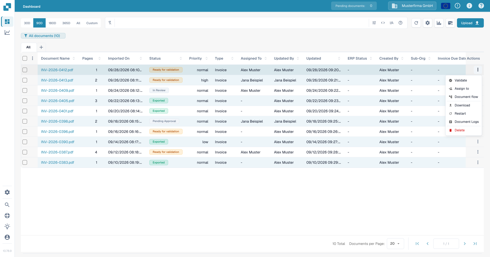

# 仪表板工具

仪表板是您的文档列表。选择文档名称即可打开文档。表格上方的控件可帮助您查找文档、更改显示内容以及上传新文件。某些控件取决于组织设置和您的权限，因此您的仪表板显示的按钮可能少于下方示例。

<figure><figcaption>
英文测试组织中的仪表板。
</figcaption></figure>

## 查找文档

1. 在左侧选择日期范围：**30D**、**90D**、**180D**、**365D**、**All** 或 **Custom**。日期控件可用时，此选项会限制显示的文档。
2. 在搜索栏中输入文档名称或 ID。搜索也支持按字段查询。选择搜索栏旁边的 **?**，查看示例和可用运算符。
3. 选择搜索栏内的滑块图标，按 **Status**、**Assigned To** 或 **Restart Required** 缩小列表范围，然后选择 **Apply**。使用 **Clear filters** 移除这些筛选条件。
4. 选择列标题可对表格排序。使用底部的页面控件在结果页之间切换，或更改 **Documents per Page**。

搜索字段开头的图标会打开可用字段选择器，并显示您所在组织支持的搜索功能。**code** 图标可在常规搜索视图和原始查询视图之间切换；除非您已了解查询语法，否则请使用常规视图。放大镜图标会打开 **Search in document content**：**Automatic** 首先搜索可见字段，**Always include document content** 会搜索文件内部的文本，而 **Visible columns only** 会将匹配范围限制为表格字段。要搜索文件内部内容，必须为您的组织启用相应的搜索功能。

<figure><figcaption>
搜索栏内的筛选条件。
</figcaption></figure>

<figure><figcaption>
选择普通搜索可以匹配的内容。
</figcaption></figure>

如需逐步了解搜索，请参阅[快速搜索](quick-search.md)和[筛选文档](filtering-documents.md)。**?** 面板会说明高级搜索语法；简单地按名称搜索时无需使用该语法。

<figure><figcaption>
仪表板中的搜索帮助。
</figcaption></figure>

## 刷新和自定义视图

* 选择表格上方的圆形箭头可重新加载文档列表。此操作不会重新启动文档处理。
* 选择齿轮图标可打开 **Advanced settings**。在此可以打开键盘快捷键、查看电子邮件导入日志或管理表格中显示的列。管理员还可能会看到仪表板设置链接。后续操作请参阅[键盘快捷键](keyboard-shortcuts.md)和[更改文档列](change-document-columns.md)。
* 选择柱状图可在表格上方显示 **Analytics**。选择一个类别卡片（例如 **Pending User Input**）可筛选文档。再次选择图表可隐藏这些卡片。
* 选择搜索栏下方已保存的仪表板徽标，可切换或管理您自己的仪表板。请参阅[个人仪表板](personal-dashboards.md)。
* 选择 **All** 选项卡旁边的 **+**，可添加文档类型选项卡。在测试组织中，可用的类型为 **Invoice**。选择选项卡可显示该类型的文档。

<figure><figcaption>
打开齿轮菜单，查看仪表板选项。
</figcaption></figure>

<figure><figcaption>
文档列表上方的 Analytics 卡片。
</figcaption></figure>

## 上传文档

选择 **Upload**。将文件拖入 **Document Uploader**，或选择 **Click to upload** 从您的电脑中选择文件。如果您知道文档类型，请开启 **Classify as** 并选择类型；否则请保持关闭，由系统自动分类。选择 **Upload** 提交文件。后续处理情况请参阅[已上传文档概览](overview-of-uploaded-documents.md)。

<figure><figcaption>
当前的上传对话框。
</figcaption></figure>

## 批量处理文档

选中要操作的文档旁边的复选框，然后打开表格标题栏中的三点菜单。根据文档和您的权限，菜单中会提供 **Merge**、**Assign to**、**Restart**、**Restart export** 和 **Delete**。选择操作前请检查已选中的行；**Delete** 会删除文档。要合并文件，请按照[文档合并](document-merging.md)中的说明操作。

<figure><figcaption>
表格选择复选框旁边的批量操作。
</figcaption></figure>

对于单个文档，请打开其所在行末尾的三点菜单。根据文档和您的权限，菜单中会提供 **Validate**、**Assign to**、**Document flow**、**Download**、**Restart**、**Document Logs** 和 **Delete** 等操作。**Validate** 会打开文档以供审核；**Document flow** 会显示文档的处理历史；**Restart** 会重新开始处理；**Delete** 会删除文档。更改正在处理的文档前，请参阅[文档流](document-flow.md)和[文档状态](document-status.md)。

<figure><figcaption>
单个文档的操作。
</figcaption></figure>

## 您所在组织可能显示的其他按钮

* 信封按钮会使用组织现有的电子邮件导入配置开始导入。若不确定邮箱是否已配置，请咨询管理员；选择此按钮会立即开始导入。
* 只有在启用了文档扫描且扫描仪可用时，才会显示 **Scan document**。
* 只有在启用了仪表板导出时，才会显示 **Export this table**。其菜单提供 CSV 和 Excel 文件。导出的内容为表格当前显示的文档。

可用按钮可能会因屏幕宽度而异。在较窄的屏幕上，打开 **More** 可找到一些在桌面屏幕上单独显示的操作。
