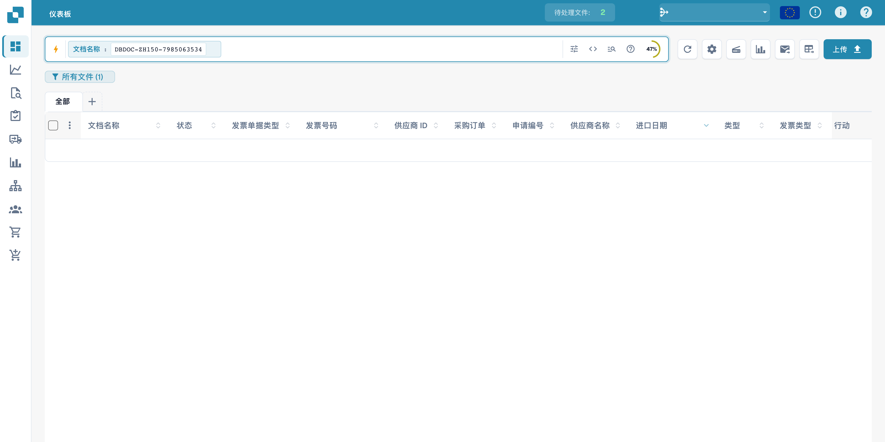
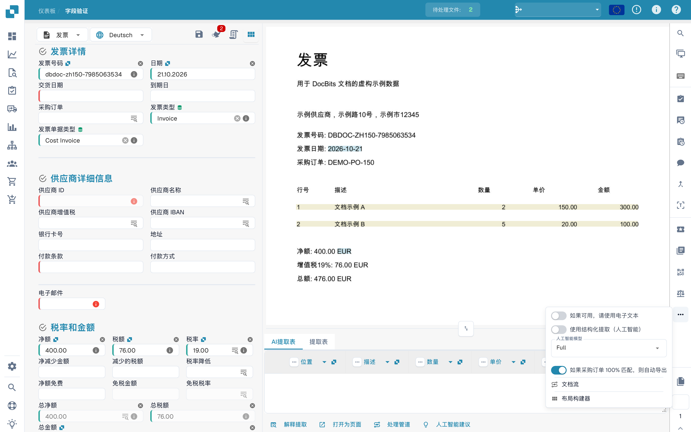
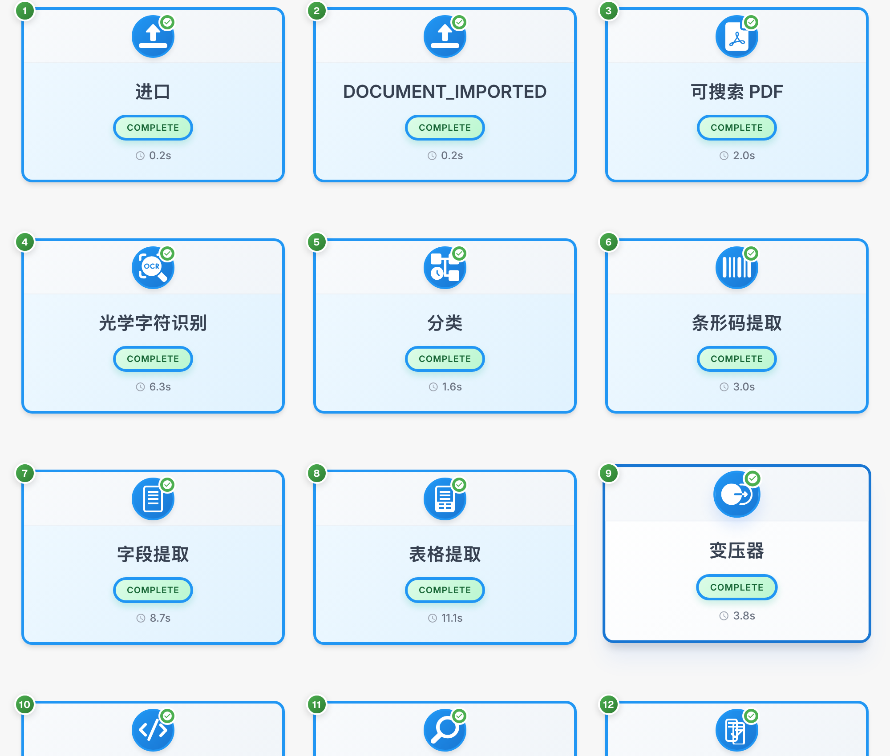

# 文档流程

文档流程展示处理阶段的顺序、状态和耗时。示例使用虚构发票。

## 打开流程

在仪表盘中找到文档。文档数据已隐藏。

<figure><figcaption>
在仪表盘中查找虚构文档；文档数据已隐藏。
</figcaption></figure>

打开字段验证，再从右侧工具栏的选项菜单进入文档流程。

<figure><figcaption>
用于打开文档流程的验证菜单。
</figcaption></figure>

## 查看阶段

每张卡片代表一个阶段，例如导入、OCR、分类或字段提取。按编号查看顺序。

<figure><figcaption>
虚构发票的处理阶段；技术代码保持不变。 “变压器”在此指数据转换阶段；部分技术阶段和状态名称仍为英文。
</figcaption></figure>

技术代码 DOCUMENT_IMPORTED 和 COMPLETE 保持不变。COMPLETE 表示该阶段已完成。

## 查看详情

选择卡片，检查可用详情和日志。

| 详情 | 含义 |
| --- | --- |
| 模块 | 处理该阶段的组件 |
| 状态 | 当前阶段状态 |
| 耗时 | 已记录的处理时间 |
| 日志 | 可用技术消息 |

重新启动前，先检查阶段消息和文档状态。

阶段详情显示处理组件、状态、耗时以及可用的技术日志。
