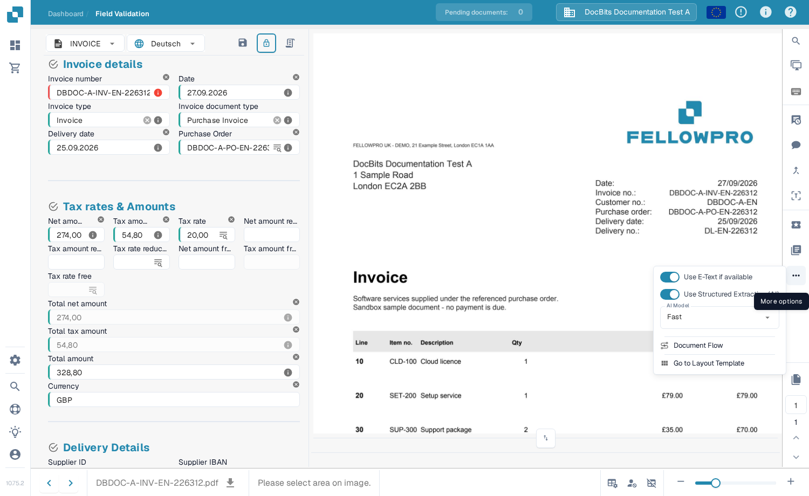

# 文档流

**文档流**显示单个文档的处理步骤。您可以用它查看哪些步骤已完成、哪个步骤正在等待，以及处理耗时。以下示例使用英文 Sandbox 中的一张合成发票。

## 从仪表板打开

在**仪表板**上找到该文档。在其**操作**列中，选择三个点，然后选择**文档流**。此选项会打开该文档的流程视图；不会更改文档。

<figure><figcaption>从文档的“操作”菜单中选择“文档流”。</figcaption></figure>

## 从字段验证打开

打开该文档。在**字段验证**中，选择右侧操作栏中的三个点，然后在**更多选项**下选择**文档流**。

<figure><figcaption>也可以从文档视图打开相同的流程。</figcaption></figure>

## 阅读流程

左侧的**流程统计**汇总了步骤总数、已完成和正在等待的步骤数、重新启动次数、总耗时、当前状态和整体进度。每张编号卡片都显示一个处理步骤及其当前状态。向下滚动可查看后续步骤。

<figure><figcaption>合成发票流程中的前几个步骤。</figcaption></figure>

<figure><figcaption>向下滚动可查看后续步骤的顺序。</figcaption></figure>

选择某张步骤卡片，可在左侧打开**步骤详情**。其中会显示模块及其状态。右侧也可能打开**任务日志**面板；日志详情取决于该任务可用的信息。选择“步骤详情”中的**×**可关闭面板。

<figure><figcaption>“步骤详情”会说明所选模块的状态。</figcaption></figure>
