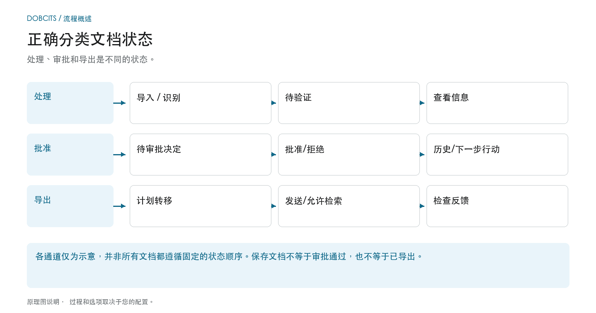
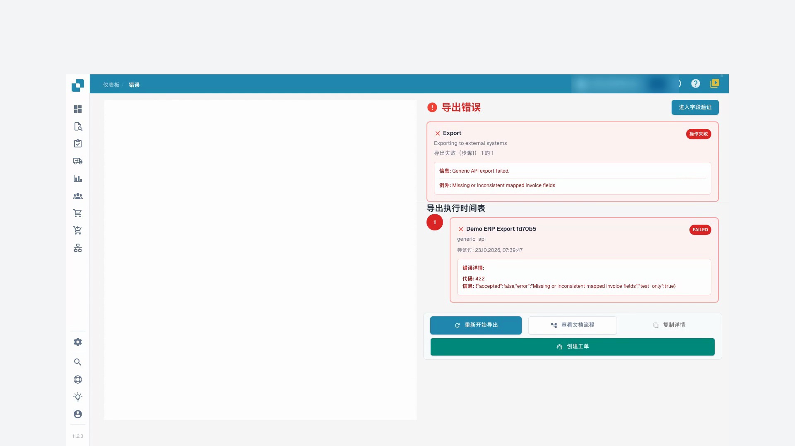
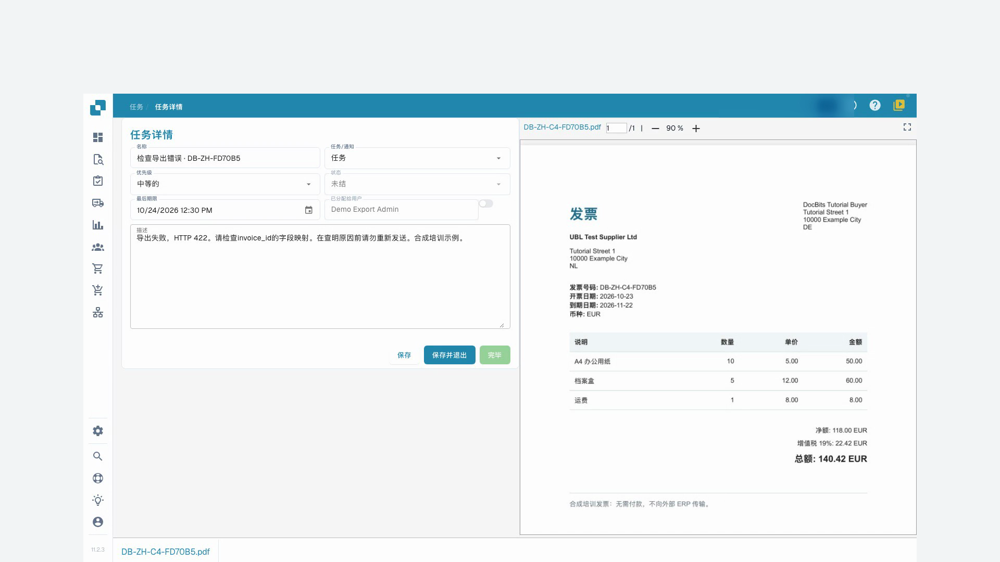

# 文档状态

## 三个状态问题而不是单个状态链

<figure><figcaption>
处理、审批和导出是不同的状态。 该图是示意性的；您组织的活动设置决定了实际行为。
</figcaption></figure>

即使认可已完成，文件仍可能等待业务批准决定。阅读处理步骤和审批流程上下文中显示的状态。

| 问题 | 含义 | 下一步 |
| --- | --- | --- |
| **处理完成了吗？** | OCR，分类和提取准备文档以供审查。 “准备好验证”并不是商业批准。 | 打开文档，将信息与原始信息进行比较并编辑必填字段错误。 |
| **业务审批决定是否已完成？** | 批准可以有多个级别。初始批准不会自动完成所有阶段。 | 检查当前级别、负责的审阅者和批准历史记录。 |
| **文件已转移吗？** | 导出状态和反馈描述了技术移交。储值或批准条目不能证明 ERP 处理。 | 阅读导出详细信息，如有必要，在目标系统中重现该过程。 |

该图将这些问题分为三个轨道。它不是技术状态代码的详尽列表，也没有建立通用顺序。实际的转换取决于文档类型、工作流程和导出路径。

### 如果发生错误，请从受影响的步骤开始

打开错误状态并阅读消息。如果缺少所需值，请对照原始值进行检查并更正。如果收件人报告导出错误，请先解决其原因，然后重试。使用 [文件流程](document-flow.md) 进行处理步骤，使用 [批准](../approve-or-reject-invoices.md) 指南进行业务审批决策。

处理状态表示 OCR、分类或导出等步骤。**准备验证**表示文档可供检查；审批状态表示仍有审批步骤待完成；**已导出**表示文档导出已完成。点击**错误**状态可查看可用的错误详情。

如果存在处理耗时数据，将鼠标悬停在状态上可查看各阶段及其耗时。存在疑似重复文档时会显示重复图标，点击该图标可比较相关文档。

打开文档行后，即可在验证界面中处理文档。行操作菜单提供您有权执行的操作，例如分配、下载、查看历史记录或重新启动处理。下载选项取决于文档，可能包括带批注的版本或电子发票格式。

使用复选框选择多个文档，然后打开表头中的菜单，执行允许的批量操作，例如分配、合并、重新启动、重新导出或删除。请仔细检查所选文档和每次确认。这些操作可能更改文档；保存视图只会更改工作列表的显示方式。

搜索、文档操作和已保存视图的说明请参阅[仪表板指南](README.md)。

## 视频教程: 处理受阻发票


处理受阻发票


[查看带字幕和章节的视频](https://docbits-videos.fra1.cdn.digitaloceanspaces.com/settings-assistant/blocked-invoices-customer/v1/zh.html)

部分产品原生标签可能仍为其他语言。技术字段标识符保持不变。

我在字段验证中打开这张发票。在这个例子中，发票号码缺失了。其他数值已经填好。在修改任何内容之前，我会将它们与原件进行核对。

现在我输入发票号码并离开该字段。然后，我保存发票。我等待系统反馈并重新加载单据。这样我就能看出修改是否真的生效了。

重新打开后，号码依然存在。必填字段错误已解决。不过，保存并不意味着发票已获批或已导出到ERP系统。

对于第二张发票，列表显示了一个导出错误。我打开状态并阅读详情。测试接收端拒绝了提交的数据，错误代码为422。这里需要检查技术映射。我不会盲目地多次重启导出。

<figure><figcaption>
导出错误与接收方响应
</figcaption></figure>

通过单据上的任务功能，我向我们的测试管理员创建一个明确的交接任务。我提到了错误代码，并请求在映射中检查发票号码。在本次培训中，邮件发送功能保持关闭。

重新加载后，我检查任务是否已保存并分配给了正确的人。在查明原因之前，任务会保持开启状态。创建任务本身并不等于导出成功。

<figure><figcaption>
已保存并分配给管理员的交接任务
</figcaption></figure>
