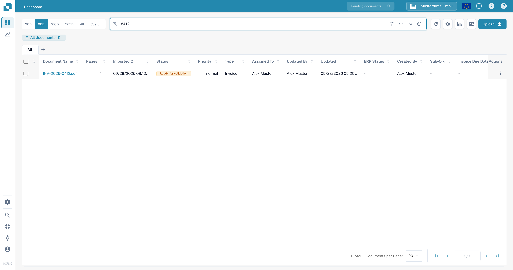
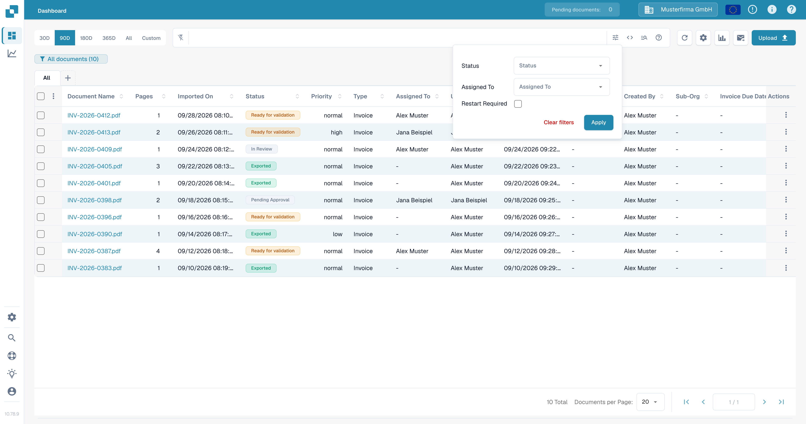
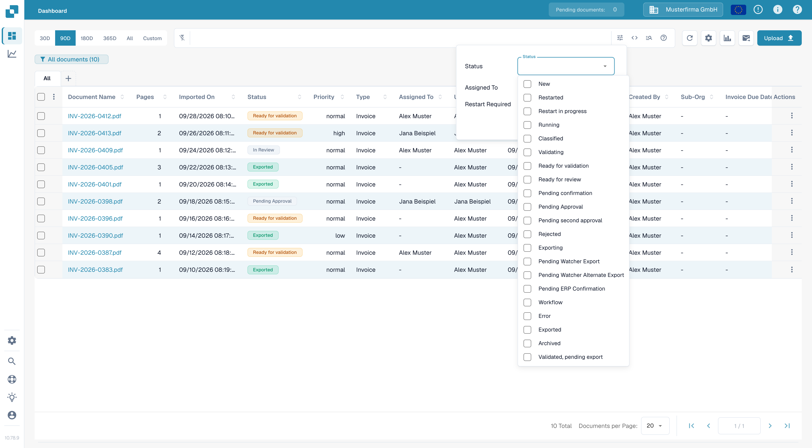
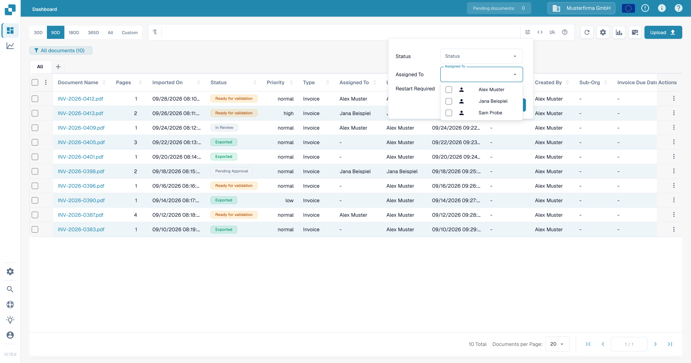
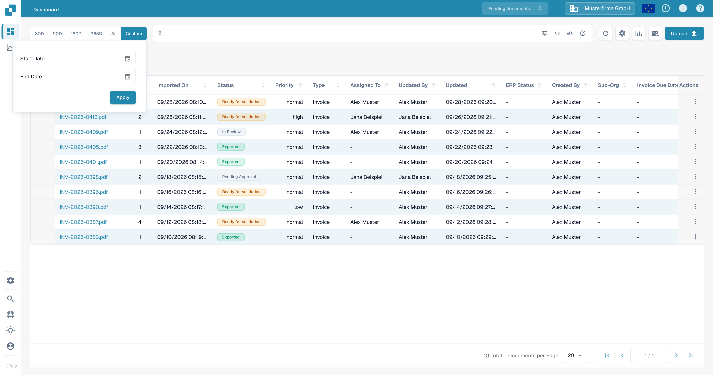
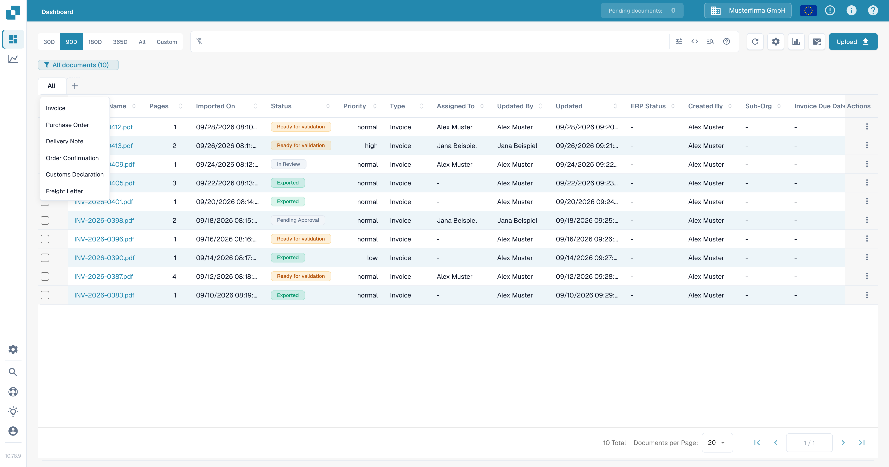
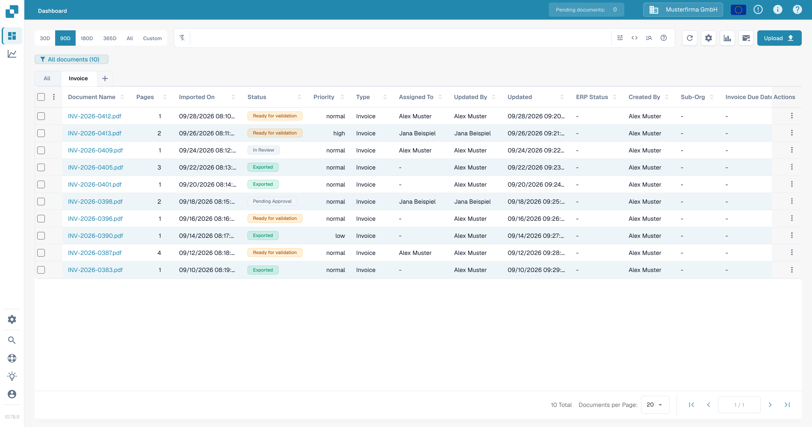

# 筛选文档

使用仪表板搜索栏、筛选面板、日期范围和文档类型选项卡缩小文档列表范围。这些控件会共同生效：文档必须符合当前搜索条件和筛选条件，才会保留在表格中。

## 按名称查找文档

1. 打开 **Dashboard**。
2. 在表格上方的搜索栏中输入部分文档名称，然后按 **Enter**。仪表板徽标中的数量和表格会更新，显示匹配的文档。
3. 想查找其他文档时，请替换搜索词。有关字段搜索和搜索语法，请参阅 [快速搜索](quick-search.md)。

<figure><figcaption>按文档名称搜索可缩小测试文档列表的范围。</figcaption></figure>

## 按状态、受托人或重启要求筛选

1. 选择搜索栏最右侧的 **Filters** 图标（滑块）。
2. 选择一个或多个 **Status** 值。可以同时选择多个状态。
3. 在 **Assigned To** 中，选择要查看其文档的用户。如果组织启用了组权限，组也会显示在此列表中。此面板中没有单独的 **Assigned to Group** 字段。
4. 选择 **Restart Required**，以显示需要重启的文档。
5. 选择 **Apply**。在此面板中选择 **Clear filters** 可移除这些选择；搜索文本和日期范围是单独的控件。

<figure><figcaption>当前筛选面板包含三个条件和两个操作。</figcaption></figure>

<figure><figcaption>选择所需的处理状态。</figcaption></figure>

<figure><figcaption>在 Assigned To 中选择用户。</figcaption></figure>

有关各处理状态含义的说明，请参阅 [文档状态](document-status.md)。

## 选择导入日期范围

在搜索栏上方，选择 **30D**、**90D**、**180D**、**365D** 或 **All**，以更改导入日期范围。要指定范围，请选择 **Custom**，然后选择 **Start Date** 和 **End Date**，再选择 **Apply**。当前选项会高亮显示。

<figure><figcaption>预设日期范围不适用时，请使用 Custom。</figcaption></figure>

## 使用文档类型选项卡

1. 选择 **All** 旁边的 **+**。菜单会列出组织可用的文档类型。
2. 选择一种类型（例如 **Invoice**）以添加对应选项卡。然后选择新选项卡，将表格筛选为该类型。选择 **All** 可取消类型限制，但不会删除该选项卡。
3. 要移除类型选项卡，请选择其 **×**。**All** 选项卡不能移除。

<figure><figcaption>从加号菜单添加文档类型选项卡。</figcaption></figure>

<figure><figcaption>选择选项卡以应用类型筛选；选择 × 可移除选项卡。</figcaption></figure>

如果 **+** 菜单中没有任何类型，请联系管理员检查组织启用了哪些文档类型。请参阅 [文档类型](../../../administration-and-setup/settings/global-settings/document-types/README.md)。如需保存一组筛选条件以便稍后使用，请参阅 [个人仪表板](personal-dashboards.md)。
