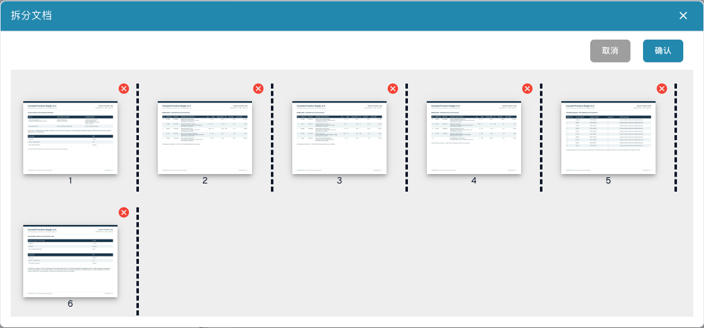

# 拆分 PDF 并调整页面顺序

<figure><figcaption>
提交拆分前的页面缩略图、分隔点和移除控件。
</figcaption></figure>

当一个 PDF 包含多个独立业务单据时，使用手动拆分。例如：第 1–3 页为发票 A，第 4–7 页为发票 B，第 8–10 页为送货单。各单据应分别继续处理。

## 准备工作

需要单据编辑权限和多页文件。保留原始文件；如有单据锁定，先与负责人协调，不要直接覆盖他人的工作。

## 操作步骤

1. 从仪表板打开单据，逐页检查原件。
2. 在文档查看器的更多选项中选择拆分文档。
3. 检查带页码的缩略图，在每份单据最后一页后设置分隔点。本例为第 **3** 页和第 **7** 页之后。
4. 如顺序错误，拖动缩略图调整，再次检查顺序和分隔点。
5. 仅在确实应排除某页时点击该页的**红色叉号**。空白分隔页可能不需要保留，但税额明细和附件可能必不可少。
6. 点击**确认**，阅读确认提示，分组正确后再继续。**取消**会退出而不提交拆分。
7. 返回仪表板，分别打开生成的单据，检查首页、末页、页数、文档类型和提取值，再继续验证或审批。

## 验证结果与排查问题

每个原始页面都应属于预定单据，或被明确排除。拆分成功不代表提取、审批或 ERP 导出已成功。

如果没有拆分选项，检查页数、权限、锁定和状态。没有选择分隔、重新排序或移除页面时，系统可能提示没有更改。发生错误后先检查仪表板，确认实际结果，再决定是否重试，避免重复执行结果不明的操作。

另见[合并文档](document-merging.md)。自动按条形码拆分在[分类与提取](../../../administration-and-setup/settings/document-processing/classification-and-extraction/README.md)中配置。
