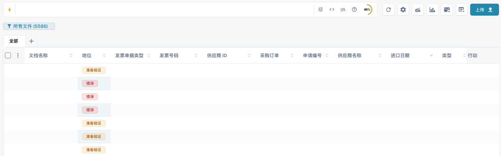

# 已上传文档概览

仪表板是您在 DocBits 中的日常工作列表。您可以查找已导入的文档、查看状态、打开文档进行验证，并与团队协作处理工作。

<figure><figcaption>
当前仪表板包含搜索、工具、已保存视图、文档类型和文档表格。为保护数据，文档中的具体值已隐藏。
</figcaption></figure>

每一行代表一个文档。根据列配置，您可以看到名称、状态、文档类型、发票数据、供应商、分配对象、日期和金额。点击支持排序的列标题可更改排序。水平滚动可查看其他列；使用分页控件和每页文档数量浏览更多结果。

如果提供分组功能，请在表格上方选择分组字段。对于日期字段，可按日、周或月分组。展开分组可查看其中的文档；取消分组可返回普通文档列表。

点击文档类型选项卡旁的 **+** 可显示其他类型。拖动选项卡可更改顺序。移除选项卡只会更改视图，不会删除文档。

打开齿轮菜单，再打开列设置。在隐藏列和可见列列表之间移动列，并拖动可见列调整顺序。您也可以添加某种文档类型的字段。请参阅[更改文档列](change-document-columns.md)。

搜索、文档操作和已保存视图的说明请参阅[仪表板指南](README.md)。
