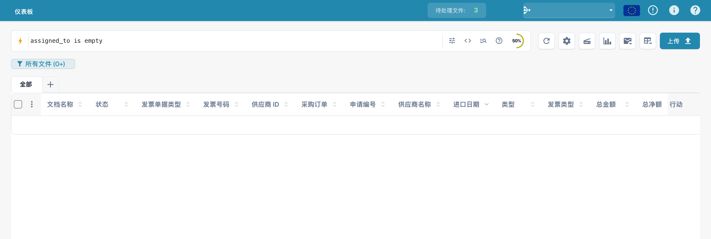
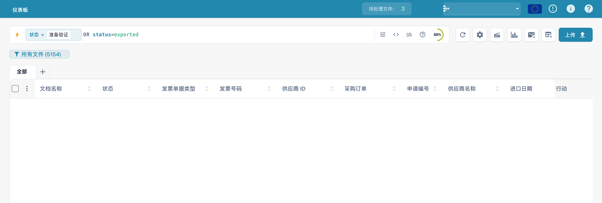

# 快速搜索

**快速搜索**是在仪表板上查找文档的最快方式。输入要查找的内容——名称、状态、金额、日期——文档列表就会立即筛选。

本指南按照搜索功能的构成来介绍：

1. **标准字段** — 每个文档都具有的列（文档名称、状态、日期）。始终可用。
2. **全文字段** — 提取的内容（供应商、采购订单、发票编号、金额、行项目）。启用全文搜索后可用。
3. **运算符、快捷方式和示例** — 熟悉搜索后可查阅的完整参考。

> 您无需记住任何内容：点击搜索栏，从列表中选择字段和值，快速搜索会为您构建查询。下面的示例也展示了可直接复制的输入形式。

<figure><figcaption><p>中文仪表盘中的快速搜索。</p></figcaption></figure>

---

## 搜索栏的工作方式 — 条件标签、工具栏和原始视图

在了解字段之前，先熟悉搜索栏的布局会更容易。

### 条件会变成标签

完成一个条件（字段、运算符和值）后，快速搜索会将其转换为一个**条件标签**——搜索栏中的彩色圆角标签——并开始创建下一个条件。标签会显示**字段**、**运算符**和**值**，并带有用于移除标签的 **×**。标签颜色表示数据所在的位置：

| 标签颜色 | 字段类型 |
|-------------|------------|
| **蓝色** | 标准列（文档名称、状态、日期） |
| **橙色** | 全文／提取字段（供应商、金额、发票编号） |
| **紫色** | 向量（语义）搜索 |
| **绿色** | OCR 文本搜索 |

点击标签可编辑它（标签会展开为文本）；点击 **×** 可删除它。默认情况下，多个标签组合后表示 **AND**。

### 工具栏

搜索栏右侧：

- **ⓘ 帮助** — 打开应用内的 **仪表板搜索 — 字段和语法**参考，其中列出了您工作区中可用的所有字段、运算符和快捷方式。
- **过滤器**（三个滑动条） — 打开常用筛选器快捷面板，其中包含**地位**、**已分配至**和**需要重新启动**，以及**清除筛选条件**和**申请**按钮。
- **索引环** — 显示全文索引构建进度的小环形图（仅在启用全文搜索时显示）。

### 标准视图与原始视图

搜索栏通常以标签的形式显示查询（**标准视图**）。切换到**原始视图**后，可以像编辑纯文本一样查看和编辑查询（例如 `status=ready_for_validation AND supplier_name=Test`）——适合复制、分享或直接输入较长的查询。切换视图时查询会保留，重新加载仪表板后也会记住查询。

---

## 第 1 部分 — 标准字段

标准字段是文档自身的列。无论是否启用全文搜索，它们都**始终可用**。

### 按名称查找文档

文档名称是最常用的搜索项。匹配方式有三种，且都**不区分大小写**：

#### `=` → 以……开头

```
filename=invoice
```

查找名称**以**“invoice”开头的文档。匹配时不区分大小写，因此以下名称都符合 `filename=invoice`：

```
Invoice.pdf   iNVoice.pdf   iNvoiCE.pdf   INVOICE.pdf
Invoice.xml   iNVoice.xml   iNvoiCE.edi   …
```

它**不会**匹配 `XYZ_Invoice.pdf`（其中“invoice”位于名称中间——请使用 `:`）。

<figure><figcaption><p>输入按文件名查询的条件。</p></figcaption></figure>

#### `:` → 包含（任意位置）

```
filename:invoice
```

使用 `:` 可匹配名称中**任意位置**的单词，例如 `2026_Invoice.pdf`、`vietnam_einvoice_sample.xml`、`scan_invoice_copy.pdf`。

<figure><figcaption><p>按文件名片段搜索：filename:invoice。</p></figcaption></figure>

#### `="…"` → 以……开头或结尾

```
filename="invoice"
```

引号会让 `=` 匹配**以**该值开头或结尾的名称——适用于搜索开头的代码或文件名后缀。

> **三种方式一目了然：** `=` → 以……开头 · `:` → 包含 · `="…"` → 以……开头或结尾。三者都不区分大小写。随时可以通过搜索栏中的**帮助图标**查看此摘要（见下一节）。

### 按状态查找文档

```
status=ready_for_validation
```

状态是一个固定列表，因此 `=` 表示**精确**匹配；输入 `status=` 时，搜索栏会提供值选择器。

<figure><figcaption><p>输入技术状态 ready_for_validation 筛选条件。</p></figcaption></figure>

### 按日期查找文档

```
created_on>2026-05-25
```

使用 `>`、`<`、`>=`、`<=` 指定日期范围。也可以使用**相对日期**：`today()`、`today()-7`（最近 7 天）、`today()+30`（未来 30 天）。

<figure><figcaption><p>查询 2026 年 5 月 25 日之后创建的文档。</p></figcaption></figure>

### 按发票子类型查找文档

```
invoice_sub_type="Cost Invoice"
```

发票子类型是一个固定列表（例如 **成本发票** 或 **采购发票**），因此 `=` 表示**精确**匹配；输入 `invoice_sub_type=` 时，搜索栏会提供值选择器。使用 `invoice_sub_type!="Cost Invoice"` 可查找该子类型以外的所有文档。

---

## 第 2 部分 — 全文字段

全文字段用于搜索文档的**提取内容**，例如供应商、采购订单、发票编号、金额和行项目。它们以**橙色**显示，并在您的组织**启用全文搜索**后可用。匹配规则与标准文本字段完全相同（`=` 表示以……开头，`:` 表示包含，`="…"` 表示以……开头或结尾）。

### 按供应商查找文档

```
supplier_name=Test
```

按提取出的供应商名称进行前缀匹配。使用 `supplier_name:Example` 匹配名称中的任意位置，或使用 `supplier_name:"Example"` 搜索带空格的值。

<figure><figcaption><p>供应商查询示例：supplier_name=Test。</p></figcaption></figure>

### 按采购订单查找文档

```
purchase_order=PO
```

按提取出的采购订单编号进行前缀匹配——非常适合搜索采购订单前缀。

<figure><figcaption><p>采购订单查询示例：purchase_order=PO。</p></figcaption></figure>

### 按金额查找文档

```
total_amount>5000
```

使用 `>`、`<`、`>=`、`<=`，或使用 `between 100 and 500` 指定范围。

<figure><figcaption><p>输入总金额大于 5000 的筛选条件。</p></figcaption></figure>

指定金额区间时，使用 `between`：

```
total_amount between 1000 and 5000
```

这是 `total_amount>=1000 AND total_amount<=5000` 的简写形式。

<figure><figcaption><p>输入金额在 1000 到 5000 之间的查询。</p></figcaption></figure>

### 查找缺失项

```
supplier_name=""
```

`=""` 表示“此字段**未设置**”；`supplier_name!=""` 表示“存在任意供应商”。

<figure><figcaption><p>输入供应商名称为空的筛选条件。</p></figcaption></figure>

同样的存在性检查适用于任何字段，例如查找仍缺少 AP 分配代码的文档：

```
ap_assignment_code=""
```

<figure><figcaption><p>搜索没有 AP 分配的文档。</p></figcaption></figure>

---

## 智能过滤器 — 一键应用

搜索框最左侧的**闪电**图标打开字段选择器。该选择器顶部就是**智能过滤器**：点击一次即可应用的预设搜索。每个过滤器都是您也可以自行输入的查询快捷方式：

| 智能过滤器 | 查找内容 | 等同于输入 |
|--------------|-------|----------------|
| ⚠️ **逾期** | 已超过到期日的项目 | `invoice_due_date<today()` |
| 🕐 **即将到来** | 未来 7 天内到期的项目 | `invoice_due_date<=today()+7` |
| 👤 **分配给我** | 等待您处理的项目 | `assigned_to=<you>` |
| 📅 **今日收件箱** | 今天导入的项目 | `imported_on>=today()` |
| 📋 **待验证** | 已准备好进行验证的项目 | `status=ready_for_validation` |
| 🧾 **电子文档** | 电子发票（XML、ZUGFeRD、EDI） | `is_edoc=true` |
| ✅ **完全匹配** | 与采购订单完全匹配 | `po_match_status=full_matched` |
| ➗ **部分 PO 匹配** | 与采购订单部分匹配 | `po_match_status=partial_matched` |
| 📉 **在 PO 匹配下** | 数量或单价低于采购订单 | `po_match_status=under_matched` |

这三种采购订单匹配过滤器以及全文字段都要求您的组织启用全文搜索。

<figure><figcaption><p>快速搜索的查询与筛选帮助。</p></figcaption></figure>

---

## 对结果分组

您可以按任意字段对结果进行**分组**，而不是显示为平铺列表，例如供应商、状态、文档类型、子组织或日期区间。在搜索栏中添加分组：

```
group by supplier_name
```

随后列表会显示可折叠的**分组标题**，每个标题包含组名和**数量**（例如 *Example (12)*）。点击标题可展开或折叠该组。对于日期字段，可以按**天、周或月**分组。

<figure><figcaption><p>输入按供应商分组的查询。</p></figcaption></figure>

分组可以与任意筛选器组合使用——`status=ready_for_validation group by
supplier_name` 会仅对匹配的文档分组。点击某个组可**深入查看**：系统会将该组的值作为筛选条件，并返回该筛选结果的平铺列表。

---

## 第 3 部分 — 运算符、连接符和快捷方式

### 内置帮助

搜索栏中的**帮助图标**会打开完整参考，其中列出您工作区中可用的所有字段、运算符和快捷方式，包括标准字段与全文字段的区别。

<figure><figcaption><p>内置的<strong>仪表板搜索 — 字段和语法</strong>帮助，其中列出了每个运算符及其值的匹配方式。</p></figcaption></figure>

### 按字段类型查看 `=` 的匹配方式

所有文本匹配都不区分大小写。

| 字段类型 | 示例 | `=` 表示 |
|------------|---------|-----------|
| 文本（名称、供应商、采购订单） | `filename=invoice` | **以……开头** |
| 文本，任意位置 | `filename:invoice` | **包含** |
| 文本，以……开头*或*结尾 | `filename="invoice"` | **以……开头或结尾** |
| 状态／类型／采购订单匹配（固定列表） | `status=finished` | **精确** |
| 标识符（发票编号、供应商 ID） | `invoice_number=INV-100` | **精确** |
| 数字 | `total_amount>5000` | 范围（`> < >= <= between`） |
| 日期 | `created_on>2026-01-01` | 范围 + `today()±N` |

### 运算符

| 运算符 | 含义 |
|----------|---------|
| `=` | 前缀匹配（文本）／精确匹配（列表、数字、日期） |
| `:` | 包含（文本，任意位置） |
| `="…"` | 前缀或后缀匹配（文本） |
| `!=` | 与 `=` 相反 |
| `>` `<` `>=` `<=` | 大于／小于 |
| `between … and …` | 闭区间 |
| `field=""` / `field!=""` | 为空／已设置 |
| `today()`、`today()-7`、`today()+30` | 相对日期 |

### 连接符

使用 **AND**（两项都为真）、**OR**（任一项为真）、**NOT** 以及用于分组的括号 `( … )` 组合条件：

```
status=ready_for_validation AND supplier_name=Test
(status=error OR status=failed) AND created_on>today()-1
```

<figure><figcaption><p>使用 AND 连接状态与供应商条件。</p></figcaption></figure>

### 查询示例

图片展示在中文界面中输入的查询。文档数据已隐藏。筛选栏图片并不证明精确的查询结果数量。

#### 文本比较运算符

```
created_on gt 2026-05-25
```

<figure><figcaption><p>日期查询中的 gt 比较运算符。</p></figcaption></figure>

#### 早于今天

```
created_on < today()
```

<figure><figcaption><p>将 created_on 与 today() 比较。</p></figcaption></figure>

#### 从创建日期开始

```
created_on >= 2026-06-01
```

<figure><figcaption><p>输入从 2026 年 6 月 1 日开始的创建日期条件。</p></figcaption></figure>

#### 未分配负责人

```
assigned_to is empty
```

<figure><figcaption><p>搜索尚未分配负责人的文档。</p></figcaption></figure>

#### 状态筛选

```
status=ready_for_validation
```

<figure><figcaption><p>快速搜索中的状态筛选示例。</p></figcaption></figure>

#### 日期范围之外

```
created_on not between 2026-06-01 and 2026-06-15
```

<figure><figcaption><p>输入日期范围之外的查询条件。</p></figcaption></figure>

#### 多个可选状态

```
status=ready_for_validation OR status=exported
```

<figure><figcaption><p>使用 OR 连接两个技术状态。</p></figcaption></figure>

#### 排除供应商条件

```
NOT supplier_name=Test
```

<figure><figcaption><p>使用 NOT 排除供应商条件。</p></figcaption></figure>

#### 文件名片段

```
filename:invoice
```

<figure><figcaption><p>在文件名中搜索关键词。</p></figcaption></figure>

#### 发票编号查询

```
invoice_number=INV
```

<figure><figcaption><p>使用 invoice_number 的查询示例。</p></figcaption></figure>

#### 空分配

```
assigned_to=""
```

<figure><figcaption><p>输入空分配条件：assigned_to=&quot;&quot;。</p></figcaption></figure>

#### 货币查询

```
currency=EUR
```

<figure><figcaption><p>输入货币筛选条件：currency=EUR。</p></figcaption></figure>

#### 到期日期早于今天

```
invoice_due_date<today()
```

<figure><figcaption><p>输入到期日期早于 today() 的条件。</p></figcaption></figure>

#### 金额阈值

```
total_amount>=1000
```

<figure><figcaption><p>输入总金额大于或等于 1000 的条件。</p></figcaption></figure>

## 包含文档内容

内容搜索菜单决定查询是否包含文档文本。此选项独立于技术前缀 vector:、ocr: 和 ai:。

### 自动

首先搜索可见列。如果没有匹配项，且组织具备所需功能，则包含文档内容。

<figure><figcaption><p>快速搜索自动包含文档内容。</p></figcaption></figure>

### 始终包含内容

明确包含文档内容。所需搜索功能必须可用。

<figure><figcaption><p>快速搜索始终包含文档内容。</p></figcaption></figure>

### 仅可见列

仅搜索仪表盘的可见列。

<figure><figcaption><p>搜索仅限可见列。</p></figcaption></figure>

### 快捷查询和结果示例

以下示例展示了每种快捷方式的输入查询，以及仪表板显示的结果。第一组使用标准字段，即使未启用全文搜索也可使用。第二组使用全文专用字段，例如金额或发票到期日。

#### 无需全文搜索

##### 运算符别名

- 查询：`created_on gt 2026-05-25`
- 等同于：`created_on>2026-05-25`
- 结果：按 2026 年 5 月 25 日之后创建进行筛选。

##### 直接使用日期词

- 查询：`created_on < today`
- 等同于：`created_on<today()`
- 结果：将直接使用的单词 today 展开为 today()。

##### 相对周期

- 查询：`created_on this_month`
- 等同于：`created_on>=first day of this month AND created_on<=last day of this month`
- 结果：将 this_month 展开为日期区间。

##### 表示为空或已设置的词

- 查询：`assigned_to is empty`
- 等同于：`assigned_to=""`
- 结果：查找没有受指派人的文档。

##### 友好状态

- 查询：`status:open`
- 等同于：`status=ready_for_validation`
- 结果：将 open 映射为验证状态。

##### 不在区间内

- 查询：`created_on not between 2026-06-01, 2026-06-15`
- 等同于：`(created_on<2026-06-01 OR created_on>2026-06-15)`
- 结果：查找不在日期区间内的值。

##### 列表中的任意值

- 查询：`status in (ready_for_validation, exported)`
- 等同于：`status=ready_for_validation OR status=exported`
- 结果：匹配列出的任意状态。

##### 否定前缀

- 查询：`not status=finished`
- 等同于：`status!=finished`
- 结果：反转 finished 状态谓词。

##### 字符串包含

- 查询：`filename contains E2E`
- 等同于：`filename:E2E`
- 结果：使用 contains 按文件名子字符串搜索。

##### 发票前缀

- 查询：`#INV-1234`
- 等同于：`invoice_id:INV-1234`
- 结果：将 #... 映射为发票 ID 搜索。

##### 受指派人前缀

- 查询：`@Daniel`
- 等同于：`assigned_to:"Daniel"`
- 结果：将 @... 映射为受指派人姓名搜索。

#### 需要全文搜索

如果同一快捷方式使用全文专用字段，查询仍然需要全文搜索。例如，`ap_assignment_code is empty` 使用的“为空／已设置”快捷方式与 `assigned_to is empty` 相同，但 AP 分配字段仅支持全文搜索。

##### 金额后缀

- 查询：`total_amount > 5k`
- 等同于：`total_amount>5000`
- 结果：在金额字段中将 k 展开为千。

##### 逾期快捷方式

- 查询：`overdue`
- 等同于：`invoice_due_date<today() AND status!=finished`
- 结果：查找已超过到期日且尚未完成的发票。

##### 金额前缀

- 查询：`$5000+`
- 等同于：`total_amount>=5000`
- 结果：将 $...+ 映射为金额阈值。

---

## 第 4 部分 — 高级搜索模式

除了字段搜索之外，还有三种前缀模式可直接搜索文档内容。

### 向量（语义）搜索 — `vector:`

按**含义**而非精确文本匹配——适用于“查找关于 XYZ 的文档”。需要 Vector 模块；搜索范围为文档内容。

```
vector: invoices about office supplies
vector: shipping delays with Hamburg port
```

### OCR 文本搜索 — `ocr:`

搜索 OCR 引擎提取的**页面文本**，而不仅仅是结构化列。当您记得的值位于文档正文中时，这种方式很有用。

```
ocr: Versandkosten
ocr: "purchase order PO-12345"
ocr: Hamburg AND doc_type=INVOICE
ocr: IBAN
```

### 自然语言（AI）搜索 — `ai:`

用通俗英语描述您要查找的内容；AI 会读取您的描述，并从中提取供应商、日期、金额等筛选条件，生成结构化查询。与向量搜索不同，它会**构建查询**，而不是查找相似文档。

```
ai: invoices from Ruiz over 1000 last quarter
ai: overdue invoices waiting on approval
ai: shipping documents from Hamburg last month
```

---

### 示例

| 您要查找…… | 输入内容 |
|-----------|-----------|
| 准备好进行验证且与采购订单完全匹配的文档 | `status=ready_for_validation AND po_match_status=full_matched` |
| 本周来自该供应商的文档 | `supplier_name=Test AND created_on>today()-7` |
| 高价值的逾期发票 | `total_amount>5000 AND invoice_due_date<today()` |
| 同时查找两家供应商 | `supplier_name=ExampleA OR supplier_name=ExampleB` |
| 今天发生错误的文档 | `(status=error OR status=failed) AND created_on>today()-1` |
| 电子贷项通知单 | `is_edoc=true AND sub_doc_type=CREDIT_NOTE` |
| 按采购订单前缀搜索 | `purchase_order=PO-2026` |

> 橙色（全文）字段要求您的组织**启用全文搜索**。值中直接输入的 `%` 或 `_` 会被视为普通字符。
