# 快速搜索

**快速搜索**是在仪表板上查找文档的最快方式。输入要查找的内容——名称、状态、金额、日期——文档列表就会立即筛选。

本指南按照搜索功能的构成来介绍：

1. **标准字段** — 每个文档都具有的列（文档名称、状态、日期）。始终可用。
2. **全文字段** — 提取的内容（供应商、采购订单、发票编号、金额、行项目）。启用全文搜索后可用。
3. **运算符、快捷方式和示例** — 熟悉搜索后可查阅的完整参考。

> 您无需记住任何内容：点击搜索栏，从列表中选择字段和值，快速搜索会为您构建查询。下面的示例也展示了可直接复制的输入形式。

<figure>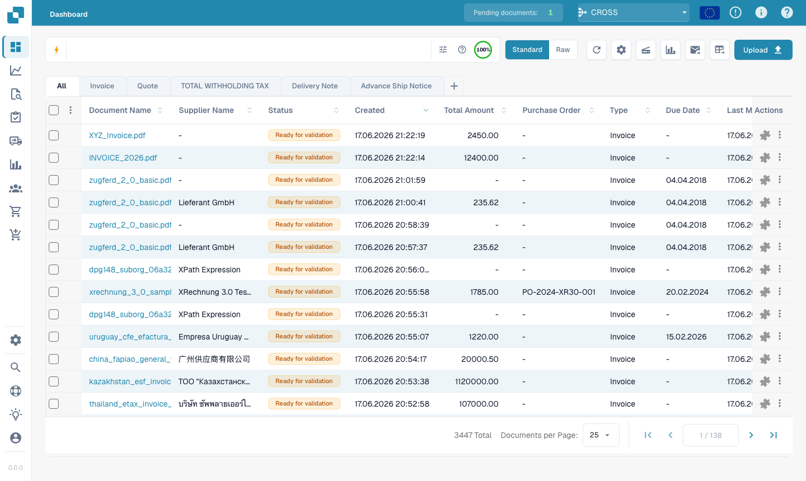<figcaption><p>仪表板顶部的快速搜索栏。</p></figcaption></figure>

---

## 搜索栏的工作方式 — 条件标签、工具栏和原始视图

在了解字段之前，先熟悉搜索栏的布局会更容易。

### 条件会变成标签

完成一个条件（字段、运算符和值）后，快速搜索会将其转换为一个**条件标签**——搜索栏中的彩色圆角标签——并开始创建下一个条件。标签会显示**字段**、**运算符**和**值**，并带有用于移除标签的 **×**。标签颜色表示数据所在的位置：

| 标签颜色 | 字段类型 |
|-------------|------------|
| **蓝色** | 标准列（文档名称、状态、日期） |
| **橙色** | 全文／提取字段（供应商、金额、发票编号） |
| **紫色** | 向量（语义）搜索 |
| **绿色** | OCR 文本搜索 |

点击标签可编辑它（标签会展开为文本）；点击 **×** 可删除它。默认情况下，多个标签组合后表示 **AND**。

### 工具栏

搜索栏右侧：

- **ⓘ 帮助** — 打开应用内的 **仪表板搜索 — 字段和语法**参考，其中列出了您工作区中可用的所有字段、运算符和快捷方式。
- **筛选器（调整）** — 打开常用的状态／用户／重启筛选器快捷面板，其中包含**清除筛选器**和**应用**选项。
- **索引环** — 显示全文索引构建进度的小环形图（仅在启用全文搜索时显示）。

### 标准视图与原始视图

搜索栏通常以标签的形式显示查询（**标准视图**）。切换到**原始视图**后，可以像编辑纯文本一样查看和编辑查询（例如 `status=ready_for_validation AND supplier_name=Test`）——适合复制、分享或直接输入较长的查询。切换视图时查询会保留，重新加载仪表板后也会记住查询。

---

## 第 1 部分 — 标准字段

标准字段是文档自身的列。无论是否启用全文搜索，它们都**始终可用**。

### 按名称查找文档

文档名称是最常用的搜索项。匹配方式有三种，且都**不区分大小写**：

#### `=` → 以……开头

```
filename=invoice
```

查找名称**以**“invoice”开头的文档。匹配时不区分大小写，因此以下名称都符合 `filename=invoice`：

```
Invoice.pdf   iNVoice.pdf   iNvoiCE.pdf   INVOICE.pdf
Invoice.xml   iNVoice.xml   iNvoiCE.edi   …
```

它**不会**匹配 `XYZ_Invoice.pdf`（其中“invoice”位于名称中间——请使用 `:`）。

<figure>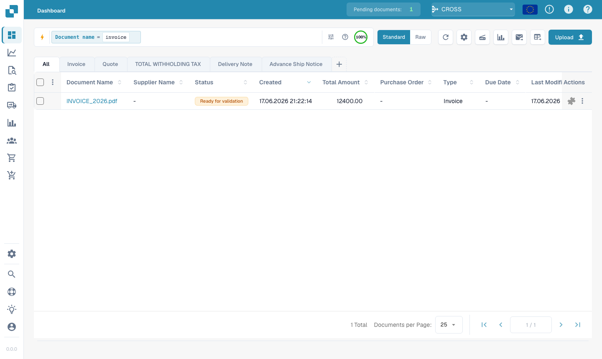<figcaption><p><code>filename=invoice</code> — 仅匹配以“invoice”开头的名称，不区分大小写（<code>Invoice.pdf</code>、<code>iNVoice.pdf</code>、<code>INVOICE_2026.pdf</code>……都符合）。请与下文的 <code>:</code> 比较。</p></figcaption></figure>

#### `:` → 包含（任意位置）

```
filename:invoice
```

使用 `:` 可匹配名称中**任意位置**的单词，例如 `2026_Invoice.pdf`、`vietnam_einvoice_sample.xml`、`scan_invoice_copy.pdf`。

<figure>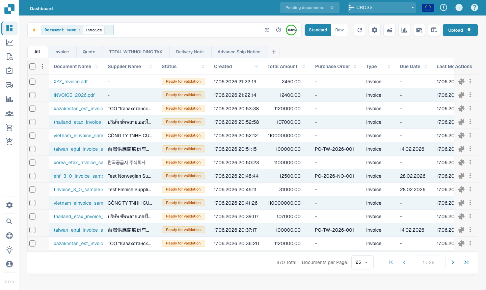<figcaption><p><code>filename:invoice</code> — 匹配文档名称中任意位置的单词。</p></figcaption></figure>

#### `="…"` → 以……开头或结尾

```
filename="invoice"
```

引号会让 `=` 匹配**以**该值开头或结尾的名称——适用于搜索开头的代码或文件名后缀。

> **三种方式一目了然：** `=` → 以……开头 · `:` → 包含 · `="…"` → 以……开头或结尾。三者都不区分大小写。随时可以通过搜索栏中的**帮助图标**查看此摘要（见下一节）。

### 按状态查找文档

```
status=ready_for_validation
```

状态是一个固定列表，因此 `=` 表示**精确**匹配；输入 `status=` 时，搜索栏会提供值选择器。

<figure>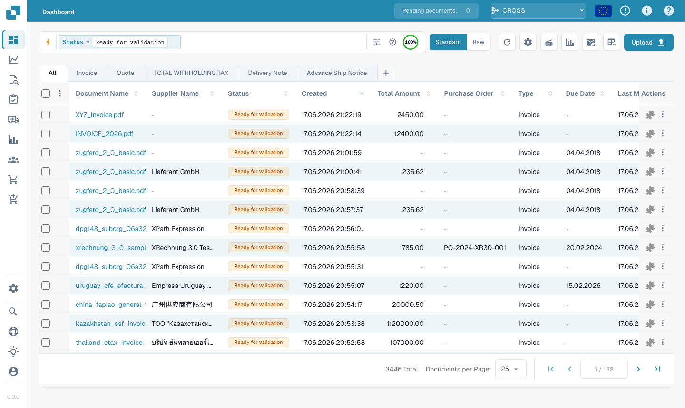<figcaption><p><code>status=ready_for_validation</code> — 精确匹配固定列表中的值。</p></figcaption></figure>

### 按日期查找文档

```
created_on>2026-05-25
```

使用 `>`、`<`、`>=`、`<=` 指定日期范围。也可以使用**相对日期**：`today()`、`today()-7`（最近 7 天）、`today()+30`（未来 30 天）。

<figure>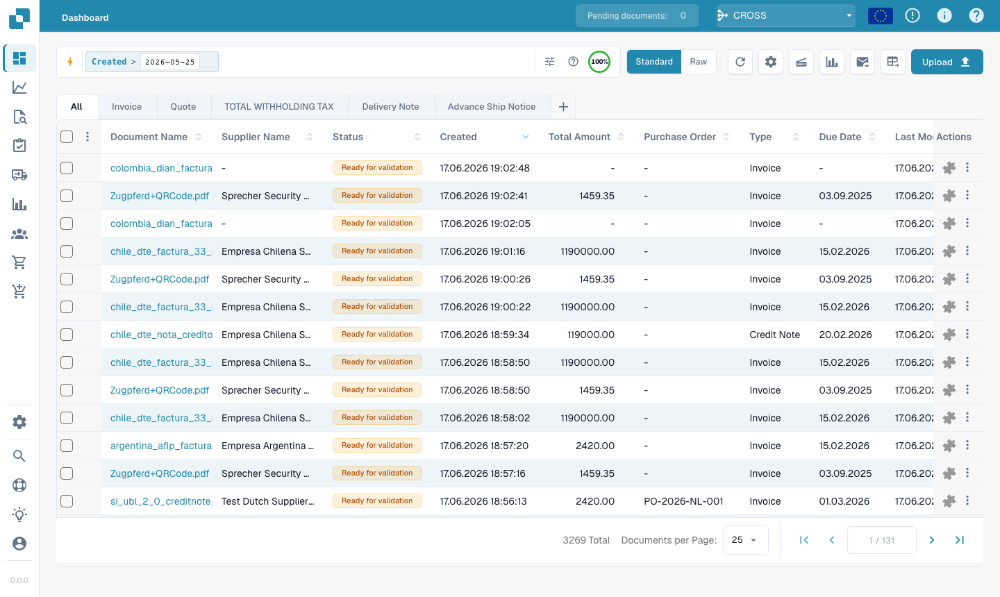<figcaption><p><code>created_on&#62;2026-05-25</code> — 查找在指定日期之后创建的文档。</p></figcaption></figure>

### 按发票子类型查找文档

```
invoice_sub_type="Cost Invoice"
```

发票子类型是一个固定列表（例如 **Cost Invoice** 或 **Purchase Invoice**），因此 `=` 表示**精确**匹配；输入 `invoice_sub_type=` 时，搜索栏会提供值选择器。使用 `invoice_sub_type!="Cost Invoice"` 可查找该子类型以外的所有文档。

---

## 第 2 部分 — 全文字段

全文字段用于搜索文档的**提取内容**，例如供应商、采购订单、发票编号、金额和行项目。它们以**橙色**显示，并在您的组织**启用全文搜索**后可用。匹配规则与标准文本字段完全相同（`=` 表示以……开头，`:` 表示包含，`="…"` 表示以……开头或结尾）。

### 按供应商查找文档

```
supplier_name=Test
```

按提取出的供应商名称进行前缀匹配。使用 `supplier_name:fuji` 匹配名称中的任意位置，或使用 `supplier_name:"Ruiz Foods"` 搜索带空格的值。

<figure><figcaption><p><code>supplier_name=Test</code> — 每条结果的供应商名称都以“Test”开头。</p></figcaption></figure>

### 按采购订单查找文档

```
purchase_order=PO
```

按提取出的采购订单编号进行前缀匹配——非常适合搜索采购订单前缀。

<figure>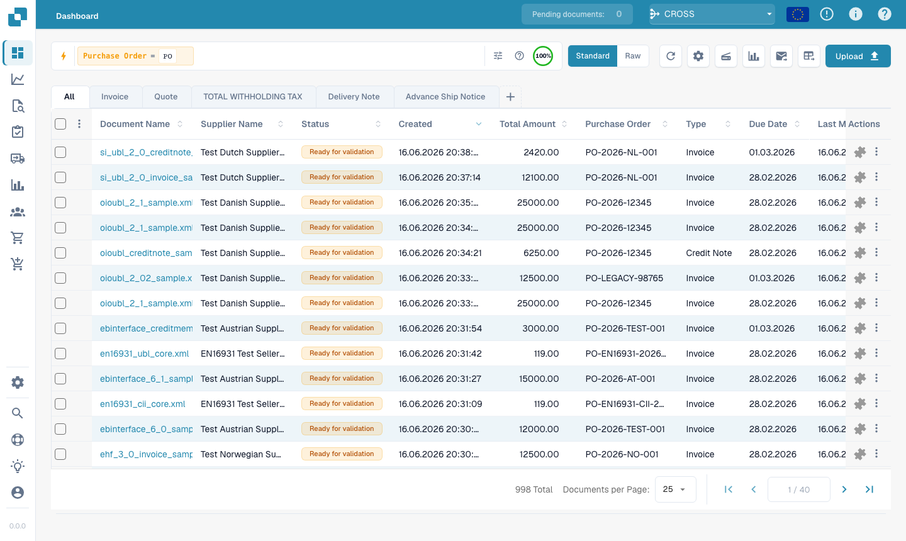<figcaption><p><code>purchase_order=PO</code> — 查找采购订单编号以“PO”开头的文档。</p></figcaption></figure>

### 按金额查找文档

```
total_amount>5000
```

使用 `>`、`<`、`>=`、`<=`，或使用 `between 100 and 500` 指定范围。

<figure>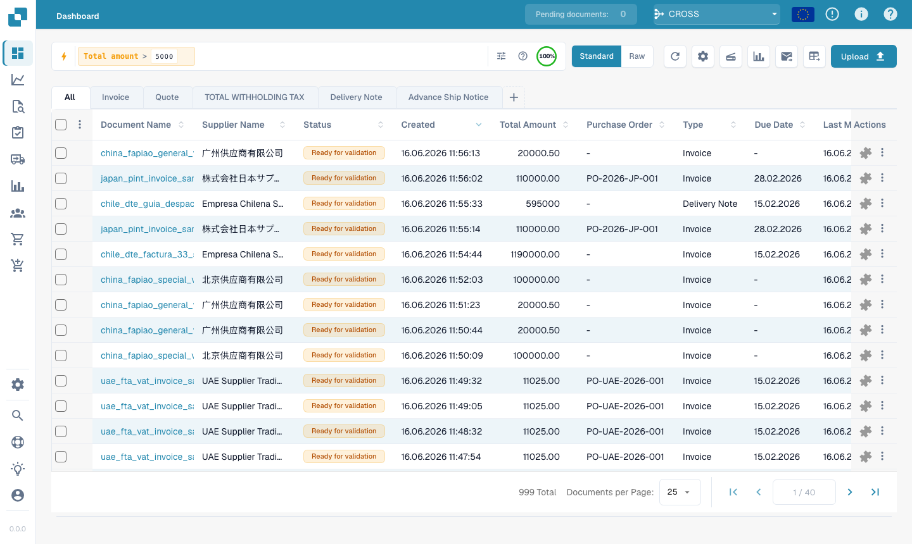<figcaption><p><code>total_amount&#62;5000</code> — 查找金额大于 5,000 的发票。</p></figcaption></figure>

指定金额区间时，使用 `between`：

```
total_amount between 1000 and 5000
```

这是 `total_amount>=1000 AND total_amount<=5000` 的简写形式。

<figure>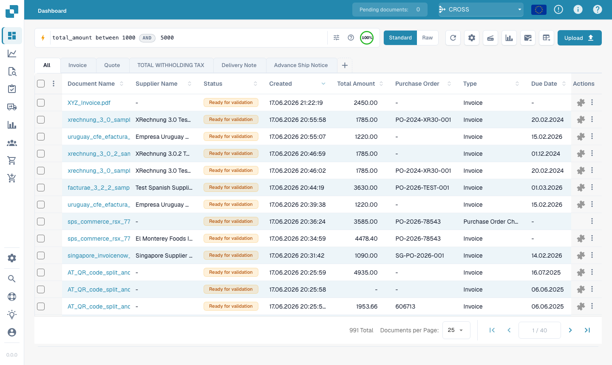<figcaption><p><code>total_amount between 1000 and 5000</code> — 每条结果的金额都在该区间内。</p></figcaption></figure>

### 查找缺失项

```
supplier_name=""
```

`=""` 表示“此字段**未设置**”；`supplier_name!=""` 表示“存在任意供应商”。

<figure>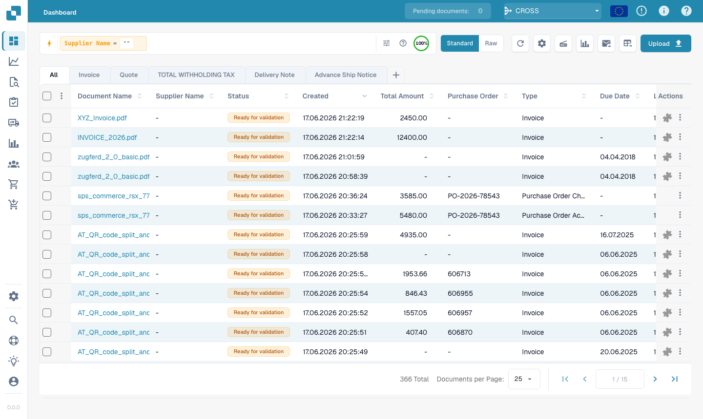<figcaption><p><code>supplier_name=""</code> — 查找尚未设置供应商的文档。</p></figcaption></figure>

同样的存在性检查适用于任何字段，例如查找仍缺少 AP 分配代码的文档：

```
ap_assignment_code=""
```

<figure>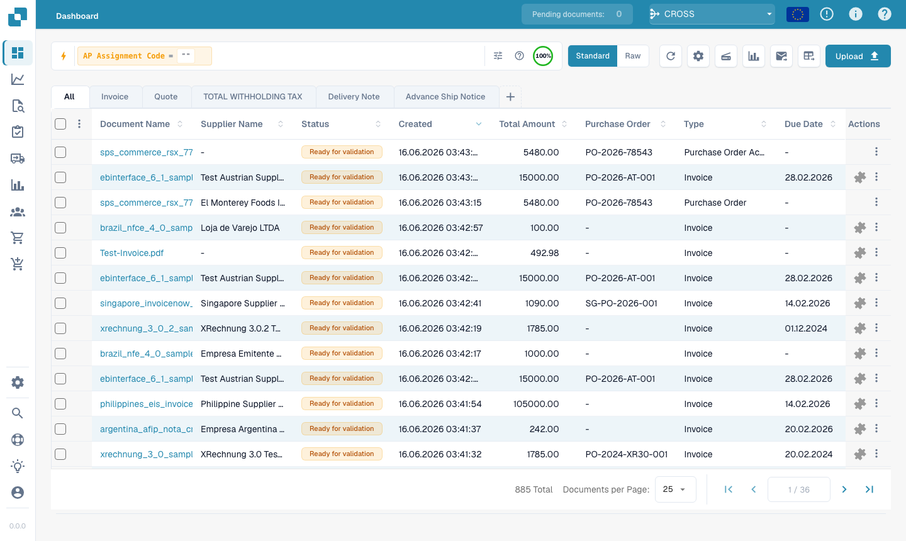<figcaption><p><code>ap_assignment_code=""</code> — 查找没有 AP 分配代码的文档。使用 <code>ap_assignment_code!=""</code> 查找已设置该代码的文档。</p></figcaption></figure>

---

## 智能筛选器 — 一键应用

在快速搜索下拉菜单顶部（点击搜索栏即可打开）可以找到**智能筛选器**：点击一次即可应用的预设搜索。每个筛选器都是您也可以自行输入的查询快捷方式：

| 智能筛选器 | 查找内容 | 等同于输入 |
|--------------|-------|----------------|
| ⚠️ **已逾期** | 已超过到期日的项目 | `invoice_due_date<today()` |
| 🕐 **即将到期** | 未来 7 天内到期的项目 | `invoice_due_date<=today()+7` |
| 👤 **分配给我** | 等待您处理的项目 | `assigned_to=<you>` |
| 📅 **今日收件箱** | 今天导入的项目 | `imported_on>=today()` |
| 📋 **待验证** | 已准备好进行验证的项目 | `status=ready_for_validation` |
| 🧾 **电子文档** | 电子发票（XML、ZUGFeRD、EDI） | `is_edoc=true` |
| ✅ **完全匹配的采购订单** | 与采购订单完全匹配 | `po_match_status=full_matched` |
| ➗ **部分匹配的采购订单** | 与采购订单部分匹配 | `po_match_status=partial_matched` |
| 📉 **低于采购订单的匹配值** | 数量或单价低于采购订单 | `po_match_status=under_matched` |

这三种**采购订单匹配**筛选器以及全文字段都要求您的组织启用全文搜索。

<figure><figcaption><p>快速搜索下拉菜单顶部的智能筛选器——点击一次即可应用筛选器（已逾期、即将到期、分配给我、今日收件箱、待验证、电子文档、完全／部分／低于采购订单匹配）。</p></figcaption></figure>

---

## 对结果分组

您可以按任意字段对结果进行**分组**，而不是显示为平铺列表，例如供应商、状态、文档类型、子组织或日期区间。在搜索栏中添加分组：

```
group by supplier_name
```

随后列表会显示可折叠的**分组标题**，每个标题包含组名和**数量**（例如 *Ruiz Foods (12)*）。点击标题可展开或折叠该组。对于日期字段，可以按**天、周或月**分组。

<figure>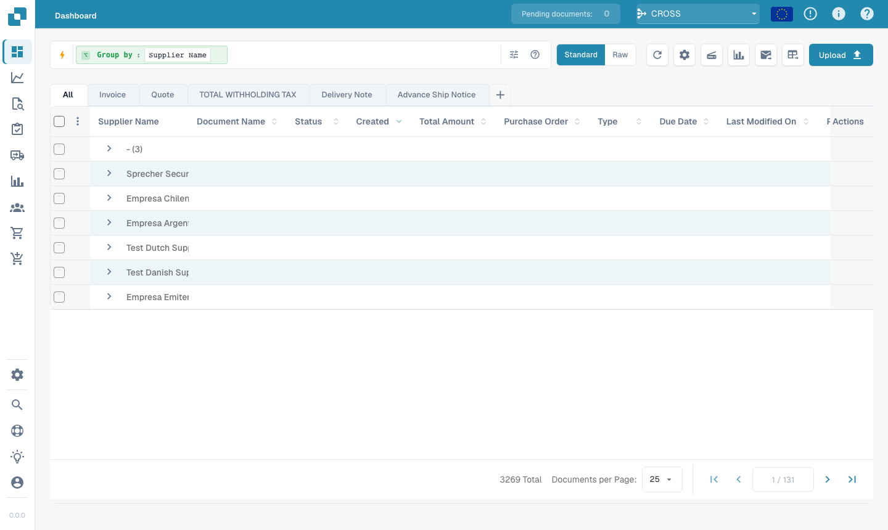<figcaption><p><code>group by supplier_name</code> — 将结果折叠为每个供应商一个可展开的标题。</p></figcaption></figure>

分组可以与任意筛选器组合使用——`status=ready_for_validation group by
supplier_name` 会仅对匹配的文档分组。点击某个组可**深入查看**：系统会将该组的值作为筛选条件，并返回该筛选结果的平铺列表。

---

## 第 3 部分 — 运算符、连接符和快捷方式

### 内置帮助

搜索栏中的**帮助图标**会打开完整参考，其中列出您工作区中可用的所有字段、运算符和快捷方式，包括标准字段与全文字段的区别。

<figure><figcaption><p>内置的<strong>仪表板搜索 — 字段和语法</strong>帮助，其中列出了每个运算符及其值的匹配方式。</p></figcaption></figure>

### 按字段类型查看 `=` 的匹配方式

所有文本匹配都不区分大小写。

| 字段类型 | 示例 | `=` 表示 |
|------------|---------|-----------|
| 文本（名称、供应商、采购订单） | `filename=invoice` | **以……开头** |
| 文本，任意位置 | `filename:invoice` | **包含** |
| 文本，以……开头*或*结尾 | `filename="invoice"` | **以……开头或结尾** |
| 状态／类型／采购订单匹配（固定列表） | `status=finished` | **精确** |
| 标识符（发票编号、供应商 ID） | `invoice_number=INV-100` | **精确** |
| 数字 | `total_amount>5000` | 范围（`> < >= <= between`） |
| 日期 | `created_on>2026-01-01` | 范围 + `today()±N` |

### 运算符

| 运算符 | 含义 |
|----------|---------|
| `=` | 前缀匹配（文本）／精确匹配（列表、数字、日期） |
| `:` | 包含（文本，任意位置） |
| `="…"` | 前缀或后缀匹配（文本） |
| `!=` | 与 `=` 相反 |
| `>` `<` `>=` `<=` | 大于／小于 |
| `between … and …` | 闭区间 |
| `field=""` / `field!=""` | 为空／已设置 |
| `today()`、`today()-7`、`today()+30` | 相对日期 |

### 连接符

使用 **AND**（两项都为真）、**OR**（任一项为真）、**NOT** 以及用于分组的括号 `( … )` 组合条件：

```
status=ready_for_validation AND supplier_name=Test
(status=error OR status=failed) AND created_on>today()-1
```

<figure>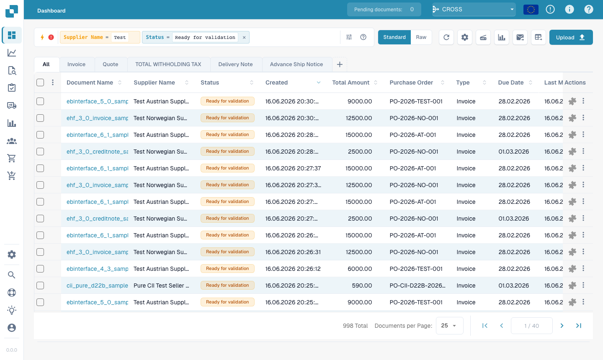<figcaption><p><code>status=ready_for_validation AND supplier_name=Test</code> — 组合两个条件。</p></figcaption></figure>

### 快捷方式

同一查询也可以用更简短的写法，根据可读性选择：

| 快捷方式 | 等同于 | 说明 |
|----------|----------|-------------|
| `total_amount gt 5000` | `total_amount>5000` | 比较运算符的文字别名（`gt`/`gte`/`lt`/`lte`/`eq`/`ne`） |
| `due_date > today` | `due_date>today()` | 直接使用 `today`／`yesterday`／`tomorrow` |
| `imported_on this_week` | `imported_on>=today()-7 AND imported_on<=today()` | 相对周期（`this_week`、`last_week`、`this_month`……） |
| `ap_assignment_code is empty` | `ap_assignment_code=""` | 检查字段是否有值 |
| `status:open` | `status=ready_for_validation` | 友好的状态标签（`open`/`closed`/`failed`/`done`） |
| `total_amount not between 100, 200` | `total_amount<100 OR total_amount>200` | 查找数值不在区间内的结果 |
| `status in (finished, error)` | `status=finished OR status=error` | 匹配列表中的任意值 |
| `not status=finished` | `status!=finished` | 对任意谓词取反 |
| `filename contains rechnung` | `filename:rechnung` | 字符串匹配（`contains`/`starts_with`/`ends_with`） |
| `total_amount > 5k` | `total_amount>5000` | 金额后缀 `k`（×1 000）、`M`（×1 000 000） |
| `overdue` | `invoice_due_date<today() AND status!=finished` | 已超过到期日且未付款的发票 |
| `#INV-1234` | `invoice_id:INV-1234` | 用于发票 ID 的 Twitter 风格前缀 |
| `@User` | `assigned_to:User` | 用于受指派人的 Twitter 风格前缀 |
| `$5000+` | `total_amount>=5000` | 金额阈值的 `$` 前缀 |

### 快捷查询和结果示例

以下示例展示了每种快捷方式的输入查询，以及仪表板显示的结果。第一组使用标准字段，即使未启用全文搜索也可使用。第二组使用全文专用字段，例如金额或发票到期日。

#### 无需全文搜索

##### 运算符别名

- 查询：`created_on gt 2026-05-25`
- 等同于：`created_on>2026-05-25`
- 结果：按 2026 年 5 月 25 日之后创建进行筛选。

<figure>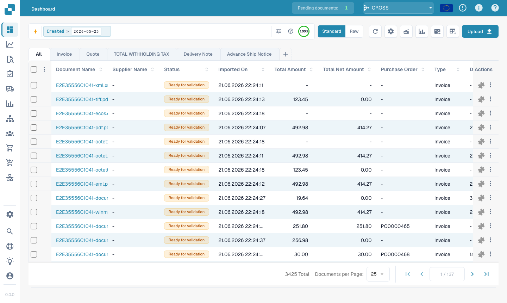<figcaption><p><code>created_on gt 2026-05-25</code> - 按 2026 年 5 月 25 日之后创建进行筛选。</p></figcaption></figure>

##### 直接使用日期词

- 查询：`created_on < today`
- 等同于：`created_on<today()`
- 结果：将直接使用的单词 today 展开为 today()。

<figure><figcaption><p><code>created_on &lt; today</code> - 将直接使用的单词 today 展开为 today()。</p></figcaption></figure>

##### 相对周期

- 查询：`created_on this_month`
- 等同于：`created_on>=first day of this month AND created_on<=last day of this month`
- 结果：将 this_month 展开为日期区间。

<figure><figcaption><p><code>created_on this_month</code> - 将 this_month 展开为日期区间。</p></figcaption></figure>

##### 表示为空或已设置的词

- 查询：`assigned_to is empty`
- 等同于：`assigned_to=""`
- 结果：查找没有受指派人的文档。

<figure>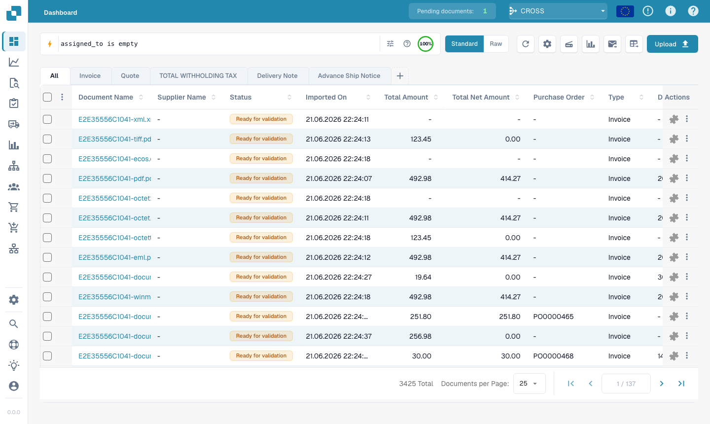<figcaption><p><code>assigned_to is empty</code> - 查找没有受指派人的文档。</p></figcaption></figure>

##### 友好状态

- 查询：`status:open`
- 等同于：`status=ready_for_validation`
- 结果：将 open 映射为验证状态。

<figure>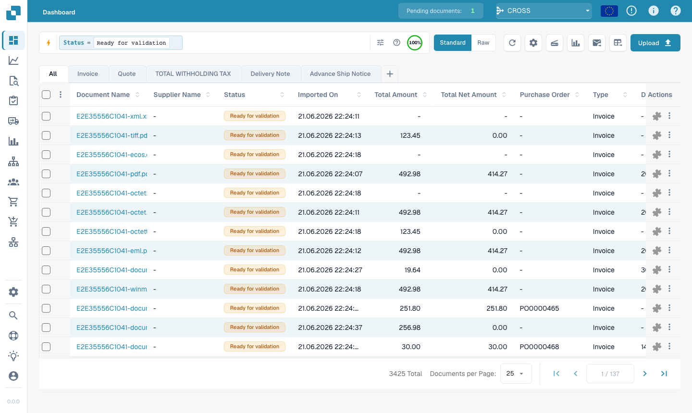<figcaption><p><code>status:open</code> - 将 open 映射为验证状态。</p></figcaption></figure>

##### 不在区间内

- 查询：`created_on not between 2026-06-01, 2026-06-15`
- 等同于：`(created_on<2026-06-01 OR created_on>2026-06-15)`
- 结果：查找不在日期区间内的值。

<figure>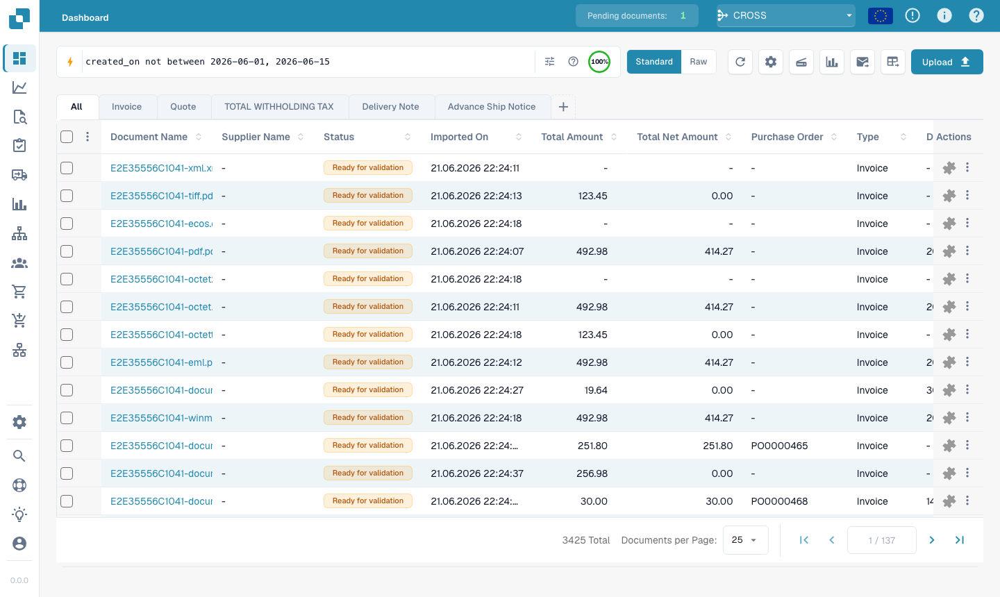<figcaption><p><code>created_on not between 2026-06-01, 2026-06-15</code> - 查找不在日期区间内的值。</p></figcaption></figure>

##### 列表中的任意值

- 查询：`status in (ready_for_validation, exported)`
- 等同于：`status=ready_for_validation OR status=exported`
- 结果：匹配列出的任意状态。

<figure>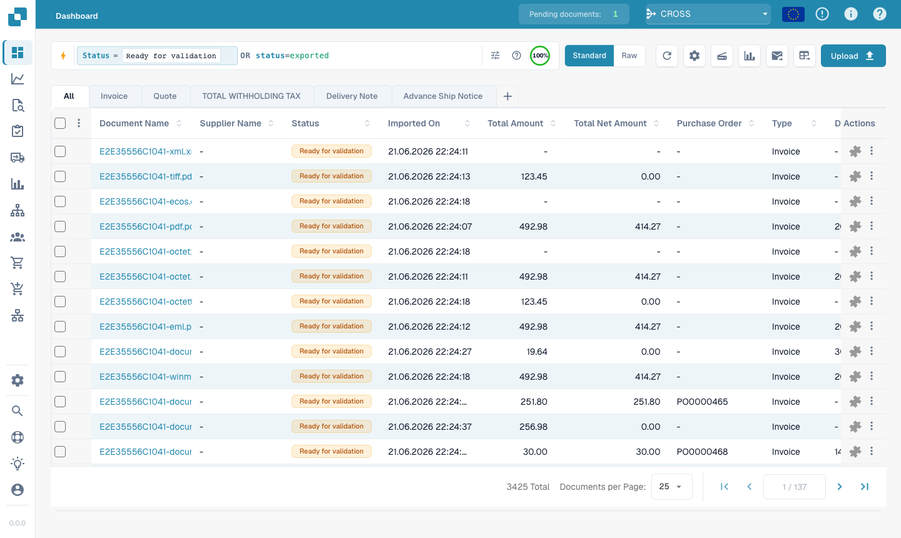<figcaption><p><code>status in (ready_for_validation, exported)</code> - 匹配列出的任意状态。</p></figcaption></figure>

##### 否定前缀

- 查询：`not status=finished`
- 等同于：`status!=finished`
- 结果：反转 finished 状态谓词。

<figure><figcaption><p><code>not status=finished</code> - 反转 finished 状态谓词。</p></figcaption></figure>

##### 字符串包含

- 查询：`filename contains E2E`
- 等同于：`filename:E2E`
- 结果：使用 contains 按文件名子字符串搜索。

<figure><figcaption><p><code>filename contains E2E</code> - 使用 contains 按文件名子字符串搜索。</p></figcaption></figure>

##### 发票前缀

- 查询：`#INV-1234`
- 等同于：`invoice_id:INV-1234`
- 结果：将 #... 映射为发票 ID 搜索。

<figure><figcaption><p><code>#INV-1234</code> - 将 #... 映射为发票 ID 搜索。</p></figcaption></figure>

##### 受指派人前缀

- 查询：`@Daniel`
- 等同于：`assigned_to:"Daniel"`
- 结果：将 @... 映射为受指派人姓名搜索。

<figure><figcaption><p><code>@Daniel</code> - 将 @... 映射为受指派人姓名搜索。</p></figcaption></figure>

#### 需要全文搜索

如果同一快捷方式使用全文专用字段，查询仍然需要全文搜索。例如，`ap_assignment_code is empty` 使用的“为空／已设置”快捷方式与 `assigned_to is empty` 相同，但 AP 分配字段仅支持全文搜索。

##### 金额后缀

- 查询：`total_amount > 5k`
- 等同于：`total_amount>5000`
- 结果：在金额字段中将 k 展开为千。

<figure><figcaption><p><code>total_amount &gt; 5k</code> - 在金额字段中将 k 展开为千。</p></figcaption></figure>

##### 逾期快捷方式

- 查询：`overdue`
- 等同于：`invoice_due_date<today() AND status!=finished`
- 结果：查找已超过到期日且尚未完成的发票。

<figure>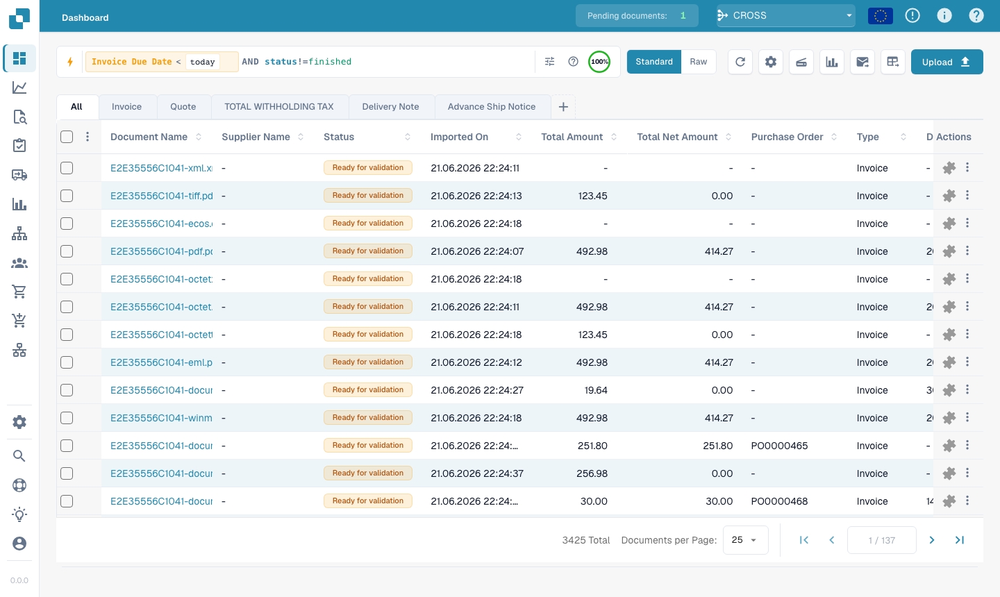<figcaption><p><code>overdue</code> - 查找已超过到期日且尚未完成的发票。</p></figcaption></figure>

##### 金额前缀

- 查询：`$5000+`
- 等同于：`total_amount>=5000`
- 结果：将 $...+ 映射为金额阈值。

<figure>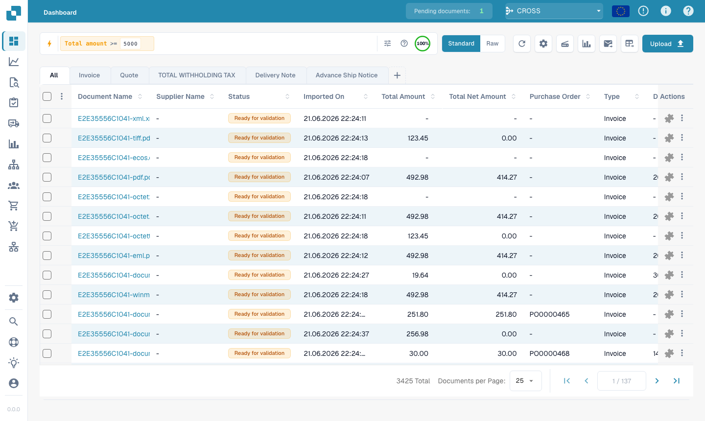<figcaption><p><code>$5000+</code> - 将 $...+ 映射为金额阈值。</p></figcaption></figure>

---

## 第 4 部分 — 高级搜索模式

除了字段搜索之外，还有三种前缀模式可直接搜索文档内容。

### 向量（语义）搜索 — `vector:`

按**含义**而非精确文本匹配——适用于“查找关于 XYZ 的文档”。需要 Vector 模块；搜索范围为文档内容。

```
vector: invoices about office supplies
vector: shipping delays with Hamburg port
```

<figure>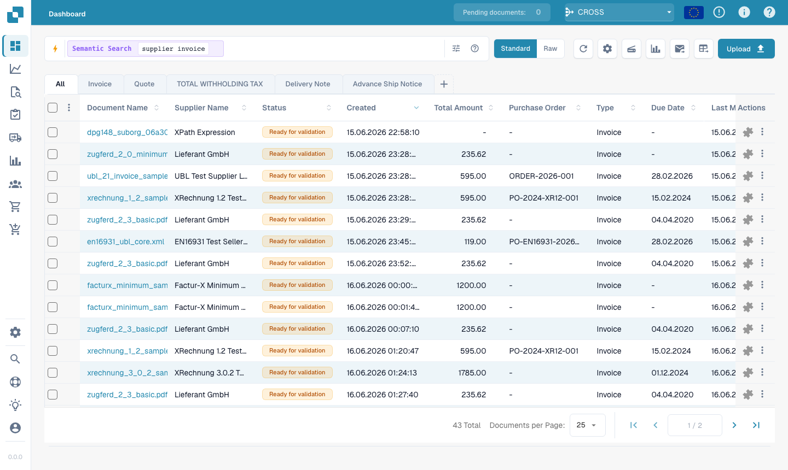<figcaption><p><code>vector: supplier invoice</code> — 查找语义相关的文档，即使文档中没有这些完全相同的词语。</p></figcaption></figure>

### OCR 文本搜索 — `ocr:`

搜索 OCR 引擎提取的**页面文本**，而不仅仅是结构化列。当您记得的值位于文档正文中时，这种方式很有用。

```
ocr: Versandkosten
ocr: "purchase order PO-12345"
ocr: Hamburg AND doc_type=INVOICE
ocr: IBAN
```

<figure>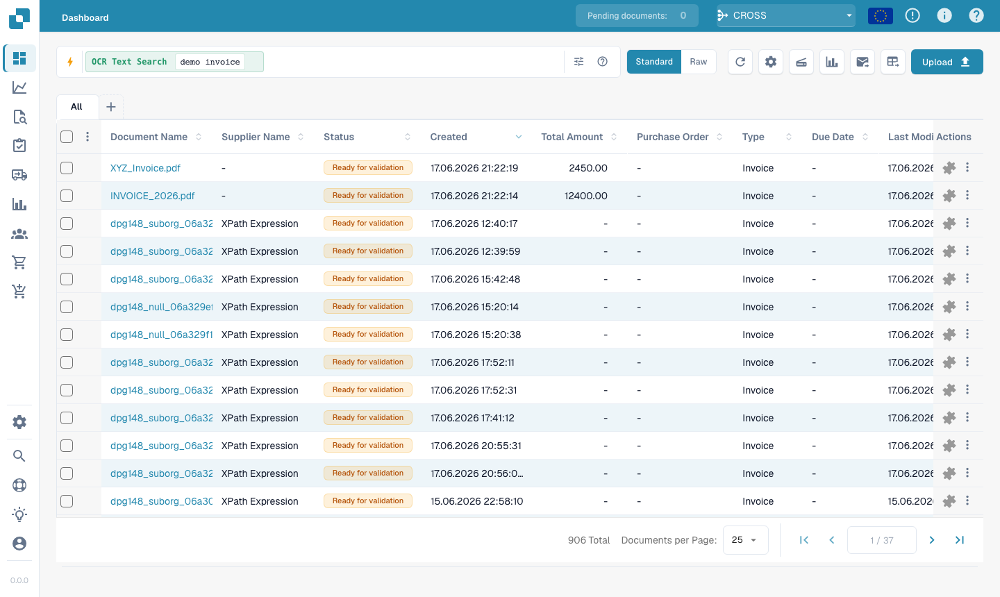<figcaption><p><code>ocr: demo invoice</code> — 匹配文档页面任意位置找到的文本。</p></figcaption></figure>

### 自然语言（AI）搜索 — `ai:`

用通俗英语描述您要查找的内容；AI 会读取您的描述，并从中提取供应商、日期、金额等筛选条件，生成结构化查询。与向量搜索不同，它会**构建查询**，而不是查找相似文档。

```
ai: invoices from Ruiz over 1000 last quarter
ai: overdue invoices waiting on approval
ai: shipping documents from Hamburg last month
```

<figure>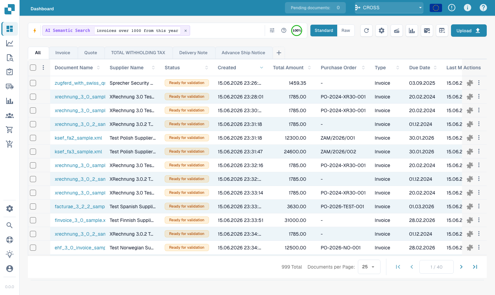<figcaption><p><code>ai: invoices over 1000 from this year</code> — AI 会自动将这句话转换为筛选条件。</p></figcaption></figure>

---

### 示例

| 您要查找…… | 输入内容 |
|-----------|-----------|
| 准备好进行验证且与采购订单完全匹配的文档 | `status=ready_for_validation AND po_match_status=full_matched` |
| 本周来自该供应商的文档 | `supplier_name=Test AND created_on>today()-7` |
| 高价值的逾期发票 | `total_amount>5000 AND invoice_due_date<today()` |
| 同时查找两家供应商 | `supplier_name=fuji OR supplier_name=acme` |
| 今天发生错误的文档 | `(status=error OR status=failed) AND created_on>today()-1` |
| 电子贷项通知单 | `is_edoc=true AND sub_doc_type=CREDIT_NOTE` |
| 按采购订单前缀搜索 | `purchase_order=PO-2026` |

> 橙色（全文）字段要求您的组织**启用全文搜索**。值中直接输入的 `%` 或 `_` 会被视为普通字符。
