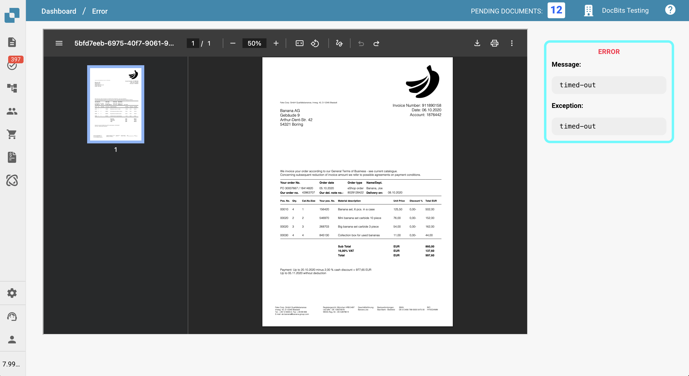
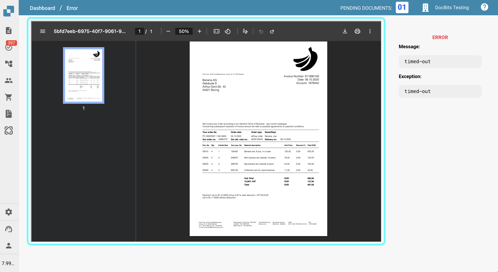
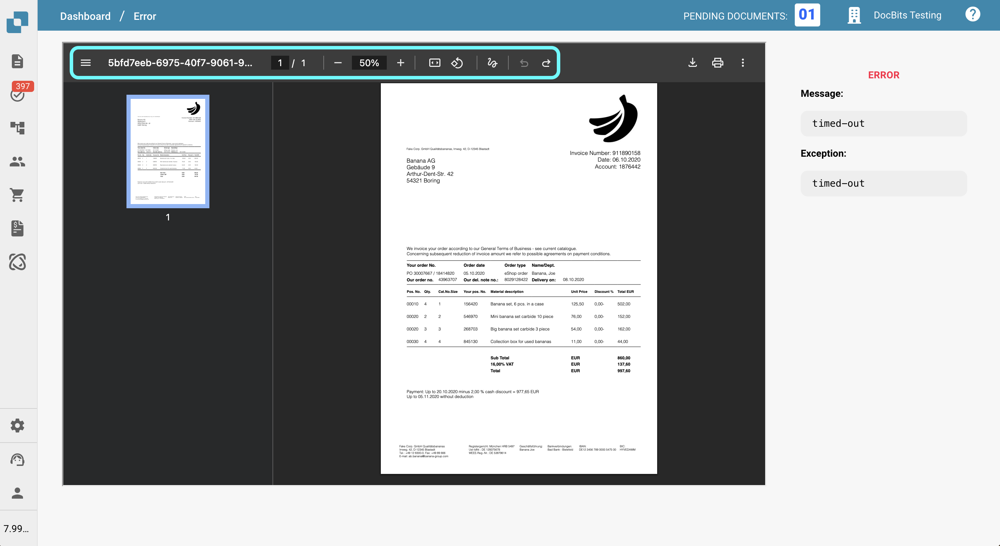
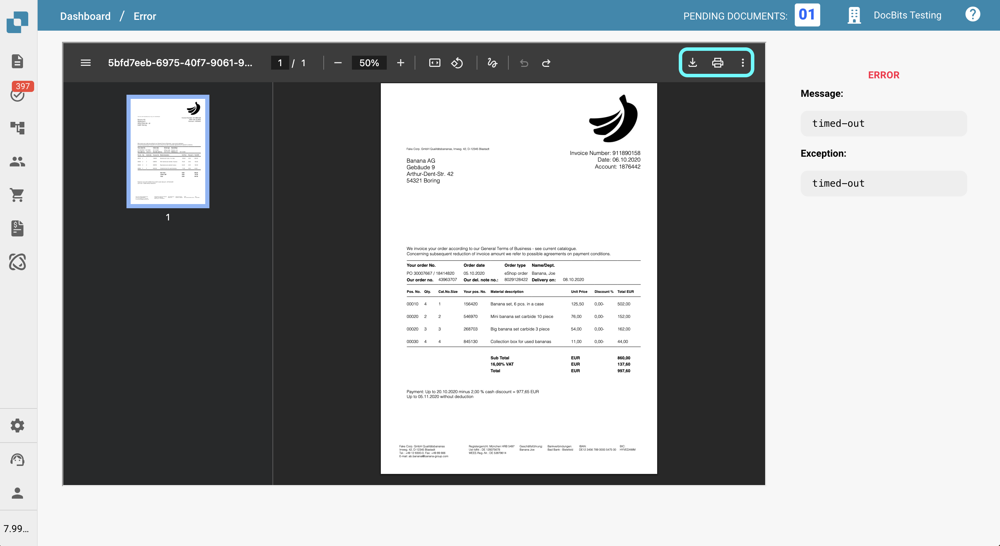
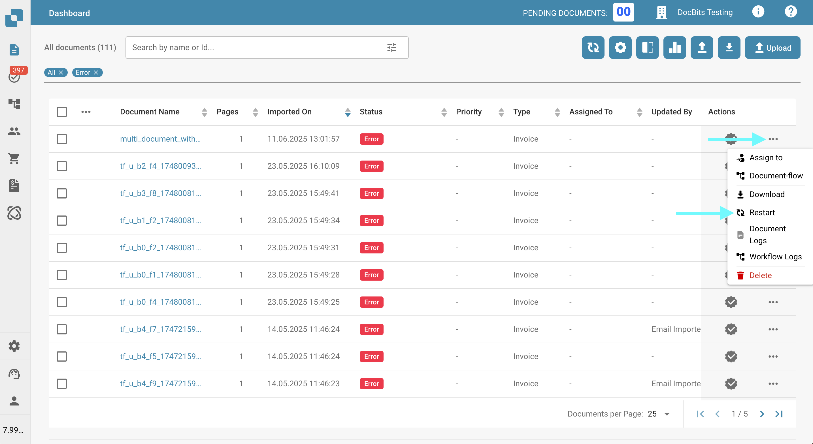

# 错误

## 概述

如果文档工作流中发生错误，文档将进入 **Error** 状态。此时，您可以点击该文档来：

* 查看说明错误原因的关键信息
* 为文档添加备注
* 打印或下载文档

这样，您可以诊断问题并采取适当措施，同时仍能访问文档本身。

本页概述了可用于查看和管理处于 **Error** 状态的文档的工具。

## 错误详情

在文档视图的右侧，您会看到 **Error Message**，其中简要说明了发生的问题。\
错误消息下方会显示 **Exception**，指出代码中发生错误的位置。这些信息有助于排查问题；向支持团队报告问题时，请一并提供这些信息。

<figure><figcaption></figcaption></figure>

## 编辑选项

页面左侧显示文档以及可用于交互和查看的工具。

<figure><figcaption></figcaption></figure>

### **左侧工具栏选项**

<figure><figcaption></figcaption></figure>

页面左侧的工具栏提供了与文档交互的工具：

* **切换缩略图视图**\
  显示或隐藏侧边栏，其中以缩略图形式列出文档的所有页面，方便导航。
* **查看文档 ID**\
  报告问题时很有帮助，请在支持请求中提供此 ID。
* **跟踪当前页码和缩放级别**\
  查看当前正在查看的页面及其缩放百分比。
* **适应高度或宽度**\
  调整文档显示效果，使其适应查看器的高度或宽度。
* **旋转文档**\
  旋转文档，方便查看扫描内容或横置内容。
* **添加批注**\
  使用评论或高亮标注文档。
* **撤销或重做操作**\
  快速撤销或重新执行最近的操作。

***

### **右侧工具栏选项**

<figure><figcaption></figcaption></figure>

页面右侧的工具栏提供了其他功能：

* **下载文档**\
  将文档保存到设备，可选择是否包含批注。
* **打印文档**\
  将文档发送到打印机，包括当前显示的批注。
* **切换查看模式**\
  在不同的显示样式或阅读模式之间切换。
* **查看文档属性**\
  查看文件名、类型、大小和创建日期等元数据。

## 后续处理方式

如果文档进入 **Error** 状态，您可以通过以下方式继续处理：

**1. 重新启动文档**

在许多情况下，重新启动文档可以解决问题并恢复处理。

*   重新启动文档：

    1. 点击 **Actions** 列中的三个点。
    2. 从菜单中选择 **Restart**。

    <figure><figcaption></figcaption></figure>

**2. 联系支持团队**

如果重新启动后错误仍然存在，您可以联系支持团队以获取进一步帮助。\
请尽可能提供详细信息，以便团队高效解决问题（例如文档 ID、错误消息和已采取的操作）。

提交支持工单的说明请参阅[此处](ressources-and-support/user-support.md)。
