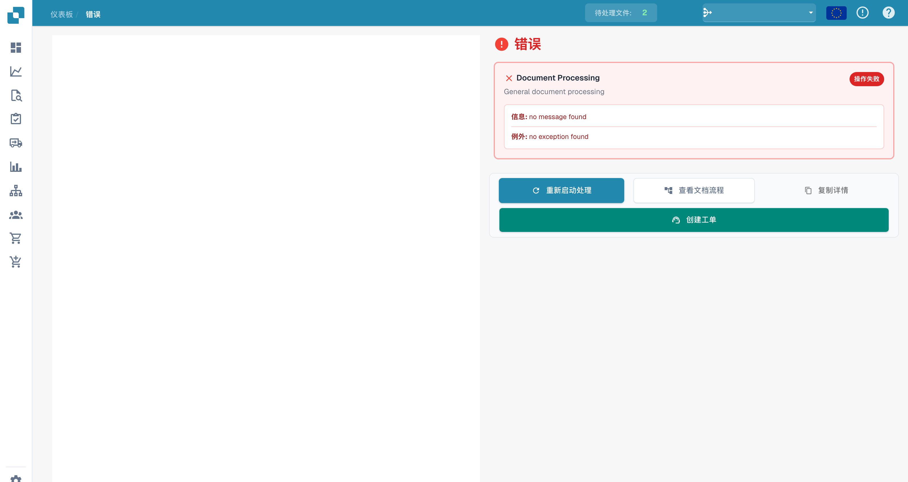
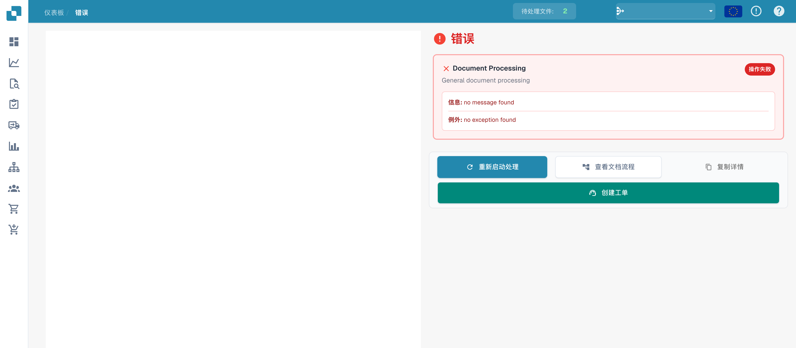

# 错误视图

错误视图展示文档可用的技术错误信息。示例使用虚构文档，没有已记录的错误消息；它展示界面，不是复现的故障。

## 消息和异常

检查错误消息及异常区域是否包含详细信息。

<figure><figcaption>
没有已记录消息的错误消息和异常视图。 该页面用于展示诊断操作入口；示例文档没有实际处理异常，因此技术占位消息仍为英文。
</figcaption></figure>

没有消息不代表处理已经成功。请结合文档状态、处理流程及阶段日志判断。

## 可用操作

工具栏提供与文档状态和权限相关的操作。

<figure><figcaption>
错误视图中的操作；示例没有已记录的错误详情。 该页面用于展示诊断操作入口；示例文档没有实际处理异常，因此技术占位消息仍为英文。
</figcaption></figure>

重新启动前，记录文档 ID、发生时间及相关阶段，并检查配置和日志。向支持人员提供必要的诊断信息；本页图片没有验证重新启动或导出结果。

旧版独立 PDF 工具栏不再是此视图的固定组成部分。

文档操作和预览是否可用取决于文档是否已加载。
