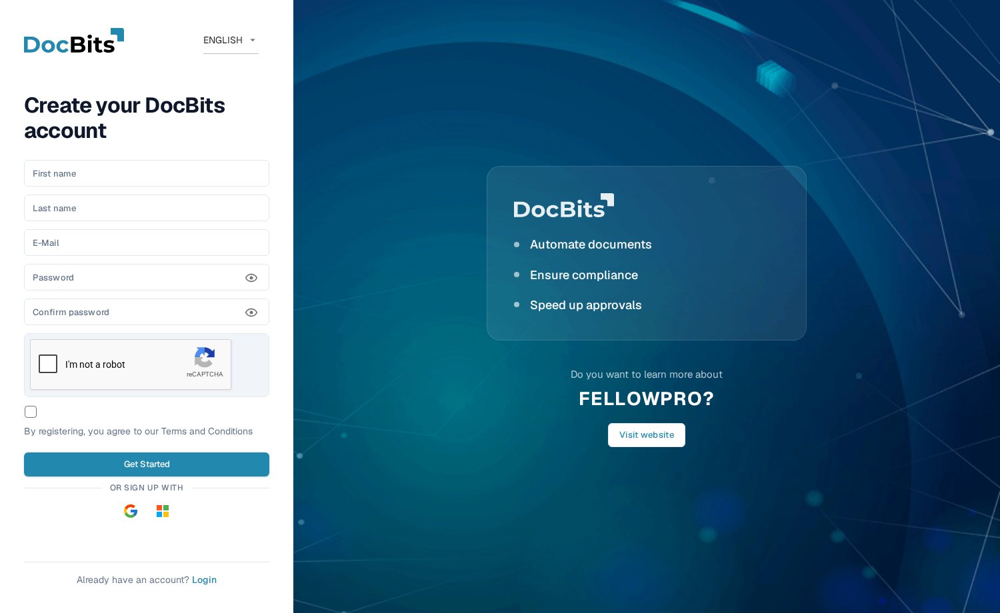
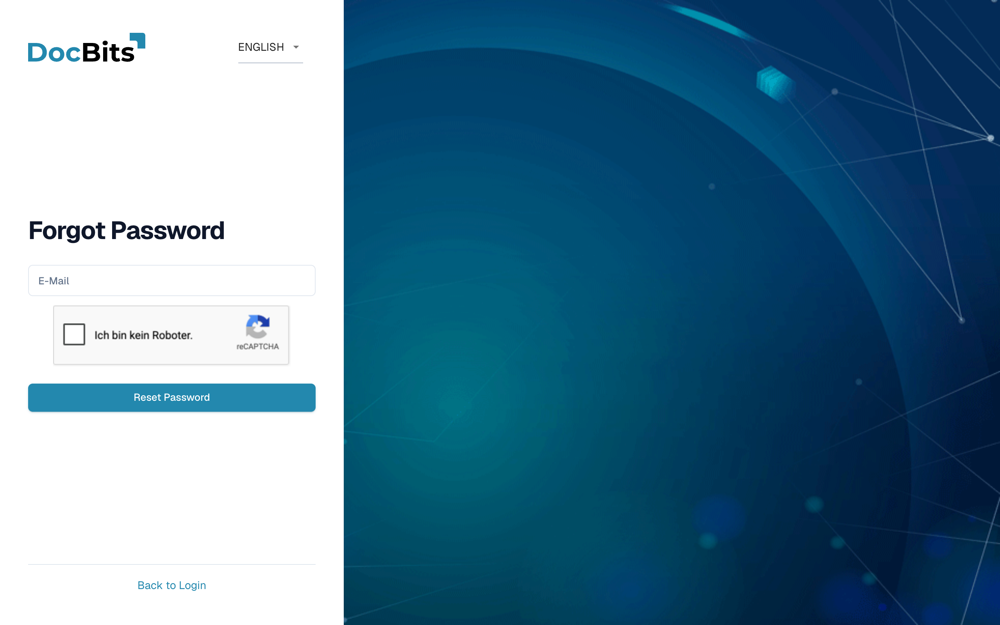
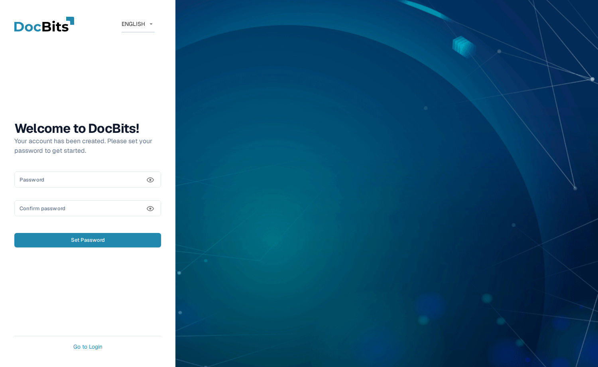

# 获取访问权限并登录

本页介绍如何获取 DocBits 账户，以及忘记密码时如何登录：

* [注册](#registration) — 创建自己的 DocBits 账户。
* [忘记密码](#forgot-password) — 使用重置链接重置密码。
* [管理员创建账户后的首次密码](#first-password-for-admin-created-accounts) — 为管理员创建的账户设置首次密码。

使用现有账户登录以及双重身份验证，请参阅[双重身份验证 (2FA)](../../security/two-factor-authentication.md)。如果需要使用其他显示语言，请使用这些表单右上角的语言菜单。

## 注册 

你可以在注册页面自行创建 DocBits 账户。点击登录页面上的 **Register** 链接打开该页面，或访问 `https://app.docbits.com/register`（请使用组织提供的网址）。

<figure><figcaption>
注册表单。除特别注明外，所有字段均为必填项。
</figcaption></figure>

填写表单：

1. **First name** 和 **Last name** — 填写希望显示在 DocBits 中的姓名。
2. **E-Mail** — 填写你的工作邮箱地址。这是你的登录标识。
3. **Password** 和 **Confirm password** — 请参阅下方的密码规则。密码字段下方的检查清单会显示密码已满足哪些规则。
4. 如果页面显示 **reCAPTCHA** 小组件，请完成验证。仅在你的 DocBits 部署启用了机器人防护时才会显示该小组件。
5. 勾选复选框，确认你同意 **Terms and Conditions**。
6. 点击 **Get Started**。如果你已有账户，请点击底部的 **Login** 返回登录页面。**Visit website** 会打开 DocBits 网站以查看产品信息。

点击密码字段旁边的眼睛图标，可以显示或隐藏已输入的字符。

### 密码规则 

密码必须：

* 长度为 **8 到 20 个字符**，
* 至少包含一个**大写字母**和一个**小写字母**，
* 至少包含一个**数字**，
* 至少包含一个**特殊字符** (`!@#$%^&*()_+=\[{]\};:,.<>?/\|~-`)。

只允许使用字母、数字和上述特殊字符。

### 使用 Google 或 Microsoft 注册

你可以点击 **Or sign up with** 下方的 **Google** 或 **Microsoft** 按钮，无需设置密码。DocBits 会通过你的身份提供商创建账户，你之后也可以通过相同方式登录。

### 确认邮箱地址

提交表单后，DocBits 会显示确认页面，并向你填写的地址发送一封**验证邮件**。打开邮件并点击其中的链接，即可进入确认页面验证邮箱地址。如果没有收到邮件，确认页面会提供**重新发送**选项。邮箱地址验证完成后，点击 **Sign in**，使用邮箱和密码登录。

## 忘记密码 

DocBits 会将登录密码保存为带盐的单向哈希值。无法从哈希值还原已有密码，因此此流程会设置新密码。有关密码存储和恢复的详情，请参阅[凭据的安全存储](../../security/secure-storage-of-credentials.md)。

如果忘记密码：

1. 在登录页面点击 **Forgot password?**。
2. 在 **Forgot Password** 页面输入你的 **E-Mail** 地址，然后点击 **Reset Password**。如果页面显示 reCAPTCHA 小组件，请先完成验证。

   <figure><figcaption>
Forgot Password 页面。输入账户邮箱后，DocBits 会向你发送密码重置链接。
</figcaption></figure>

   如果你不想重置密码，请点击 **Back to Login** 返回登录页面。

3. DocBits 会向你发送一封包含**密码重置链接**的邮件。打开邮件并点击链接，即可打开重置页面。
4. **输入两次新密码**。适用与[注册](#password-rules)时相同的密码规则，检查清单会显示已满足哪些规则。
5. 点击 **Reset Password**。DocBits 会确认密码已更改，并将你带回登录页面，你可以使用新密码登录。


重置链接会在短时间后失效。如果链接无法使用，请重复上述步骤申请新链接。


## 管理员创建账户后的首次密码 

管理员将你添加为用户时（请参阅[用户](../../administration-and-setup/settings/global-settings/groups-users-and-permissions/users/README.md)），你会收到一封包含登录详情和首次**设置密码**链接的邮件。该链接会打开 **Set Password** 页面：

<figure><figcaption>
管理员创建账户后显示的 Set Password 页面。
</figcaption></figure>

1. 点击邀请邮件中的链接。页面会向你显示欢迎消息：“欢迎使用 DocBits！你的账户已创建。请设置密码以开始使用。”
2. 输入两次密码 — 适用相同的[密码规则](#password-rules)。
3. 点击 **Set Password**。之后，你就可以使用邮箱和该密码登录。

点击眼睛图标可以显示或隐藏已输入的内容。如果你尚未设置密码就离开页面，点击 **Go to Login** 可返回登录页面。

该链接与你的账户绑定，且只能使用一次。如果链接在使用前过期，请联系管理员重新发送邀请，或使用你的邮箱地址点击 **Forgot password?**。
