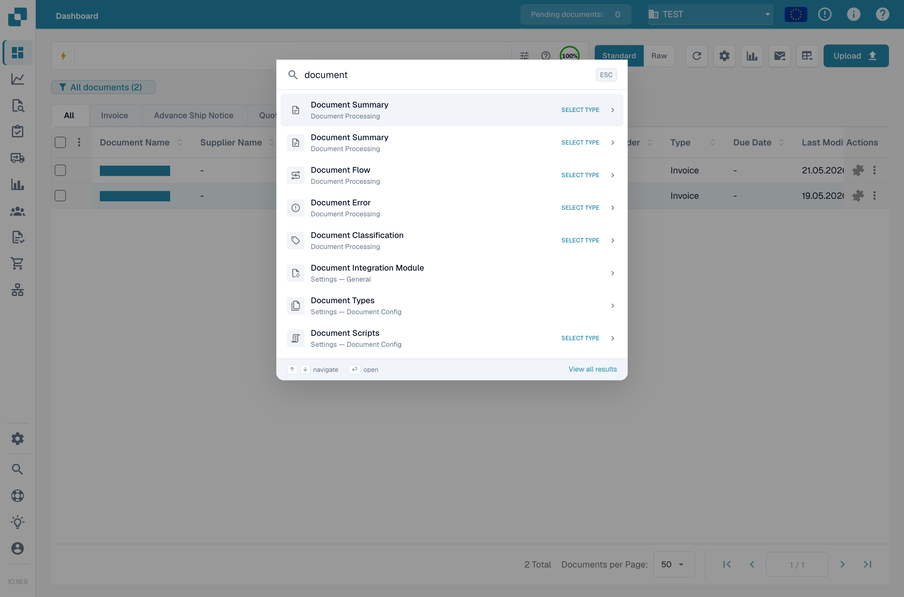

# 全局快速搜索

全局快速搜索是一个由键盘驱动的启动器，可在 DocBits 的任何位置查找页面、设置、仪表板和页面内功能。如果你已经知道要找什么，它可以替代逐项点击侧边栏。

## 如何访问

在 macOS 上按 <kbd>Cmd</kbd> + <kbd>K</kbd>，或在 Windows 和 Linux 上按 <kbd>Ctrl</kbd> + <kbd>K</kbd>。在任何屏幕上都可以使用此快捷键。

<figure><figcaption>
快速搜索会在当前页面上方打开。
</figcaption></figure>

## 搜索

开始输入即可筛选页面和页面内功能目录。快速搜索采用模糊匹配，因此输入部分词语或略有拼写错误也能找到正确条目。系统按相关性排序并显示前八个结果。

每个结果会显示：

* 功能或页面标签。
* 所属类别（设置、仪表板、验证等）。
* 表明条目类型的小徽标——页面、对话框、侧边栏、面板、菜单或操作。

使用向上和向下箭头键高亮显示结果，然后按 <kbd>Enter</kbd> 打开。按 <kbd>Esc</kbd> 关闭弹窗。

<mark>结果列表只显示你有权限使用的条目。非管理员用户看不到仅限管理员使用的条目。</mark>

## 最近搜索

搜索框为空时，快速搜索会显示你最近的五条查询，方便你只按一次键就返回常用位置。最近搜索按浏览器存储，不会在设备之间同步。

## 用于文档查找的选择器模式

某些目标需要额外信息才能打开，例如“按 ID 打开文档”需要先输入文档 ID。选择此类条目后，快速搜索会切换到**选择器模式**：

* 对于文档 ID，输入或粘贴 ID，然后按 <kbd>Enter</kbd>。
* 对于文档类型，从内嵌列表中选择类型。

选择器模式会遵循仪表板的状态权限，因此你只能看到有权打开的文档。

## 查看所有结果

如果八个可见结果不够，请点击页脚中的**查看所有结果**链接，以当前搜索内容作为预筛选条件打开[站点地图](sitemap.md)。

## 键盘快捷键参考

| 按键 | 操作 |
|---|---|
| <kbd>Cmd</kbd>/<kbd>Ctrl</kbd> + <kbd>K</kbd> | 从任何位置打开快速搜索 |
| <kbd>↑</kbd> / <kbd>↓</kbd> | 在结果之间移动 |
| <kbd>Enter</kbd> | 打开高亮显示的结果 |
| <kbd>Esc</kbd> | 关闭弹窗 |
