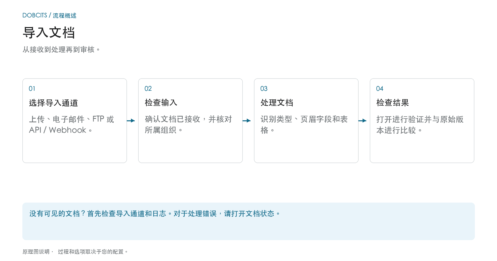

# 如何导入文档

## 从收据到准备审查的文件

<figure><figcaption>
从接收到处理再到审核。 该图是示意性的；您组织的活动设置决定了实际行为。
</figcaption></figure>

首先选择导入路径。成功发送电子邮件或提交 API 请求并不能证明文档已完全处理。在 DocBits 中检查其收据，然后检查其文档状态。

1. **选择导入渠道：** 对单个文件使用手动上传，或对常规输入使用设置的自动渠道。
2. **检查收据：** 在正确的组织中找到文档。对于传入的电子邮件，如有必要，请检查导入日志；格式和发件人规则是否支持附件？
3. **等待处理：** DocBits 根据文档类型和活动设置处理文档。对于PDFs、OCR或现有的PDF文本均可使用；电子文档可以提供结构化数据。并非每个导入都经过相同的提取路径。
4. **打开结果：** 文档准备好进行验证后，将识别的值与原始值进行比较。导入文档不批准它或将其导出到ERP。

### 寻找正确的导入途径

| 输入 | 使用说明 |
| --- | --- |
| 上传个人文件 | [手动导入](manual-import.md) |
| 连接邮箱或转发电子邮件 | [邮件导入](email/README.md) |
| 通过设置的 FTP 通道检索文件 | [FTP](ftp.md) |
| 从应用程序传输文件 | [Webhook / API](webhook.md) |

**如果缺少东西：** 首先检查输入通道。如果 DocBits 中已存在该文档，则 [文件状态](../dashboard/document-status.md) 和 [文件流程](../dashboard/document-flow.md) 有助于查找受影响的处理步骤。


DocBits 导入教程：上传文档、拖放，以及手动与自动分类


本指南介绍如何将文档上传到 DocBits。
