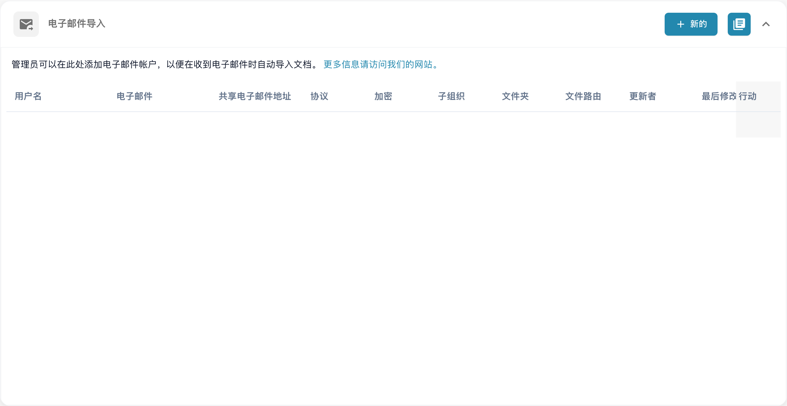
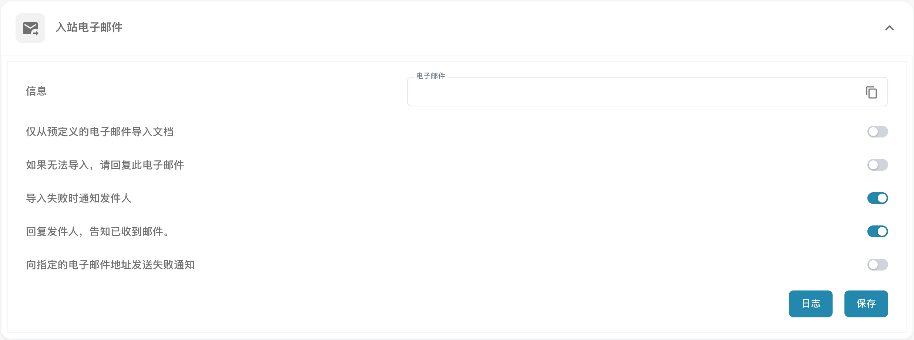

# 电子邮件

DocBits 可以通过两种方式从电子邮件导入文档。两种方式都在 **设置 → 导入**（文档处理）下配置。

## 方法 1 — 电子邮件导入（连接邮箱）

连接电子邮件帐户后，DocBits 会在收到新邮件时自动导入文档。在“导入”页面中，展开 **电子邮件导入** 部分并点击 **+ 新建**。

<figure><figcaption>
中文“电子邮件导入”列表及“新的”入口；连接数据已隐藏，未新增或修改邮箱连接。
</figcaption></figure>

然后选择邮箱使用的协议：

* **IMAP** — 请参阅 [IMAP](imap.md)
* **OAuth（Office 365）** — 请参阅 [OAuth Office365](oauth-office365.md)

## 方法 2 — 入站电子邮件（转发至 DocBits）

将电子邮件转发或直接发送到您组织专属的收件地址，DocBits 会自动导入附件。无需连接邮箱。在“导入”页面中打开 **入站电子邮件** 部分。

<figure><figcaption>
中文“入站电子邮件”设置及通知选项；组织导入地址已隐藏，未切换开关、保存设置或发送邮件。
</figcaption></figure>

* **信息 / 电子邮件** — 您组织专属的收件地址（格式为 `<org-id>@inbound.docbits.com`）。将文档转发到此地址；点击复制图标即可复制地址。
* **仅从预定义的电子邮件地址导入文档** — 启用后，系统只会导入来自您添加到白名单的发件人的电子邮件；其他发件人的邮件将被忽略。
* **如果无法导入，请回复此电子邮件** — 导入失败时自动向发件人发送回复。
* **导入失败时通知发件人** — 如果发件人的电子邮件无法导入，则通知发件人。
* **日志** — 打开收件电子邮件处理日志。点击 **保存** 以应用更改。

## 支持的文档附件

两种电子邮件导入方式都支持以下文档附件：

| 格式 | 文件扩展名 | 常见用途 |
| --- | --- | --- |
| PDF | `.pdf` | 发票及其他 PDF 文档 |
| TIFF | `.tif`、`.tiff` | 扫描文档 |
| XML | `.xml` | 结构化电子文档 |
| EDI / 采购订单数据 | `.edi`、`.purchaseorder` | 电子数据交换和采购订单 |

如果转发服务将 PDF、TIFF 或 XML 文件标记为通用附件，DocBits 可以根据文件内容或已知文件扩展名识别该文件。转发的 `.eml` 邮件也可能包含受支持的文档；DocBits 会在导入前提取其中的附件。

PNG、JPG、GIF 和 BMP 等图像不会作为文档导入。转发邮件中的内嵌签名图片和徽标会被跳过。Word、Excel 和 PowerPoint 等 Office 文件不受这些电子邮件导入方式支持。

对于转发的电子邮件，如果文档缺失，请检查 **入站电子邮件** 下的 **日志**。启用 **导入失败时通知发件人** 后，发件人会收到说明以及指向此页面的链接。对于已连接的邮箱，请参阅 [IMAP](imap.md) 或 [OAuth（Office 365）](oauth-office365.md) 设置指南。
