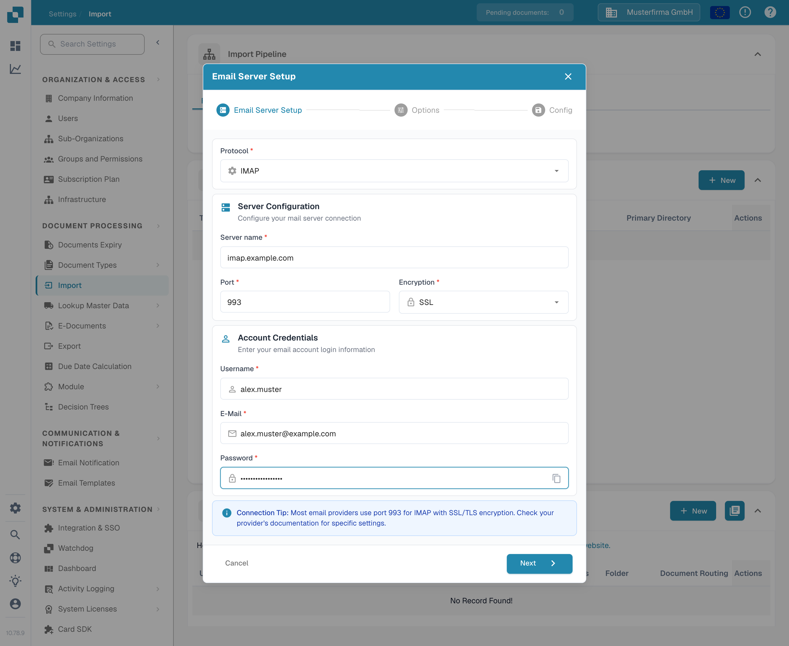

# IMAP



选择 IMAP 作为协议，然后输入电子邮件服务提供商的信息：服务器名称、端口、加密方式、用户名、电子邮件地址和密码。接下来，设置相关选项和电子邮件文件夹。

<figure><figcaption>
电子邮件服务器设置示例。请将示例值替换为您的电子邮件服务提供商提供的信息。
</figcaption></figure>

注意事项

* 在界面中输入所有必需的信息。服务器、端口等其他信息取决于主机（快速搜索一下 Google 应该会有所帮助）。
* 在此处，“文件夹”和“移动已导入”具有相同的功能。“文件夹”无法禁用；如果留空，默认使用收件箱。
