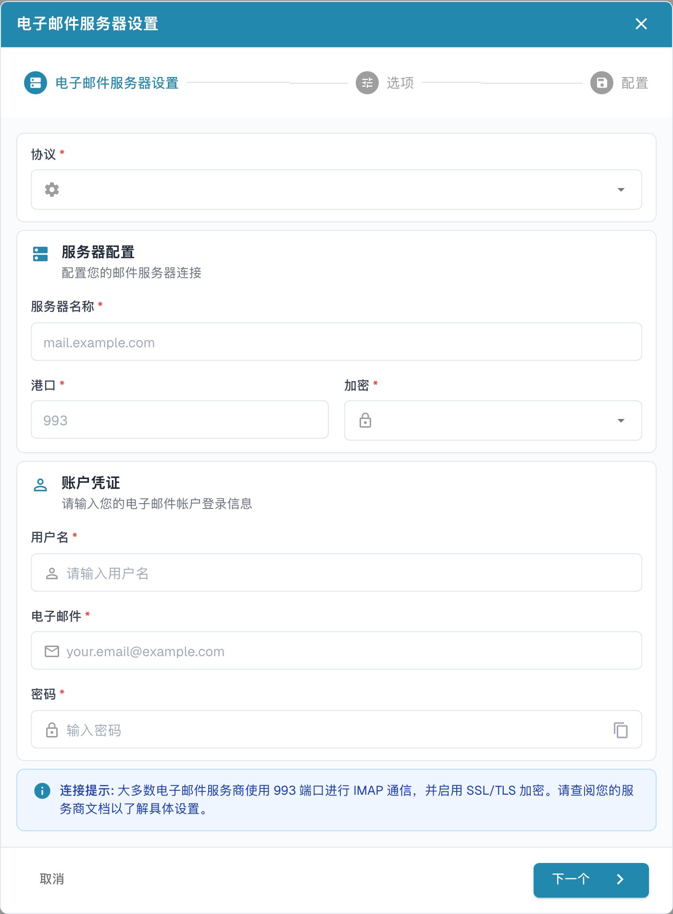

# IMAP



选择 IMAP 作为协议，然后输入电子邮件服务提供商的信息：服务器名称、端口、加密方式、用户名、电子邮件地址和密码。接下来，设置相关选项和电子邮件文件夹。

<figure><figcaption>
中文邮件服务器设置空白向导，显示服务器、加密和凭据字段。“港口”在此指网络端口；993 是原生示例占位值，实际设置以邮件服务商要求为准。未建立连接。
</figcaption></figure>

注意事项

* 在界面中输入所有必需的信息。服务器、端口和加密方式以邮件服务商的正式连接说明为准；不要照搬截图中的示例值。
* 在此处，“文件夹”和“移动已导入”具有相同的功能。“文件夹”无法禁用；如果留空，默认使用收件箱。
