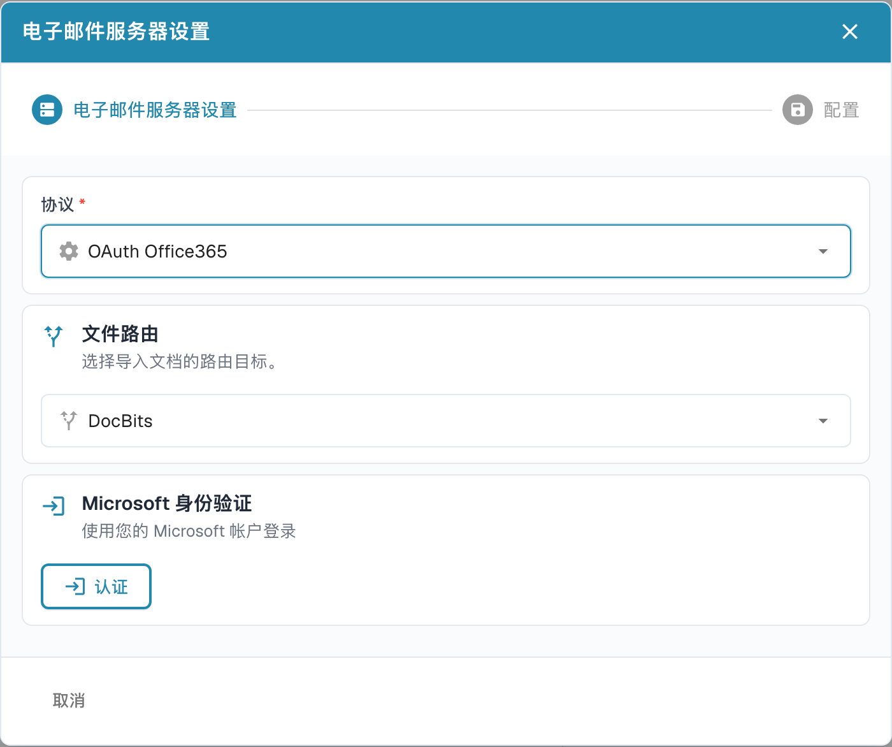

# OAuth Office365



打开**电子邮件导入 → 新的**，选择 **OAuth Office365**。核对目标组织／子组织与邮件路由，然后在准备连接获准邮箱时选择**认证（Authenticate）**。认证会启动实际 Microsoft 授权流程；只展开向导不会完成连接。

<figure><figcaption>
中文邮件向导中本地选择 OAuth Office365 后的认证入口。尚未点击“认证”，没有登录 Microsoft、生成认证代码或保存连接。
</figcaption></figure>

如果当前连接使用设备代码流程，DocBits 会显示本次会话的代码和 Microsoft 验证地址。按当前页面说明打开该地址，输入该代码，使用获准的 Microsoft 账户完成登录及所需授权，再返回 DocBits 选择**完成认证（Finish Authentication）**。代码会过期，不能重复使用旧截图中的代码。参阅 [Microsoft 设备代码授权说明](https://learn.microsoft.com/en-us/entra/identity-platform/v2-oauth2-device-code)。

认证成功后，再检查可用的导入选项。选项可能随版本和连接类型变化；本次只查看认证前入口，没有登录 Microsoft、生成代码、保存连接或验证邮箱导入。

**Use Folder**

如果需要其他源文件夹，启用该选项并从当前连接提供的文件夹列表选择目标；可用列表可能在认证或保存后才显示。

**Use Shared Mailbox**（使用共享邮箱）

如果您希望电子邮件导入功能访问共享邮箱中的收件箱或文件夹，请启用滑块，然后在此输入电子邮件地址。

**Move emails**（移动邮件）

当前向导可在启用移动后选择目标文件夹；不要把移动操作等同于“导入全部已读和未读邮件”，也不要假定目标始终为垃圾箱。请根据实际连接设置，使用一封获准测试邮件验证读取范围、附件处理及导入后的文件夹和已读状态。

如果收到错误消息，提示您没有权限建立此类连接，则需要由拥有 Azure 管理员权限的人员授权此连接。有关更多信息，请访问以下页面：https://learn.microsoft.com/en-us/entra/identity/enterprise-apps/grant-admin-consent?pivots=portal#grant-tenant-wide-admin-consent-in-enterprise-apps
