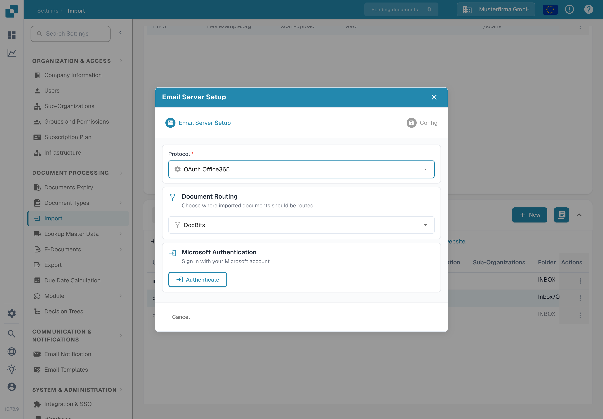
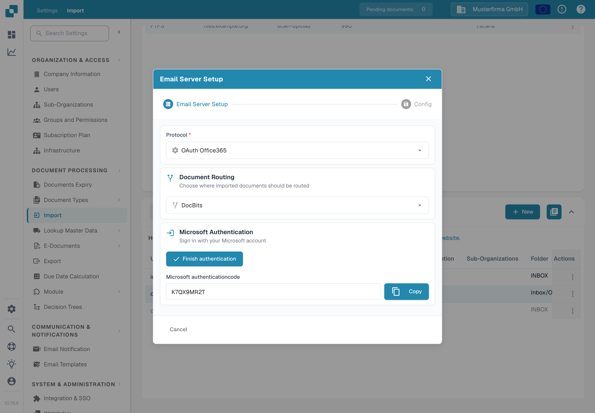
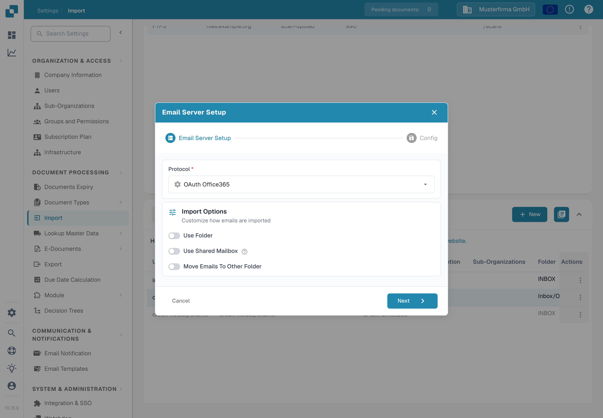

# OAuth Office365



在这里，只需输入所需的子组织，然后按“Authenticate”

<figure><figcaption>
选择路由，然后按 Authenticate。
</figcaption></figure>

系统会带您前往 Microsoft 页面，您需要在该页面输入一段代码。

返回 DocBits 即可找到这段代码，代码会像下图所示显示在那里。只需复制代码并将其输入 Microsoft 页面。之后，您需要输入自己的 Microsoft 凭据。

<figure><figcaption>
Microsoft 代码会显示在 DocBits 中。
</figcaption></figure>

按 FINISH AUTHENTICATION 按钮，系统会带您前往此菜单

<figure><figcaption>
身份验证完成后的选项。
</figcaption></figure>

**Use Folder**

如果您使用的文件夹不是收件箱，请启用滑块，然后输入文件夹名称。

**Use Shared Mailbox**

如果您希望电子邮件导入功能访问共享邮箱中的收件箱或文件夹，请启用滑块，然后在此输入电子邮件地址。

**Move imported emails to trash**

如果您希望导入所有电子邮件（而不只是未读邮件），并将其移至垃圾箱，请启用此选项。否则，系统只会检查未读邮件，导入文档，将邮件标记为已读，并将其保留在当前位置。

如果收到错误消息，提示您没有权限建立此类连接，则需要由拥有 Azure 管理员权限的人员授权此连接。有关更多信息，请访问以下页面：https://learn.microsoft.com/en-us/entra/identity/enterprise-apps/grant-admin-consent?pivots=portal#grant-tenant-wide-admin-consent-in-enterprise-apps
