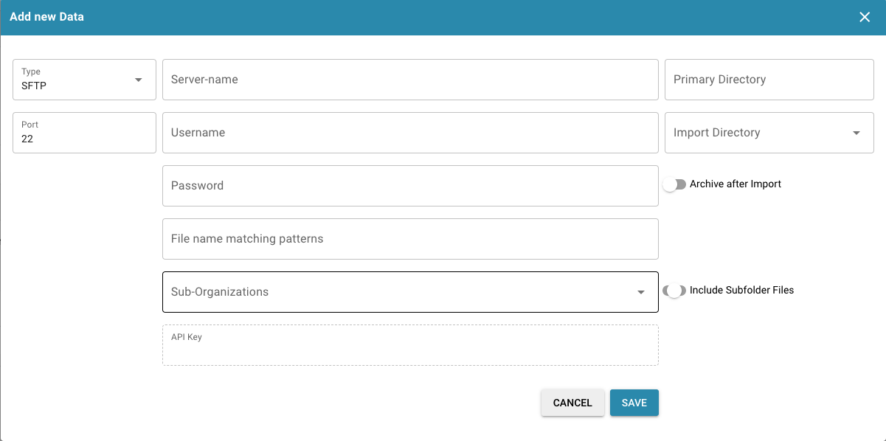
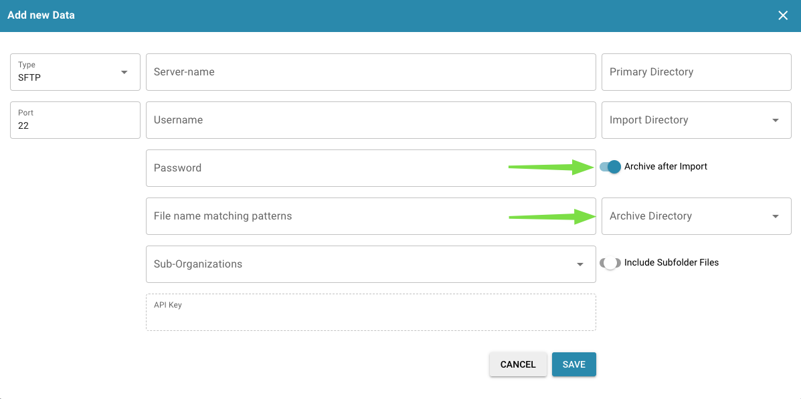

# FTP

如果您希望将 SFTP 与 DocBits 集成以导入文档。

要求

* 配置正确且兼容 Linux 的 SFTP 服务器
* SFTP 主机名、用户名和密码
* 专用导入文件夹

**导入配置**

在仪表板中，打开 Settings（设置）并导航至 Import（导入）。在 FTP Import（FTP 导入）下，选择添加新配置。

<figure><figcaption></figcaption></figure>

在相应字段中输入 SFTP 凭据，然后选择保存（API Key（API 密钥）字段会自动填入您当前使用环境的 API Key）。

<figure><figcaption></figcaption></figure>

输入 SFTP 的所有必要信息后，点击 SAVE（保存）。

### **FTP 文件归档**

1. **启用文件归档**
   * 找到“File Archiving”（文件归档）选项。
   * 将开关切换到“On”（开启）位置以启用归档。
2. **选择归档目录**
   * 启用“File Archiving”（文件归档）开关后，会显示一个字段，供您指定归档文件的目录路径。
   * 在 SFTP/FTP 服务器上选择用于存储归档文件的目标文件夹路径。
3. **保存更改**
   * 点击 **Save（保存）** 按钮以应用更改。

<figure><figcaption></figcaption></figure>
